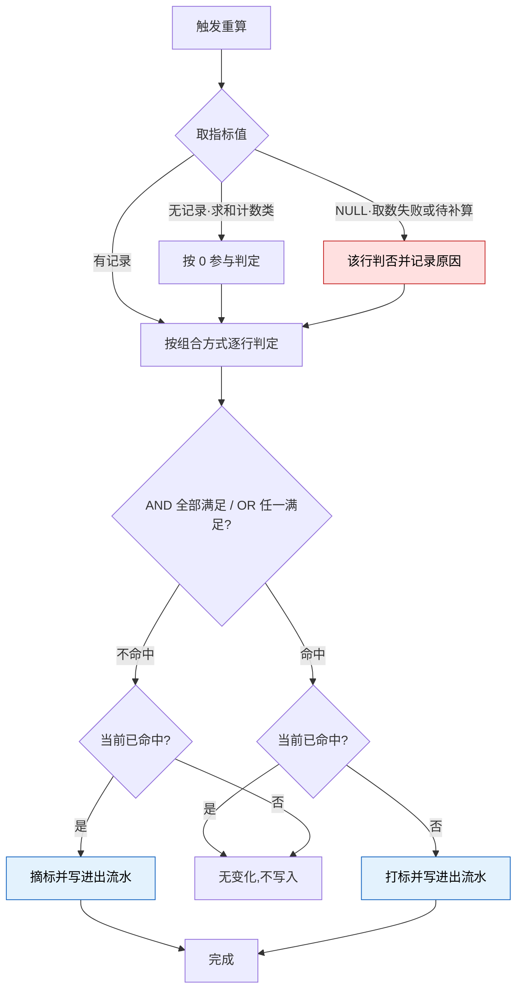
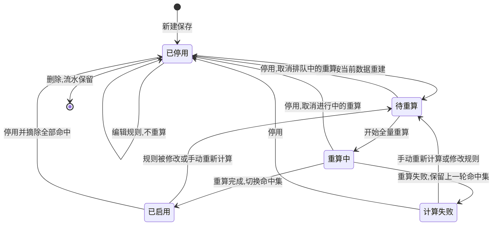

# 2.5 · 用户标签

<a id="1-背景与目标"></a>

## 1. 用途

让运营用平台预置的**基础指标与属性**组合出**条件**,再由条件组合出**标签**,
新增一类人群当天生效,不用等发版。

### 使用者

| 角色 | 用来做什么 | 没有会怎样 |
|---|---|---|
| 运营 | 圈出目标人群做活动投放 | 只能用现成的几个固定标签,换个阈值就要提需求等排期 |
| 风控 | 把「小额多笔」「多设备登录」这类特征固化成可复用的判断 | 各人凭经验判断,同一批人看出不同结论 |
| 客服 | 打开玩家资料一眼看出这人是什么类型 | 自己翻充提记录反推,慢且口径不一 |

新增人群从「提需求 → 排期 → 发版」变成运营自助;
指标与时间范围分离,指标清单不随时间维度膨胀;一个标签能装多个条件,标签墙不再无限膨胀;
口径集中一处,活动、风控、客服看到同一个定义。

### 本次范围

- **不做人工打标** —— 标签一律由条件判定,不能给单个玩家手工挂上或摘掉(D23)
- **不做多层嵌套** —— 条件间为标签级单选的 AND 或 OR,不支持嵌套条件(D33)
- **运营不能新增基础指标或属性** —— 两类条件项都由平台预置,清单见 `条件模型.md` 第 3 段
- **不做标签引用标签** —— 条件的左右两侧都不得出现标签(D31)
- **不做指标间运算** —— 四则运算、百分比、自定义公式不做,带系数的比率条件列二期(D31)
- 不做活动参与次数指标(第一阶段暂不,数据源未接)
- 不做人群导出与活动投放本身;不对玩家可见

### 适用范围

| 维度 | 取值 |
|---|---|
| 终端 | Web 后台,桌面优先(设计基准 1440px) |
| 响应式 | 最小支持 1280px;不做移动端适配 |
| 界面语言 | 后台界面简体中文 |
| 时区 | 判定与自然日切片统一按**业务时区**计算(A13);界面展示时间按查看者浏览器本地时区 |
| 货币 | 金额类指标按标准计价币种判定,口径见 A9 |

<a id="4-关键参数与规则"></a>
<a id="5-字段清单"></a>

## 2. 配置项

**筛选字段**

| 字段 | 类型 | 可输入数据与校验 |
|---|---|---|
| 标签名 | text | 模糊匹配,去首尾空格 |
| 状态 | select | 停用 / 待重算 / 重算中 / 启用 / 规则已保存，计算失败,未选择时不限 |
| 条件指标 | select | 反查条件里用到该基础指标或属性的标签;基础指标含用作右值的 |
| 更新开始时间、更新结束时间 | datetime | 分别选择日期和时间,可只填一端 |

**表格列**

| 列 | 说明 | 默认显示 |
|---|---|---|
| 标签 | 标签颜色、名称和备注;点击打开标签详情 | 是 |
| 匹配规则 | 全部条件拼成一行,AND 显示为「且」、OR 显示为「或」,如「累计充值金额 ≥ 1000 且 最近 7 天投注金额 > 最近 7 天充值金额」;超长折叠,下方显示全部满足或任一满足及条件数;点击打开标签详情 | 是 |
| 命中人数 | 最近一次重算后的命中玩家数,点击跳到用户列表;启用后尚未算出时显示「尚未计算」,**不显示 0**;停用时显示「—」 | 是 |
| 状态 | 启停开关;待重算、重算中、计算失败另有标记,失败时显示错误原因;同时显示最近计算时间 | 是 |
| 更新信息 | 更新时间和更新人 | 是 |
| 操作 | 编辑;更多操作含查看详情 · 重新计算 · 进出记录 · 删除标签 | 是 |

列表上方提供「全部进出记录」(含已删除标签的记录)和「新建标签」。

**编辑标签 · 表单字段**

| 字段 | 必填 | 规则 |
|---|---|---|
| 标签名称 | 是 | A3 |
| 标签颜色 | 否 | 颜色选择,默认蓝色 `#1677ff` |
| 条件关系 | 是 | 单选 AND / OR(A14),界面显式写出「全部满足 / 任一满足」 |
| 条件行 | 是 | 1 到 A1 行 |
| 行 · 左值 | 是 | 从系统提供的条件项下拉选择,不可自由输入;同一项允许出现多次,无需先选择指标或属性分类 |
| 行 · 左值时间范围 | 指标时是 | 按该指标已有可用范围提供选项(A8);选最近N天须填 N(A7)。VIP、渠道等当前属性沿用当前值,不新增历史时点查询 |
| 行 · 比较符 | 是 | 数值用 `= ≠ > ≥ < ≤`;VIP使用等级区间,已有的非区间规则保留原比较方式,可改为区间;渠道来源用「属于 / 不属于」;布尔值用等于 / 不等于 |
| 行 · 右值 | 是 | 指标条件选常量或现有类型、单位支持比较的基础指标(A7、A12);VIP通过起始和结束两个下拉框选择有效等级,包含上下限,允许相等且起始不得大于结束;渠道从当前可用渠道中多选,至少一个 |
| 备注 | 否 | 说明圈的是什么人,最长 200 字符 |

表单不提供启用开关。**新建标签固定为停用**,先试算确认人群合理,再回列表启用。

**条件行控件排布** —— 单条条件保持一行;选定左值后,系统自动确定其类型、单位、
时间范围、比较符与右值形态,动态限制后续选项:

```
右值为常量:  [充值金额 ▼] [累计 ▼] [≥ ▼] [常量 ▼] [1000] USD
右值为指标:  [充值金额 ▼] [累计 ▼] [> ▼] [基础指标 ▼] [提现金额 ▼] [累计 ▼]
VIP区间:     [VIP等级 ▼] [起始 VIP 3 ▼] [结束 VIP 5 ▼]  // 含 3 和 5
渠道属性:    [渠道来源 ▼] [属于 ▼] [渠道 A、渠道 B ▼]  // A 或 B
```

数值指标的区间可用同一指标的两行 AND 表达,如「累计充值金额 ≥ 30」且「累计充值金额 < 50」。
VIP区间在一条条件内判断,再与渠道等其他条件按标签级 AND / OR 组合。

### 配置限制与默认值

| 配置或参数 | 填写与执行规则 |
|---|---|
| 单个标签容纳的条件数(A1) | 最多 **10 条**,至少 1 条 |
| 启用中的标签总数上限(A2) | 当前不提供上限,启用时不校验数量 |
| 标签名称(A3) | 全局唯一,最长 20 字符 |
| 值的精度(A7) | 金额类以**标准计价币种**表示,小数 2 位;用户净输赢可为负,其余指标非负;打码倍数最多 8 位小数;次数、天数、数量为整数;最近N天的 N 为 1 到 365 的整数 |
| 时间范围(A8) | 当前 / 今日 / 昨日 / 最近N天 / 累计,自然日按业务时区;定义与各指标可用范围见 `条件模型.md` 第 4 段 |
| 金额类的币种口径(A9) | 按**标准计价币种 USD** 判定。累计及时间切片金额复用账变入账时的换算记录;账户余额、待完成流水等当前指标复用系统已有 USD 取值,具体口径见 `条件模型.md` 第 3 段,不新增汇率计算逻辑。所需换算未就绪时,该玩家该指标为 **NULL**,按 R6 判否;标准币写死(S1)(D24),见 `../2.1-会员列表/标准计价.md` |
| 每页条数(A10) | 默认 50 条/页,可选 20、50、100 条 |
| 试算响应上限(A11) | 10 秒,系统固定;超时中断并提示「试算超过 10 秒，请缩小条件后重试」,不返回半截结果 |
| 右值与指标比较(A12) | 右值为常量,或现有类型、单位支持比较的「基础指标 + 时间范围」;左右时间范围可不同。比较是否有业务意义由运营确认,不设置逐项业务白名单,也不因组合未被逐项列举而拒绝试算或保存。沿用已有类型、单位及同指标同时间范围校验;规则与示例见 `条件模型.md` 第 5 段(D31) |
| 业务时区(A13) | 部署配置,默认 Asia/Shanghai,后台不提供修改入口。标签保存时固定当时的业务时区,自然日切片按该时区计算,变更行为见 E11 |
| 条件组合方式(A14) | 标签级单选:**AND**(全部满足)或 **OR**(任一满足);不支持行级混用与嵌套条件 |

<a id="7-需求详述"></a>
<a id="25-r2"></a>
<a id="25-r6"></a>

## 3. 操作规则

### 重算方式与窗口(A4)

关键事件写入重算队列,后台持续处理该玩家的增量重算;每日 03:00 对全部启用标签做一次全量重算;含今日、昨日、最近N天的标签在业务时区跨日后自动全量重算一次;注册天数、距上次登录小时数到达变化时点时单独复核该玩家。全量重算成功才切换命中集,失败保留上一轮结果。当前不设完成时限告警。

配置或来源：系统固定。

### 停用标签的行为(A5)

停用即摘除全部命中并逐条留痕;重新启用后由下一次重算按当时数据重建,**不恢复旧集合**。

### 删除标签的前置条件(A6)

被活动、兑换码、弹窗或页面配置、提现审核规则(`../../M5-财务管理/5.8-审核规则/README.md`)或[点控规则](../../未落地需求/点控策略.md)引用时拒绝删除。标签待重算或重算中时同样拒绝,提示先停用再删除。点控历史任务的标签快照不作为当前配置引用，不阻止删除。

配置或来源：活动与弹窗,现有影响面预检已是此行为;审核规则为新增引用方。

**基础指标与属性清单**见 `条件模型.md` 第 3 段,含各指标的口径与可用时间范围,
以及 VIP等级、渠道来源、是否测试用户等当前条件项。
账户余额及当前已开放条件继续可选(D35);登录次数按去重后的登录成功事件计数。清单可扩展,
加一个指标就整体扩一圈,不改标签本身的模型。

**参数**

### 新增编辑标签(2.5-R2)

持有编辑权限的账号新增标签,或修改已有标签的名称、组合方式、条件、备注并保存。

输入信息：“配置项”表单字段。基础指标与属性只能从清单选;时间范围、比较符与右值按所选条件项联动。

1. 校验名称符合 A3 且全局唯一(编辑时排除自身),组合方式已选,行数在 1 到 A1 之间
2. 校验每行:所选基础指标或属性存在于当前清单且可用。指标条件的时间范围须合法(A8),
   最近N天的 N 符合 A7;VIP、渠道等属性读取当前值。
3. 校验右值:指标常量按 A7 校验类型与精度;右值为基础指标时沿用 A12 的类型、单位、
   时间范围及同指标同时间范围校验。指标组合的业务合理性由运营判断。
   VIP起止等级必须都存在且有效,下限不得大于上限。渠道使用「属于 / 不属于」并至少选择一个可用渠道;
   属于多选表示命中任一所选渠道,不属于表示均未命中所选渠道,整行结果再参与标签级 AND / OR。
   **VIP与渠道合法性由服务端校验**;试算与保存、新多选格式与仍接受的旧单值格式执行相同检查。
   多选中任一渠道无效时拒绝整个请求,不部分保存。
4. 保存只改规则本身,**不直接增删任何玩家的命中**;已启用标签转入待重算,由 R6 生效,
   界面提示「规则已保存，已加入后台重算队列」;停用标签提示「规则已保存」,新建提示「标签已创建，默认处于停用状态」
5. 编辑已启用的标签时,表单提示「保存后将重新计算用户匹配结果。」;当前不展示改动前后的组成差异
6. 保存留痕:操作人、时间、改动前后的完整组成;启停和删除不写规则留痕,命中变化写进出流水

### 重算与自动打标摘标(2.5-R6)

四种任一 —— 玩家侧关键事件(充值入账、提现放款、投注结算、账户余额或流水变化、登录、资料变化、上下级关系变化),按 A4 只重算该玩家;
按 A4 的定时全量兜底;已启用标签保存或标签重新启用后,只重算该标签,且覆盖**全量已有玩家**;运营手动「重新计算」(2.5-R10)。

输入信息：玩家各「指标 + 时间范围」的当前值 · 全部启用中标签的组成 · 该玩家当前的命中集合。

1. 取该玩家全部所需指标值与当前属性值。**无记录的求和/计数类指标按 0 参与判定;
   取数失败或口径未就绪为 NULL,该行判否**,记录原因,不按 0 顶替
   (语义与例子见 `条件模型.md` 第 7 段,口径依据见 D34);
   右值为指标的行,任一侧 NULL 即判否
2. 按组合方式逐行判定:**AND 全部满足才命中,OR 任一满足即命中**;用户净输赢按带号值比较。
   VIP按包含上下限的等级区间判定。渠道「属于」命中任一所选值即为真,「不属于」全部未命中才为真,整行再参与标签级 AND / OR
3. 与当前命中集比对,**只对差集动作**:应命中而未命中的打标,已命中而不再满足的摘标
4. 每次打标与摘标都写一条进出流水,记录标签、玩家、方向、时间、原因,
   以及**判定当时的值**(右值为指标的行记**两侧**的值,均含时间范围;NULL 如实记 NULL)——
   没有它,事后无法解释「他当时为什么被打上」
5. 无变化的玩家不产生任何写入与流水;停用中的标签不参与判定
6. 全量重算按新一代命中集构建,全部玩家判定完成后一次切换,中途失败不得留下一半新一半旧的命中集;
   规则修改后的重算期间继续读取旧命中集,切换后**全量玩家都按新规则判定**;
   重算进程中断时由其他进程重新执行整轮
7. 当前不提供批量摘标熔断,全量重算的摘标结果直接生效

<a id="25-r9"></a>

### 邀请宝箱的规则快照评估(2.5-R9)

[4.16 邀请宝箱](../../M4-活动管理/4.16-邀请宝箱/README.md)需要在新下级注册绑定被活动接纳时固定判断依据,
不能仅依赖后台重算更新的当前命中集。此处新增特定消费能力,不改变 R6 重算、NULL 判否与其他消费者读取当前命中集的语义。

1. 上级可由活动配置为全部用户或任一参与标签命中;M2 提供注册绑定业务时点的上级判定依据,保存所用标签规则版本、数据时点及命中结果。下级条件由活动单选一个组合标签,M2 返回完整规则版本与快照,包含条件、组合方式、单位及时间范围口径;活动不再单独配置同一套充值、投注阈值。
2. 已接纳下级后续按保存的规则版本调用 M2 同一条件评估能力,评估使用对应业务时点的数据并保留各行指标依据、结果和数据完整性。不得改读当前标签成员来代替快照评估,也不得在活动内复制一套指标计算逻辑。该评估为只读,不挂标、摘标或改写当前命中集。
3. 标签编辑、正常停用及当前成员变化不改变已接纳下级的规则快照;上级随后正常摘标只影响后续新下级接纳,不撤销此前接纳。新增接纳按 4.16 的当时配置与启用状态判断;若底层指标或依赖数据不能提供,原快照保留并报告未知,不改用新规则或默认值。
4. 返回判定业务时点、实际评估时间、规则版本、各行取值和来源依据,并区分命中、不命中与依据不足的未知状态。未知及迟到事实保留可恢复的处理记录;资料补齐后按原业务时点、原版本重评,活动据此恢复其资格流程。不得把取数失败当 0 或永久不达标。
5. 此能力包含保存供后续使用的版本和事件判定依据,属于 4.16 的新增依赖;现有进出流水或当前属性字段不承诺任意历史查询。无法可靠重建注册绑定时点或达标时点依据时,返回未知并保持核查状态,不得用后来值冒充当时值。是否接纳、是否计为有效下级、是否计奖由 M4 决定。

### 业务流程



> 配色:红色为异常(NULL 判否),蓝色为产生留痕的写入步骤 ——
> 这两步不留痕,标签结论就无法追溯。无记录按 0(D34)走正常判定路径,不是异常。



<a id="9-异常与边界"></a>
<a id="10-状态清单"></a>

## 4. 特殊情况

### 边界处理

| # | 场景 | 触发条件 | 预期处理 |
|---|---|---|---|
| E1 | 越权 | 无权限账号提交新增、编辑、启停或删除 | 服务端拒绝;界面隐藏按钮不作为唯一防线 |
| E2 | 并发编辑 | 两人基于同一版本改同一标签 | 后提交者发现版本过期,重新加载差异后再提交,不静默覆盖 |
| E3 | 组合恒不命中 | AND 下同一指标同一时间范围的两行互相排斥 | 正常保存和试算,由运营判断组合是否合理;不要求额外警示确认;计算结果为 0 时显式展示 |
| E4 | 无记录与取数失败 | 玩家在窗口内无任何记录 · 取数失败或待补算 | **两者必须区分**:求和/计数类无记录**按 0 判定**(D34);取数失败为 NULL,该行**判否**,记录原因,不按 0 顶替 |
| E5 | 重算失败 | 全量重算失败或中断 | 保留上一轮命中集,不得截断后标记完成;手动或规则触发的重算显示计算失败及原因,每日重算失败保持启用并在下一轮重试。当前不设超时告警 |
| E6 | 汇总回滚 | 上游修正导致大批玩家值骤降 | 当前不提供熔断,按重算结果批量摘标并写进出流水 |
| E7 | 删除被引用的标签 | 活动、弹窗、提现审核规则或点控规则正在引用 | 按 A6 拒绝,**列出具体引用方**;判定须精确定位到配置中的位置,不接受整体文本包含式判定 |
| E8 | 条件项下线 | 某基础指标或属性不再可用但仍被条件引用(指标含作为右值) | 引用它的标签在下一次发起重算时自动停用,提示「引用的基础标签已下线，标签已停用」,不得静默按不命中跑 |
| E9 | 停用后重启 | 停用一段时间后重新启用 | 按 A5 不恢复旧命中集,由重算按当前数据重建 |
| E10 | 迁移期重复 | 旧的固定标识与新标签同时存在 | 旧标识只在系统内部记录,页面、筛选、活动圈人和提现审核都不读取,不会与标签同时展示;下线时点见 `../README.md` D23 |
| E11 | 业务时区变更 | 部署配置的业务时区被修改 | 后台不提供修改入口。已保存的标签继续按保存时的时区计算,再次保存时改用新时区;不自动触发全量重算 |
| E12 | 渠道被停用 | 「渠道来源」条件仍引用该渠道 | 标签不自动停用,继续按玩家当前渠道判定;再次试算或保存时服务端拒绝该渠道,要求运营重选 |

### 新增编辑标签遇到异常时(2.5-R2)

| 错误状况 | 提示 |
|---|---|
| 名称重复 | 标签名称已存在 |
| 超过 A1 | 标签必须包含 1 到 10 个基础标签 |
| 指标或属性已下线 | 基础标签不存在或已下线 |
| 渠道不存在或已停用 | 渠道不存在或已停用：X，请重新选择 |
| 时间范围不可用 | 「指标名」不支持时间范围 |
| N 超出范围 | 最近 N 天必须填写 1 到 365 的整数 |
| 金额精度超限 | 金额必须是非负数且最多两位小数 |
| 打码倍数精度超限 | 打码倍数必须是非负数且最多八位小数 |
| 两侧类型或单位不兼容 | 左右基础标签必须属于同一单位组(A12) |
| 指标只能与常量比较 | 该基础标签只能与常量比较 |
| VIP等级无效或区间颠倒 | VIP 起止等级必须有效，起始不得大于结束，区间使用等于比较 |
| 左右同指标同时间范围 | 左右不得选择同一个基础标签 |

### 重算与自动打标摘标遇到异常时(2.5-R6)

| 错误状况 | 提示 |
|---|---|
| 指标取数失败(NULL) | 该行判否,记录跳过原因,**不按 0 顶替** |
| 全量重算失败 | 保留上一轮结果,不得截断后当成完成,见 E5 |
| 重算期间标签被修改 | 本轮作废,按最新规则重新排队 |
| 单个玩家增量判定失败 | 该玩家按退避时间重试,最长间隔 60 秒,不影响其他玩家 |
| 全量重算中单个玩家取数失败 | 该轮按重算失败处理,见 E5 |
| 业务时区被修改 | 按 E11 处理 |

### 页面状态

| 状态 | 表现 |
|---|---|
| 待重算 | 已保存但命中集未更新,标注并展示上一轮人数,**不展示为 0** |
| 重算中 | 状态列标注重算中,展示上一轮结果,「重新计算」不可用,删除被拒绝并提示先停用;列表每 3 秒自动刷新 |
| 计算失败 | 状态列标注计算失败并显示错误原因 |
| 从未重算 | 首轮未完成时命中人数显示「尚未计算」,**不显示 0** |
| 已停用 | 命中人数显示「—」,标签详情标注停用时间,不出现在 2.1 的筛选下拉 |
| 错误 | 显示「标签加载失败」和重试,保留筛选条件 |

<a id="6-需求清单"></a>

## 5. 验收场景

| 需求编号 | 场景与操作 | 预期结果 |
|---|---|---|
| 2.5-R1 | 查看标签列表：进入页面 · 点击查询 | 能按名称、状态、条件项筛出标签,展示组成与命中人数 |
| 2.5-R2 | 新增编辑标签：点击新增或编辑并保存 | 条件完整校验;保存不立即改变命中,由重算生效 |
| 2.5-R3 | 试算命中人数：在编辑态点击试算 | 返回命中人数与不超过 20 条样本玩家,**不产生任何打标** |
| 2.5-R4 | 启用停用标签：切换状态并二次确认 | 按 A5 摘除或重建,全过程留痕 |
| 2.5-R5 | 删除标签：点击删除并二次确认 | 按 A6 校验引用;通过后标签与命中关系删除,**流水保留** |
| 2.5-R6 | 重算与自动打标摘标：关键事件触发 · 定时全量 · 标签保存后 | 命中即打标、不再命中即摘标,每次进出都写流水;新建或修改规则后对**已有全量玩家**重判,不得只覆盖此后有数据变化的玩家 |
| 2.5-R7 | 查看命中玩家：点击命中人数 | 跳到用户列表并带上该标签筛选 |
| 2.5-R8 | 查看进出流水：点击流水入口 | 能按玩家或时间查到每次打标摘标、原因与当时的值 |
| 2.5-R10 | 手动重新计算：对启用标签点击重新计算 | 加入后台重算队列,提示「已加入后台重算队列」;待重算或重算中时入口不可用;停用标签不能重算,需 `user:tag:recalculate` |
| 2.5-R9 | 邀请宝箱接纳下级后修改或停用标签,并模拟评估数据缺失、迟到补齐与上级摘标 | 已接纳下级继续按原规则版本评估,完整保存业务时点、指标依据与结果;未知可按原时点恢复,不误判永久不达标;上级正常摘标只影响新接纳;评估不写当前命中集、不在 M4 重复计算指标,其他消费者仍按 R6 读取当前标签 |

### 新增编辑标签(2.5-R2)

- 正向:新建「大额低频」= AND · 累计充值金额 ≥ 500 且 累计充值次数 < 3 → 保存成功,状态为停用
- 正向:区间写成同一指标两行 AND(≥ 30 且 < 50)→ 接受,组成正确拼出
- 正向:「净取款玩家」= 累计充值金额 ≤ 累计提现金额 → 保存成功,组成拼出两侧指标与时间范围
- 正向:「充值升温」= 今日充值金额 > 昨日充值金额(同指标不同时间范围)→ 接受(A12)
- 正向:OR 标签 = 累计充值金额 ≥ 1000 或 最近7天投注金额 ≥ 500 → 接受,组成用「或」拼接
- 正向:新建「渠道 A/B 用户」= 渠道来源 属于 [A,B] → 来自 A 或 B 的玩家命中,其他渠道不命中
- 正向:累计提现次数 = 累计投注次数 → 可配置并按当前数据试算,由运营确认组合的业务意义,不因未列入逐项业务名单而拒绝
- 正向:VIP起始和结束下拉分别选 3、5 → VIP 3、4、5 均满足,保存重开保留区间;起止相等表示单一等级
- 正向:VIP 3～5 且渠道属于 [A,B] → 等级在范围内并来自 A 或 B 才满足;渠道选值在同一行
- 正向:渠道不属于 [A,B] → 既不来自 A 也不来自 B 才满足
- 正向:AND 下同指标 ≥ 50 且 < 30 → 正常保存、试算为 0,不要求互斥警示
- 逆向:VIP不存在的等级、下限大于上限 → 试算和保存均拒绝,说明具体原因
- 逆向:渠道不存在或已停用,包括多选中混入一个无效渠道 → 新多选与仍接受的旧单值格式在试算、保存时均拒绝整个请求
- 逆向:左值充值金额、右值选登录次数(类型、单位不兼容)→ 沿用服务端基础校验拒绝(A12)
- 逆向:左右同为「充值金额 + 累计」→ 服务端拒绝
- 逆向:注册天数选时间范围「今日」→ 服务端拒绝(A8)
- 逆向:放 11 条条件 → 拒绝并提示上限
- 逆向:无编辑权限的账号提交 → 服务端拒绝,界面隐藏按钮不作为唯一防线

### 重算与自动打标摘标(2.5-R6)

- 正向:玩家充值使累计充值金额从 40 升到 60,标签要求 ≥ 50 → 按 A4 时效打标,流水记下当时值 60
- 正向:玩家累计充值 380、累计提现 420,标签为「累计充值金额 ≤ 累计提现金额」→ 命中打标,
  流水记两侧当时值(380 / 420);其后提现放款事件触发重算,持续命中则无写入
- 正向:**从未充值的新注册玩家**,标签为 累计充值金额 < 100 → **按 0 判定,命中**,
  流水记当时值 0(D34;注意与改造前行为相反,旧口径是缺失一律不命中)
- 正向:玩家用户净输赢 −600,标签为 用户净输赢 ≤ −500 → 命中(亏损至少 500)
- 正向:今日充值 80、昨日充值 50,标签为 今日充值金额 > 昨日充值金额 → 命中,流水记 80 / 50
- 正向:玩家数据无变化 → 重算后无任何写入,无流水
- 逆向:玩家有一笔待补算账变(A9),标签含累计充值金额条件 → 该指标为 NULL,该行判否,
  **不得按已换算部分的和顶替**
- 逆向:全量重算跑到一半失败 → 命中集保持整轮开始前的状态,不出现半新半旧


<a id="2-入口"></a>
<a id="3-术语"></a>
<a id="8-数据流向与系统串接"></a>
<a id="11-涉及表与职责"></a>
<a id="12-关联页面"></a>

## 6. 相关资料

> **规则模型**(基础指标、属性、时间范围、指标比较规则、0 与 NULL 的判定语义)见同目录
> [`条件模型.md`](条件模型.md),本页不重复;本页只管页面、参数边界、需求验收与异常。
> 改版决策记录见 `../README.md` 第 7 段(D31 修订、D33–D35)。

网页对照结果见[用户标签 E2E 核对记录](../../.artifacts/user-tags-e2e-2026-09-11/README.md)。该记录区分已验证能力、实现差异及未执行分支,不替代本文的业务要求。

### 入口与关联页面

- 菜单:会员管理 → 用户标签
- 跳入:2.1 会员列表的标签筛选下拉 · 2.1 详情弹窗的标签区

- 跳出:2.1 会员列表(带标签筛选查看命中玩家)

### 权限

| 操作 | 权限或执行方 |
|---|---|
| 查看标签列表(2.5-R1) | `user:tag:view` |
| 新增编辑标签(2.5-R2) | `user:tag:edit` |
| 试算命中人数(2.5-R3) | `user:tag:edit` |
| 启用停用标签(2.5-R4) | `user:tag:toggle` |
| 删除标签(2.5-R5) | `user:tag:delete` |
| 重算与自动打标摘标(2.5-R6) | 系统触发,无界面权限 |
| 查看命中玩家(2.5-R7) | `user:list:view` |
| 查看进出流水(2.5-R8) | `user:tag:view` |
| 手动重新计算(2.5-R10) | `user:tag:recalculate` |
| 邀请宝箱规则快照评估(2.5-R9) | 系统按运营方隔离调用,无新增界面权限 |

### 术语与共用口径

> 模型词(基础指标、属性、时间范围、条件、比较符、指标比较规则)的定义与示例见
> `条件模型.md` 第 2–5 段;通用词见 `../README.md` 第 2 段。此处只列页面词。

| 术语 | 定义 |
|---|---|
| 标签 | 由一到十个条件以 AND 或 OR 组合成的具名人群规则,以及当前命中它的玩家集合 |
| 命中 | AND 标签:玩家满足**全部**条件;OR 标签:满足**任一**条件 |
| 重算 | 按最新数据重新判定命中,产生打标或摘标 |
| 进出流水 | 每一次打标与摘标的记录,含时间、原因与判定当时的值 |

### 依赖与数据流

**数据流向**:运营组合条件保存标签 → 服务端校验并登记待重算(此时不动命中)→
重算按 R6 取值、判定、比对差集 → 打标摘标写入命中集并写进出流水 →
2.1 的标签筛选、玩家资料标签区、活动圈人、弹窗定向、提现自动审核(5.8)读取**当前命中集**。

**系统串接**:资金汇总与切片统计(owner=M2,本模块内;时间切片按账变和投注事实实时汇总)· 登录与设备记录(登录次数、登录天数、IP 数、设备数的取数来源,
owner=M2用户行为记录)· 活动圈人(owner=玩法,**本仓库范围外**)·
弹窗与推送定向(owner=运营,**本仓库范围外**)· 提现审核规则(owner=M5,见
`../../M5-财务管理/5.8-审核规则/README.md`,只读当前命中集)。

- 普通下游**只读当前命中集**;4.16 按 R9 使用新增的版本化只读评估。两者均不得反向写入 —— 活动不能因为某人参加了活动就给他打标
- 标签只回答「谁属于这个人群」,**不提供资格判定结论**。玩家摘标后进行中的活动资格如何处置,
  由活动自身规则决定,本页不承诺人群稳定不变
- 删除标签需向活动侧问「有没有引用」,这是本页对范围外能力的**唯一反向查询**,只用于阻断删除
- 指标的值来自资金汇总、玩家档案与登录记录,本页**只读不写**;这些口径变化会直接改变全部标签的命中,
  改动须与本页同步评审
- 4.16 的规则快照、接纳记录和有效计奖依据由 M4 保存;标签规则版本与条件评估由 M2 提供。注册设备事实只作为活动去重输入,跨账号计奖占位由活动维护,不能用单账号“登录设备数”标签代替。

### 数据归属与职责

**数据归属**

- **拥有**(owner=M2):标签 · 标签的条件组成 · 命中关系 · 进出流水 · 基础指标与属性清单 ·
  指标比较规则与各指标可用时间范围配置 · R9 所需标签规则版本与只读评估能力
- **只读**:资金汇总与切片统计(owner=M2,见 `../README.md` 第 4 段)· 玩家档案字段(owner=M2,定义在 2.1)·
  登录与设备记录(owner=M2用户行为记录)· 渠道字典(owner=M7,见 7.4)与玩家注册渠道(owner=M2)·
  活动与弹窗对标签的引用关系(owner=玩法 / 运营,**本仓库范围外**,只用于阻断删除)

> **进出流水是审计数据,只增不改不删。** 标签删除后流水仍须能解释,
> 因此要存标签名称与条件组成快照(含各行的时间范围与判定当时的值),不能只存标识后靠关联取名。

**前后端职责**

| 事项 | 归属 |
|---|---|
| 权限判定与可见范围过滤 | **服务端** |
| 名称唯一、行数、指标 / 属性有效性、时间范围、比较符、类型与单位、值域与精度校验 | **服务端** |
| 命中判定、差集比对、打标摘标与流水写入 | **服务端** |
| 重算调度与失败恢复 | **服务端** |
| 删除前的引用精确判定与事务内复校 | **服务端** |
| 试算的只读保证与超时保护 | **服务端** |
| R9 规则版本留存、业务时点评估与依据完整性、未知恢复及只读保证 | **服务端** |
| 条件行增删、时间范围 / 比较符 / 右值联动、VIP区间下拉与渠道多选 | 界面 |

### 新增编辑标签的职责(2.5-R2)

| 归属 | 做什么 |
|---|---|
| 界面 | 条件行增删、时间范围 / 比较符 / 右值联动、VIP区间下拉与渠道多选 |
| 服务端 | 名称唯一、行数、条件项有效性、时间范围、比较符、类型与单位、值域与精度校验;判权限;保存后登记待重算 |

### 重算与自动打标摘标的职责(2.5-R6)

| 归属 | 做什么 |
|---|---|
| 界面 | 展示各标签的最近重算时间与命中人数,待重算与重算中状态可见 |
| 服务端 | 取值、逐行判定、比对差集、写打标摘标与流水、通知下游,且不阻塞页面取数 |
