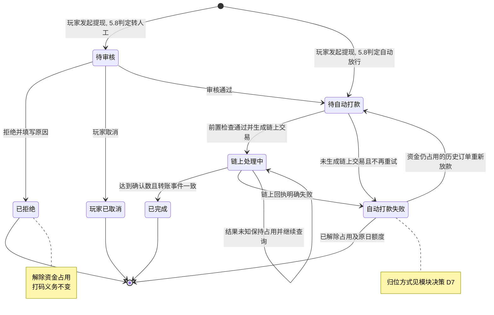
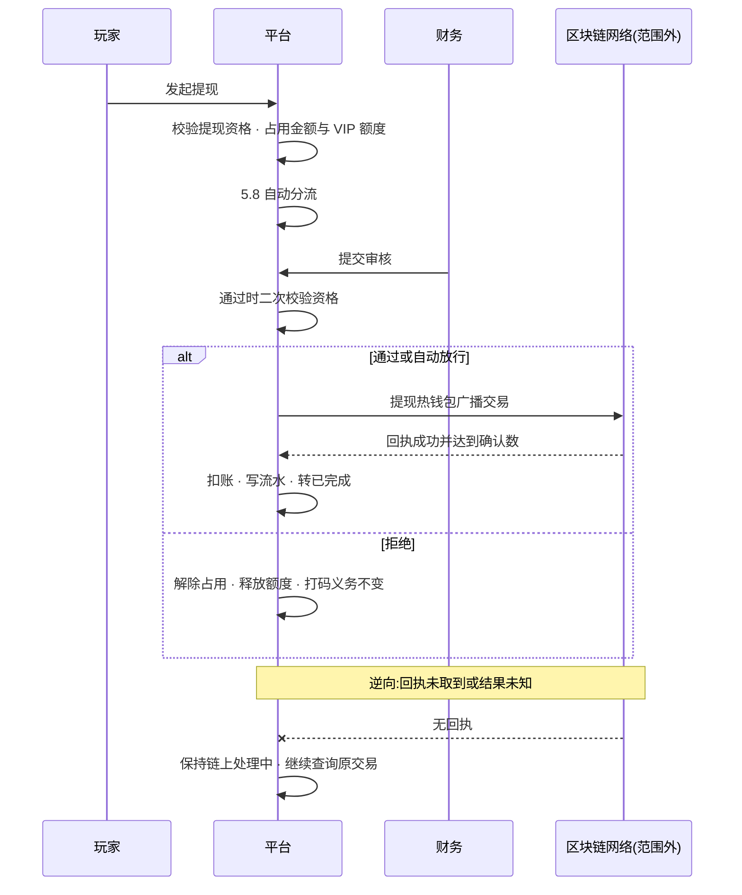

# 5.1 · 提现订单

## 1. 用途

让财务在一个页面里完成链上提现的审核与放款跟踪,并保证同一笔单只被处理一次。

### 使用者

| 角色 | 用来做什么 | 没有会怎样 |
|---|---|---|
| 财务 | 审核待处理的提现,通过或拒绝;跟踪链上放款结果 | 提现积压,玩家等钱等到投诉,口碑直接受损 |
| 风控 | 拦下异常提现,查自动判定命中的标签与规则版本 | 刷子把钱提走了才发现,追不回来 |
| 客服 | 回答「我的提现到哪一步了」 | 只能说「在处理中」,玩家不信,反复来问 |

提现是玩家对平台信任度最敏感的环节,慢一小时的体感损失远大于快一小时的收益。
同时它也是资金流出的唯一闸口,审错一笔就是真金白银的损失。这一页要同时做到**快**和**不出错**。

### 本次范围
- 本页只覆盖链上提现(Crypto 提现)。平台当前没有法币提现订单和代付通道,玩家端的法币方式不会生成本页订单
- 不做提现规则的配置(最低提现额、手续费与可提开关归 5.15 币种网络配置,分流规则归 5.8 审核规则,VIP 逐级每日次数 / 金额上限归 M4.6)
- 不做打码义务的判定逻辑本身(见“相关资料”引用的资金模型,本页只消费判定结果)
- 不做提现热钱包的配置(归 5.17 链上资产归集的平台钱包)
- 玩家端提现页交互见[Account需求](../../玩家端/Account/README.md#account-r6--提现与收款账户),本版玩家端不能提交提现;本页维护受理、手续费、占用与审核的资金口径

### 适用范围

| 维度 | 取值 |
|---|---|
| 终端 | 桌面后台,最小宽度 1440 |
| 响应式 | 否 |
| 界面语言 | 简体中文 |
| 时区 | 页面时间按操作者浏览器时区展示;VIP 每日额度按运营业务日计算 |
| 货币 | 多币种共存,金额必须带币种标识 |

## 2. 查询与处理信息

**筛选字段**

| 字段 | 类型 | 可输入数据与校验 |
|---|---|---|
| 订单号 | text | 模糊匹配 |
| 用户ID | text | 精确匹配 |
| 状态 | select | 默认全部状态,见 A2。可选待审核 / 待自动打款 / 链上处理中 / 自动打款失败 / 已拒绝 / 已完成;玩家已取消的订单可在全部状态下看到,没有单独筛选项 |

本版不提供渠道、付款通道、金额、首次提现、时间、备注和 CPF 筛选。

**表格列**

| 列 | 说明 | 默认显示 |
|---|---|---|
| 订单号 | 该笔提现的唯一单号 | 是 |
| 会员 | 用户名与用户ID,可点击进入玩家详情 | 是 |
| 币种 / 网络 | 提现的链上币种与所在网络 | 是 |
| 申请金额 | 玩家申请提取的总额,也是钱包占用金额,带币种标识 | 是 |
| 手续费 / 到账 | 本单手续费与链上应到账金额 | 是 |
| 本金 / 彩金 | 申请金额在两轨上的拆分,派生指标 | 是 |
| 收款地址 | 玩家的链上收款地址,**须脱敏** | 是 |
| 状态 | 当前状态,含义见“业务流程” | 是 |
| TxHash | 链上交易哈希,可复制;未广播时为空 | 是 |
| 链上放款 | 提现热钱包地址、Nonce、确认要求、执行版本、尝试次数、失败原因;未进入放款时为空 | 是 |
| 申请时间 | 玩家提交时间,列表按此倒序 | 是 |
| 自动判定快照 | 5.8 判定原因、命中的标签、配置版本、全局开关及异常说明 | 是 |
| 审核信息 | 审核人(自动放行显示系统)、审核时间、审核备注或拒绝原因 | 是 |
| 操作 | 待审核显示通过 · 拒绝;自动打款失败显示重新放款;其他状态无操作 | 是 |

本版不展示运营商、渠道、用户标签和首次提现列,不提供列表汇总和单笔详情页。VIP 判定快照随本单额度占用保存,用于解释受理结果,本页不展示。

### 配置限制与默认值

| 配置或参数 | 填写与执行规则 |
|---|---|
| 每页条数(A1) | 默认 20 条/页,可切换 20 / 50 / 100 |
| 默认筛选(A2) | 全部状态,按申请时间倒序 |
| 自动刷新间隔(A3) | 当前不提供自动刷新,由操作者点刷新 |
| 批量审核单次上限(A4) | 当前不提供批量审核 |
| 查询响应上限(A5) | 当前不设页面级查询超时 |
| 导出行数上限(A6) | 当前不提供导出 |
| 拒绝原因与审核备注长度(A9) | 最多 500 字符 |
| 新地址等待时长(A10) | 地址绑定满该时长后才能用于提现;部署配置 |
| 放款自动重试(A11) | 最多 10 次,间隔从 30 秒起翻倍、上限 30 分钟;部署配置 |
| 链上确认数(A12) | 取币种网络的确认数覆盖值,未配置时取链的确认数;5.15 维护,生成链上交易时写入本单 |
| 未确认替换(A13) | 广播后 10 分钟无回执时加价替换,最多替换 3 次;部署配置 |
| 放款滞留告警(A14) | 链上处理中超过 30 分钟未更新时告警;部署配置 |

## 3. 处理规则

### 提现受理与占用金额(5.1-R7)

玩家选择币种网络、填写收款地址和申请金额后提交。只开放同时满足以下条件的币种网络:网络开放提现、所属链启用且为 EVM 链、资产为 ERC-20 代币、链上币种启用、平台币种启用且允许提现。

M5 提供申请总额、钱包占用总额、手续费和预计到账:钱包占用等于申请总额,预计到账等于申请总额减手续费,VIP金额额度仍按手续费前申请总额占用。手续费与最低提现额取币种网络配置,手续费是固定金额。申请总额须大于0、小数位不超过该币种网络精度、不低于最低提现额,且必须大于手续费。

例如申请 100 USDT、手续费 2 USDT,钱包及VIP金额额度均按 100 USDT 占用,预计到账 98 USDT。不能在申请总额之外再扣 2 USDT,也不能只占用 98 而申请 100。

受理依次校验,任一不通过都不受理,也不占用资金或额度:

1. 币种网络可用,否则提示提币网络不可用
2. 收款地址是合法 EVM 地址,否则提示提币地址格式错误
3. 金额符合上述规则,否则提示格式错误、小数位超限、低于最低提币金额或必须大于手续费
4. 收款地址已绑定该币种和网络,否则提示请先绑定该币种和网络的提币地址;未满 A10 等待时长提示新提币地址需等待
5. 该币种钱包存在且状态正常,否则提示当前钱包不可提币
6. 该币种钱包没有未完成打码任务,否则提示还需完成多少流水要求
7. 可用余额(真金与彩金之和减去占用)不小于申请总额,否则提示可用余额不足。占用按真金优先、彩金兜底拆分
8. VIP 每日出款限额按 A8 校验并占用

通过后,资金占用、VIP 额度占用与订单在同一事务内生成。手续费按提交时的币种网络配置写入订单,不提供带有效期的报价,提交时不要求玩家重新确认费用变化。受理后固化本单金额,后续配置变化不重算。玩家本人授权按账户会话核验,不使用本页后台审核权限码。

同一玩家的同一请求编号只生成一笔订单,重复到达时返回原订单,不重复占用资金或额度。并发冲突自动重试,3 次仍未成功时本次不受理,玩家可用同一请求编号再次提交。

订单生成后由 5.8 判定去向:转人工进入待审核,自动放行进入待自动打款。判定异常或规则不可用时转人工,原因写入判定快照;同一笔单只判定一次。

### 锁定的持有时长(A7)

当前不提供审核锁定,没有持有时长。并发审核按 5.1-R4 的状态校验处理。

### VIP 每日出款限额(A8)

玩家申请被受理前,按 M4-D65 同时校验当前 VIP 等级的当日最高次数与标准币金额,原子占用额度并随本单保存判定快照;本页审核不因之后升降级或改配置而推翻已受理结果。

VIP 配置缺失、玩家等级未配置限额、该等级次数或金额上限为 0、汇率不可用、当日有未建立额度快照的历史单时都不受理。金额额度按申请总额折算 USD 占用,向上取整,避免多笔零头绕过上限。

配置或来源：规则在 M4.6 配,M5 执行。

### 单笔审核(5.1-R2)

对一笔待审核订单点击通过或拒绝,确认后提交。确认弹窗展示本单收款地址与到账金额,或拒绝后资金恢复的说明。

输入信息：审核结果(通过 / 拒绝)· 拒绝原因(拒绝时**必填**)· 审核备注(通过时选填)。长度见 A9。

1. 判权限;校验该单当前仍为待审核,否则拒绝操作
2. **通过时二次校验提现资格**:该币种是否仍存在未完成的打码任务。
   打开页面时可提、提交时已不可提的,**按提交时为准拒绝**,不按打开时的状态放行
3. VIP 每日出款限额已在申请受理时按 A8 原子校验并固化;审核时不按玩家当前等级或最新配置重算,避免已受理订单被追溯推翻
4. 通过:订单转入待自动打款并生成放款任务,资金与该申请日的 VIP 次数 / 金额额度都保持占用,链上确认前不扣账
5. 拒绝:必须填写原因;**解除本单的资金占用**,金额回到玩家可用余额,同一事务内释放该申请日的 VIP 次数与金额占用
6. 拒绝**不改变玩家的打码义务** —— 提现被拒不等于打码作废,也不等于额外惩罚
7. 通过与拒绝都写审核审计,记录审核人、时间、结果与原因。占用不产生账变;账变流水只在链上确认成功后写入一笔提现扣款

### 批量审核(5.1-R3)

当前不提供。页面没有勾选和批量入口,每笔订单单独审核。

### 锁定与并发控制(5.1-R4)

当前不提供审核锁定:打开审核弹窗不占用订单,列表不显示占用人,其他人也能打开同一笔订单。

并发以提交时的订单状态为准:同一笔待审核订单只有先提交的一次生效,后提交者提示该单已被处理,刷新后查看最新状态。查看与查询不受影响。

### 自动放款与链上结果(5.1-R8)

审核通过或自动放行后,订单在待自动打款中由系统按顺序处理,不需要人工操作。

1. 前置检查:币种网络和链仍开放、该网络有启用的提现热钱包、未超过热钱包单笔与当日限额(按到账金额折算 USD,当日按 UTC 零点切分)、热钱包代币余额与 Gas 足够
2. 检查通过后生成链上交易,订单转链上处理中,由托管签名服务签名并广播;同一执行版本只生成一笔链上交易
3. 广播后按 A13 处理长时间未确认的交易,替换交易与原交易都继续查询回执
4. 达到 A12 确认数且转账事件的代币、收款地址、金额都与订单一致时,一次性完成扣账:扣减钱包余额、解除占用、写提现扣款账变、把 VIP 额度转为已使用、累计用户提现数据,订单转已完成并记录 TxHash
5. 未生成链上交易时,热钱包不可用、余额或 Gas 不足、汇率不可用、执行异常按 A11 自动重试;网络停用、超过热钱包限额、金额精度错误、合约缺失不重试。重试耗尽或不可重试时订单转自动打款失败,解除资金占用并释放 VIP 额度
6. 链上回执明确失败时,订单转自动打款失败,解除资金占用并释放 VIP 额度,打码义务不变
7. 已生成链上交易后执行异常、替换次数耗尽未见回执,或回执成功但转账事件与订单不一致,都按**结果未知**处理:订单保持链上处理中,链上放款列显示失败原因,资金与 VIP 额度继续占用,系统继续查询原交易。结果未知不转失败、不退回、不重新放款

### 重新放款(5.1-R9)

对自动打款失败的订单点击重新放款,点击后直接提交,不填写原因。

1. 判权限;校验订单和放款任务都已明确失败,否则提示只有明确失败的提现才能重新放款
2. 已解冻并释放 VIP 额度的订单不能重新放款,提示玩家重新申请出款。系统判定失败时已完成解冻,所以新受理的订单失败后都走这条路径
3. 资金仍保持占用的历史订单(受理时没有 VIP 额度占用)可以重新放款:回到待自动打款,执行版本加一,尝试次数清零,原链上交易不再沿用
4. 写审核审计,记录操作人和时间

### 玩家取消(5.1-R10)

玩家可取消本人仍处于待审核的提现:订单转玩家已取消,解除资金占用,释放 VIP 额度,打码义务不变,写审计。其他状态提示只能取消本人尚未审核的出款申请。玩家端当前没有取消入口。

### 业务流程

明确失败时解除原资金占用,打码义务不变,同时释放原申请日VIP额度。结果未知保持占用并查询原交易,禁止重放款或提前退回。

## 4. 特殊情况

### 边界处理

| # | 场景 | 触发条件 | 预期处理 |
|---|---|---|---|
| E1 | 越权审核 | 无审核权限账号提交审核或重新放款 | 服务端拒绝并提示无权审核提现订单;界面不隐藏按钮 |
| E2 | 两人同审一单 | 两人都打开了同一笔订单的审核弹窗 | 先提交者生效,后提交者提示该单已被处理,资金只处理一次 |
| E3 | 审核期间资格变化 | 打开页面后玩家新充值产生打码任务 | 通过时**二次校验**,按提交时状态拒绝,并告知还差多少;拒绝操作不受影响 |
| E4 | 重复提交审核 | 网络抖动或连点导致同一单提交多次 | 只生效一次,提交中确认按钮不可点,重复请求提示该单已被处理 |
| E5 | 批量部分失败 | 不适用 | 当前不提供批量审核 |
| E6 | 放款回执丢失 | 链上已执行但平台未取到回执 | 订单保持链上处理中,不自行判定;资金与 VIP 出款额度继续占用,系统继续查询本单全部已广播交易,查到后按回执处理,超过 A14 告警 |
| E7 | 重复回执 | 同一确认结果被重复处理 | 按订单幂等,已完成订单直接跳过,只扣账一次 |
| E8 | 锁定卡死 | 不适用 | 当前不提供审核锁定,不存在占用卡死 |
| E9 | 敏感信息泄露 | 无脱敏权限的账号查看提现信息与 CPF | 服务端按权限脱敏后再返回,不在界面侧遮挡了事 |
| E10 | 拒绝被当成惩罚 | 提现被拒后玩家的打码义务被清掉或增加 | 拒绝**不改变**打码义务,只解除本单的资金占用 |
| E11 | 放款结果未知 | 已生成链上交易后执行异常、替换耗尽,或回执与订单不一致 | 保持链上处理中并显示失败原因;资金与额度继续占用,不允许重新放款 |
| E12 | 放款执行暂停 | 系统放款未开启 | 订单停留在待自动打款或链上处理中,资金继续占用,不扣账 |
| E13 | 审核后配置变化 | 通过后网络被停用或热钱包限额被调低 | 放款时按当前配置做前置检查,不满足时转自动打款失败并解除占用,玩家重新申请 |
| E14 | 通过后新增打码任务 | 审核通过或自动放行后玩家又产生打码任务 | 不影响在途放款,受理与审核时的校验结果继续有效 |
| E15 | 钱包占用异常 | 拒绝时钱包占用金额小于本单占用 | 提示钱包占用金额异常,已停止释放;拒绝不生效,订单保持待审核 |

### 单笔审核遇到异常时(5.1-R2)

| 错误状况 | 提示 |
|---|---|
| 无审核权限 | 无权审核提现订单 |
| 订单不存在 | 提现订单不存在 |
| 订单已非待审核态 | 提现订单已被处理,请刷新 |
| 提交时被他人抢先 | 提现订单已被其他人处理 |
| 二次校验发现仍有未完成打码任务 | 该用户仍需完成多少的流水要求,**告知还差多少**,不可通过 |
| 拒绝未填原因 | 请填写拒绝原因 |
| 重复提交 | 只生效一次,重复请求按订单已被处理提示 |

### 重新放款遇到异常时(5.1-R9)

| 错误状况 | 提示 |
|---|---|
| 无审核权限 | 无权审核提现订单 |
| 放款任务不存在 | 提现放款任务不存在 |
| 订单或放款任务不是明确失败 | 只有明确失败的提现才能重新放款 |
| 已解冻并释放 VIP 额度 | 此订单已解冻并释放 VIP 额度,请重新申请出款 |

### 页面状态

| 状态 | 表现 |
|---|---|
| 错误 | 列表区域内提示并可重试,不整页跳转;筛选条件保留 |
| 待自动打款 / 链上处理中 | 特有态:无操作入口,状态明确显示为处理中,避免被再次审核 |
| 结果未知 | 特有态:状态仍为链上处理中,链上放款列显示失败原因,不与自动打款失败混为一谈 |
| 自动打款失败 | 特有态:显示失败原因和重新放款;已解冻订单提交后按上表提示 |

## 5. 验收场景

| 需求编号 | 场景与操作 | 预期结果 |
|---|---|---|
| 5.1-R1 | 订单列表与筛选：进入页面 · 点查询 · 翻页 | 3 项筛选可组合;默认全部状态并按申请时间倒序;敏感字段脱敏;列表不提供汇总 |
| 5.1-R2 | 单笔审核：对某笔待审核订单点通过或拒绝 | 通过时二次校验提现资格;通过后进入待自动打款;拒绝须填原因并解除资金占用 |
| 5.1-R3 | 批量审核：进入页面查找批量入口 | 当前不提供:没有勾选和批量按钮,每笔订单单独审核 |
| 5.1-R4 | 并发审核：两人同时打开并提交同一笔订单 | 当前不提供锁定;双方都能打开,只有先提交者生效,后提交者提示已被处理,资金只处理一次 |
| 5.1-R5 | 自动刷新：停留在页面等待 | 当前不提供:列表不自动更新,点刷新才取最新数据 |
| 5.1-R6 | 全量导出：进入页面查找导出入口 | 当前不提供:没有导出按钮 |
| 5.1-R7 | 申请 100 USDT、手续费 2 USDT 并成功受理 | 钱包及VIP金额额度按 100 USDT 占用,预计到账 98 USDT,订单金额一致,不额外扣 2 USDT |
| 5.1-R7 | 金额低于最低提现额、不大于手续费、小数位超限,或地址未绑定、钱包受限、有未完成打码、余额不足、超过 VIP 额度 | 不受理并说明原因,不占用资金或额度 |
| 5.1-R7 | 同一请求编号重复提交 | 只有一笔订单,重复请求返回原单,资金和额度只占用一次 |
| 5.1-R7 | 提交前运营修改了手续费 | 当前不提供报价确认:按提交时配置受理并写入订单,受理后配置再变化不重算 |
| 5.1-R8 | 待自动打款订单前置检查通过,链上确认成功 | 转已完成,记录 TxHash,余额扣减一次,占用解除,VIP 额度转已使用,写一笔提现扣款账变 |
| 5.1-R8 | 已生成链上交易后结果未知,或回执与订单不一致 | 保持链上处理中并显示失败原因,资金与额度继续占用,不退回、不重新放款 |
| 5.1-R8 | 链上回执明确失败,或未生成交易且不再重试 | 转自动打款失败,解除占用并释放 VIP 额度,打码义务不变 |
| 5.1-R9 | 已解冻的失败订单点重新放款 | 拒绝并提示重新申请出款,不产生新的放款 |
| 5.1-R9 | 资金仍占用的历史失败订单点重新放款 | 回到待自动打款,执行版本加一,不沿用原链上交易 |
| 5.1-R10 | 玩家取消待审核订单 | 转玩家已取消,解除占用并释放 VIP 额度 |
| 5.1-R10 | 玩家取消已审核或进入放款的订单 | 拒绝,订单和资金不变 |

### 单笔审核(5.1-R2)

- 正向:一笔打码已达标的待审核订单点通过 → 状态转待自动打款,审核人与时间被记录
- 正向:点拒绝并填写原因 → 状态转已拒绝,占用金额回到可用余额,**打码任务剩余量不变**
- 逆向:打开页面时可提,提交前玩家新充值产生了打码任务 → 提交时被拦下,并**告知还差多少**
- 逆向:拒绝未填原因 → 拒绝;同一单连点两次通过 → 只生效一次
- 边界:申请后玩家降级或运营调低出款上限 → 已受理订单仍可继续审核;若拒绝则在同一事务内释放原申请日额度

### 并发审核(5.1-R4)

- 逆向:A 与 B 同时打开同一单,A 先提交 → A 生效,B 提交时提示已被处理,资金只处理一次
- 逆向:A 拒绝后 B 再点通过 → B 提交被拒绝,订单保持已拒绝,不生成放款任务

## 6. 相关资料

### 入口与关联页面

- 菜单:财务管理 → 提现管理 → 提现订单

- 跳出:玩家详情弹窗(点会员)
- 用户详情的提款记录只查询当前用户的提现扣款账变,不提供跳往本页的按钮。

### 权限

| 操作 | 权限或执行方 |
|---|---|
| 订单列表与筛选(5.1-R1) | `finance:withdraw:order:view` |
| 单笔审核(5.1-R2) | `finance:withdraw:order:review` |
| 批量审核(5.1-R3) | 当前不提供 |
| 并发审核(5.1-R4) | `finance:withdraw:order:review` |
| 自动刷新(5.1-R5) | 当前不提供 |
| 全量导出(5.1-R6) | 当前不提供 |
| 提现受理(5.1-R7) | 玩家账户会话 |
| 自动放款(5.1-R8) | 系统 |
| 重新放款(5.1-R9) | `finance:withdraw:order:review` |
| 玩家取消(5.1-R10) | 玩家账户会话 |

> **权限**:本页权限码对应角色配置里的权限树节点,
> 完整映射见 `../README.md` 第 6 段。判定一律在服务端做。

### 术语与共用口径

> 资金类术语(余额、可用余额、真金、彩金、打码任务、提现拦截)统一定义在
> `../../M2-会员管理/2.1-会员列表/资金模型.md` 第 2 段。此处不重复。

| 术语 | 定义 |
|---|---|
| 收款地址 | 玩家绑定的链上提现地址 |
| 提现热钱包 | 平台用于向玩家放款的链上钱包,由托管签名服务持有密钥 |
| 币种 / 网络 | 玩家选择的链上币种与所在链,决定最低提现额、手续费和确认数 |
| 审核人 | 审核该单的后台账号;自动放行显示系统 |

**「本金 / 彩金」是两轨的拆分,不是两个余额。**
它们由提现扣款顺序(真金优先、彩金兜底)拆分得出,是派生的展示形态。
拆分语义统一引用资金模型。用户详情的提款记录展示提现扣款账变,字段按流水定义,不复制本页的订单列。

### 依赖与数据流

**数据流向**:玩家在客户端发起提现 → 平台占用对应金额并生成订单,经 5.8 自动审核分流
(按标签处置与总开关决定自动放行或转待审核,判定快照随单)→
财务在本页审核 → 通过则进入放款队列、拒绝则解除占用 →
系统从提现热钱包发起链上转账 → 达到确认数后扣账、写流水并完成订单 → 订单处理结果呈现在本页,资金变化可在用户详情的资产变动中查询。

**系统串接**:**与区块链网络及托管签名服务串接**,不经第三方代付。

- **正向**:审核通过或自动放行 → 平台生成并签名链上交易 → 广播 → 达到确认数且转账事件一致 → 订单转已完成
- **逆向**:链上回执明确失败 → 订单转自动打款失败,资金归位方式见模块决策 D7;
  回执未取到或结果未知 → **不猜测结果**,订单保持链上处理中并继续查询原交易,不自行转成功也不自行退回;
  重复处理同一结果 → 按订单幂等,只扣账一次;
  长时间未更新 → 按 A14 告警
- **责任边界**:放款结果以**链上回执为准**,平台不自行判定成功;
  提现资格判定(打码是否达标)**完全由平台负责**

### 数据归属与职责

**数据归属**

- 拥有(owner=M5):提现订单 · 账变流水 · 审核审计 · VIP 每日出款额度占用 / 释放记录与申请时判定快照
- 只读引用(owner=M4):玩家当前 VIP 等级与逐级每日出款次数 / 金额上限,仅用于申请受理前判定(D65)
- 只读:用户、用户标签(owner=M2)· 打码任务与提现资格判定结果
  (owner=M5,语义定义见资金模型)· 币种网络与提现热钱包配置(owner=M5,见 5.15 与 5.17)

**前后端职责**

| 事项 | 归属 |
|---|---|
| 权限判定 | **服务端**,按角色的权限节点判定 |
| 可见范围过滤 | **服务端**,按账号绑定的推广商过滤,列表一律先过滤再返回(见 `../README.md` 第 6 段) |
| 提交时的提现资格二次校验 | **服务端** |
| 提现信息与 CPF 的脱敏 | **服务端**(不得由界面遮挡代替) |
| 同一笔订单只处理一次 | **服务端**,按提交时的订单状态判定 |
| 放款、回执查询与结果归位 | **服务端** |
| 筛选交互、手动刷新 | 界面 |
| 拒绝原因收集与二次确认 | 界面 + 服务端双重校验 |

### 单笔审核的职责(5.1-R2)

| 归属 | 做什么 |
|---|---|
| 界面 | 展示本单到账金额、收款地址与 5.8 判定快照(命中标签、配置版本);拒绝原因必填;防重复提交 |
| 服务端 | 权限判定、**通过时二次校验提现资格**、状态流转、解除占用与释放额度、写审核审计 |

### 重新放款的职责(5.1-R9)

| 归属 | 做什么 |
|---|---|
| 界面 | 自动打款失败时展示重新放款,结果如实提示 |
| 服务端 | 权限判定、校验明确失败与资金仍占用、重置放款任务、写审核审计 |
