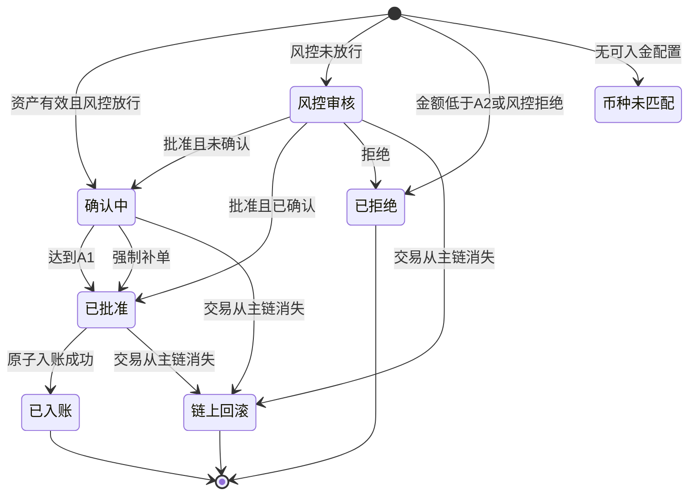
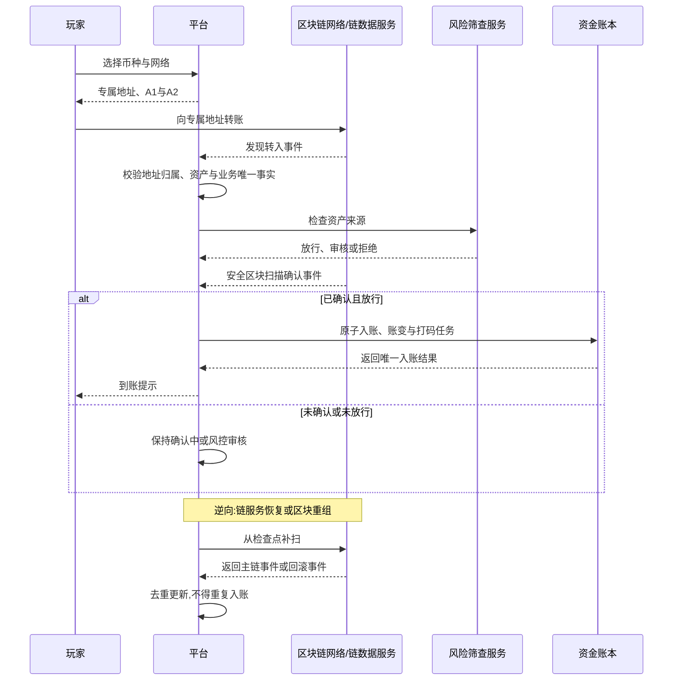

# 5.14 · Crypto入金

## 1. 用途

支持玩家通过 EVM 网络上的 Token 向自己的专属地址入金,达到确认条件后自动到账,
同一笔链上资金只入账一次且全程可追溯。

### 使用者

| 角色 | 用来做什么 | 没有会怎样 |
|---|---|---|
| 玩家 | 获取自己的充值地址并从外部钱包转入资产 | 只能使用法币通道,无法用链上资产充值 |
| 客服 | 查看最新入金记录的确认与风控状态 | 玩家说没到账时无法判断是链上确认中、充错链还是系统漏单 |
| 财务 | 核对链上实收、平台入账与异常记录 | 链上资产与玩家余额无法闭环对账 |
| 风控 | 审核未放行的入金,决定批准或拒绝 | 可疑资产可能在发现前已被提现或消费 |

扩大可接受的支付方式,减少共享地址和人工认领带来的错账,
并把链上事实、入金记录与玩家余额连成可核对的一条链。

### 本次范围

- 不向玩家或后台运营展示助记词、根密钥、私钥或派生密钥
- 不在本页执行链上提现、归集、换币或法币结算；归集见 [5.17 链上资产归集](../5.17-链上资产归集/README.md),方案见
  `Gas-Station与自动归集方案.md`
- 不承诺找回充错链、充错币或转到历史上从未分配给该玩家的地址的资产
- 除 5.14-R9 强制补单外,不把未达到确认条件的交易提前计入可用余额
- 不定义节点、密钥托管、签名设备和链监听组件的具体技术选型
- 本版只支持 EVM 网络上的 Token 入金:原生币不向玩家开放,链上也不监听原生币转账;不支持需要 Memo/Tag 的网络
- 不提供入金记录的筛选、分页、导出和重新核验;入金不生成充值订单,入金记录与账变就是到账凭据

### 适用范围

| 维度 | 取值 |
|---|---|
| 终端 | 玩家端充值面板 + Web 后台,后台桌面优先(设计基准 1440px) |
| 响应式 | 玩家端需要;后台版面按窗口宽度自适应,不做移动端专门适配 |
| 界面语言 | 玩家端跟随站点语言,后台简体中文 |
| 时区 | 链上时间按 UTC 保存,后台按浏览器本地时区展示,不标注时区 |
| 货币 | 已启用的链上币种,金额精度按币种配置且最多展示 8 位 |

## 2. 查询与处理信息

后台入金记录是「Crypto 配置中心」的一个标签页,一次展示最新 200 条已归属玩家地址的记录,点「刷新」更新,不提供筛选条件。

**表格列**

| 列 | 说明 | 默认显示 |
|---|---|---|
| 交易哈希 | 缩略显示前 10 位和后 8 位 | 是 |
| 链 | 实际发生转账的区块链标识 | 是 |
| 币种 | 根据链上资产唯一标识识别,不只按展示简称判断;未匹配时显示 - | 是 |
| 链上到账 | 链上实际转入金额,带币种;未识别资产时显示待识别及原始值 | 是 |
| 平台入账 | 写入玩家钱包的金额,带平台 Currency;未匹配时显示未匹配平台货币 | 是 |
| 确认数 | 监听到时为 0,进入安全区块后为要求确认数,不展示逐块进度 | 是 |
| 处理状态 | 见下方状态表 | 是 |
| 风险状态 | 待检测 / 通过 / 人工审核 / 拒绝 / 不可用 | 是 |
| 监听时间 | 首次监听到的时间 | 是 |
| 操作 | 风控审核记录:批准 · 拒绝;确认中记录:补单 | 是 |

**处理状态**

| 状态 | 含义 |
|---|---|
| 确认中 | 风控已放行,等待进入安全区块 |
| 风控审核 | 风控未放行,确认可继续累计,不入账 |
| 已批准 | 已确认且风控通过,等待入账;入账失败时停留此状态并定时重试 |
| 已入账 | 余额已增加,终态 |
| 已拒绝 | 低于最小入金金额,或风控、人工拒绝,终态 |
| 币种未匹配 | 转入资产当前没有可入金的币种网络配置,不入账 |
| 链上回滚 | 交易已从主链消失,终态 |

### 配置限制与默认值

| 配置或参数 | 填写与执行规则 |
|---|---|
| 入账确认数(A1) | 按网络配置,默认 6,各网络独立;Crypto 配置中心「链网络」;链最终性不同,不能全平台写死 |
| 最小入金金额(A2) | 按网络 + 币种配置,默认 0;低于阈值只记录不自动入账,状态为已拒绝;Crypto 配置中心「币种与网络」 |
| 入金手续费(A3) | 本版不收取、不提供配置,链上实收多少就入账多少 |
| 地址分配规则(A4) | 每个玩家每条网络一个稳定专属地址,由该网络启用中的钱包池派生;用户已明确要求专属钱包 |
| 同链多币种地址(A5) | 同一网络的多个 Token 共用该玩家在该网络的地址,币种仍按资产标识独立入账;避免为每个代币重复派生地址 |
| 监听起点(A6) | 按币种网络配置部署区块,默认 0;首次扫描从部署区块开始,为 0 时从当前安全区块开始,不扫描更早的历史交易;Crypto 配置中心「币种与网络」 |
| 到账时效目标(A7) | 本版不设时效监控告警;进入安全区块后在同一流程入账,失败时定时重试 |
| 地址生成时机(A8) | 玩家选中币种网络时按需分配,重复打开返回原地址 |

**充值打码统一来源**:X 只在 [5.5 充值商品与赠送](../5.5-充值商品与赠送/README.md)顶部“充值通用配置”按运营商维护,默认初始化为 1、必须为正数。Crypto 入金与商品充值共用该值,本页及 5.15 不另设倍数。入金在首次持久化记录时锁定 X 及版本;配置修改不改变确认中记录或补单的原依据。X 缺失或非正数时不入账,记录保持已批准并持续重试,不得默认取 0 或 1。统一充值 X 不表示 Crypto 自动加入商品赠送方案。

## 3. 处理规则

> A4 的“每个玩家每条网络一个地址”是“每个用户一个 HD 钱包”的产品口径:
> 玩家拥有一个逻辑托管钱包,其中按网络持有地址。地址不是币种钱包余额,同链代币可按 A5 共用地址。

### 分配用户专属地址(5.14-R1)

已登录玩家在充值面板选中某个币种网络;或已有玩家再次取地址。

输入信息：当前玩家身份 · 币种网络;玩家不得提交用户ID、派生序号或自定义地址。

1. 校验玩家已登录且账号已绑定运营商;校验所选币种网络允许入金、币种启用、平台 Currency 状态正常且允许充值、所属链启用且有启用中的钱包池
2. 已存在该玩家在该网络的地址时返回原记录,不重复生成
3. 不存在时分配新地址;同一玩家并发请求只能成功建立一条有效绑定
4. 地址必须能唯一反查玩家,同一网络的地址不得绑定给第二个玩家
5. 返回地址、A2、A1、平台 Currency、当前 X 与“仅使用所选网络”的明确警告
6. 任何响应、日志、导出和运营页面都不得包含根密钥、助记词或私钥

### 多链多币种展示(5.14-R2)

玩家进入充值面板的 Crypto 标签或切换币种、网络。

输入信息：币种 · 网络;只能选择后台已启用且绑定正确链上资产标识的组合。

1. 币种与网络是两个独立选择,同名币种跨网络不得合并成一个选项
2. 币种必须绑定网络上的唯一资产标识;不得仅凭 USDT 等展示简称识别资产
3. 按 A5 返回该网络地址,并展示当前组合的 A1、A2
4. 页面明确提示:网络选错或发送未支持资产可能无法找回

### 发现并登记链上入金(5.14-R3)

受支持网络观察到已配置 Token 转入平台已分配的用户专属地址。

输入信息：网络 · 区块高度与哈希 · 交易哈希 · 事件序号 · 收款地址 ·
Token 合约地址 · 原始链上金额 · 发送地址 · 链上时间。

1. 只监听已配置且启用入金的 Token 合约,从 A6 起点开始;收款地址不属于平台已分配地址的转账不登记
2. 通过网络 + 合约地址识别币种,不得只看名称或符号
3. 以“网络 + 交易哈希 + 事件序号”作为业务唯一事实;
   相同事件无论被实时订阅、区块扫描或重试处理多少次都只登记一次;首次持久化时同时锁定运营商的充值打码倍数 X 及配置版本,重复处理不得覆盖
4. 原始最小单位必须按币种精度准确转换,禁止浮点计算和提前舍入
5. 低于 A2 的记录转为已拒绝,保留链上事实但不自动入账
6. 币种网络未配置或已关闭入金时,处理中的事件记为币种未匹配,不写入任何玩家币种余额
7. 风控未放行时转风控审核,确认可继续累计但不得提前入账
8. 无法取得有效 X 时仍保存可审计链上事实并暂停入账;不得以最新值静默修补已登记记录的历史依据

### 确认后自动入账(5.14-R4)

已登记事件进入安全区块(最新区块减 A1 以内的主链事件),且风控状态允许入账。

输入信息：入金记录 · 确认事件 · 首次登记时锁定的充值 X 及配置版本。

1. 链上监听按网络确认数扫描安全区块,只有扫描到的主链事件才算达到 A1;记录转已批准
2. 按入金记录关联的币种网络取得稳定的 Currency 与 currencyCode;
   不得根据 Symbol 猜测入金币种
3. 校验风控已通过、入金金额为正、入金记录未入账,校验锁定的 X 存在且为正数;任何条件不满足都不得进入余额写入
4. 入账金额等于链上实收;不在此流程换汇
5. 按用户ID + currencyCode 定位唯一平台钱包;不存在时在本次原子操作内创建,
   已存在时使用原钱包
6. 入该钱包的真金轨,按资金模型以**实际到账金额 × 锁定 X**创建独立打码任务并写账变流水;不得按当前最新配置重算
7. 钱包、余额、账变、打码任务、累计充值与入金记录状态必须整笔原子成功;同一事务生成代理佣金依据并排入标签与 VIP 重算
8. 重复执行返回首次结果;不得产生第二个同币种钱包或第二次余额增加
9. 入账失败时全部回滚,记录保持已批准,系统定时重试
10. 成功后向玩家推送到账提示,并触发刮刮乐发放;推送或发放失败不回滚已完成入账

### 重新核验异常记录(5.14-R6)

本版不提供。需要人工干预时使用风控审核(5.14-R8)或强制补单(5.14-R9)。

### 风控审核(5.14-R8)

超级管理员对风控审核状态的记录点批准或拒绝。

输入信息：入金记录 · 审批备注(批准选填,拒绝必填,最多 500 字符)。

1. 批准:记录须已匹配用户和币种且未入账、未回滚;风险状态转通过,已确认的记录转已批准等待入账,未确认的转确认中继续等待
2. 拒绝:已入账或已回滚的记录不能拒绝;风险状态与处理状态转拒绝,保留原因,不入账
3. 备注写入风险原因,页面二次确认后提交

### 强制补单(5.14-R9)

持有补单权限的运营对确认中且未入账的记录点补单,填写原因并确认。

输入信息：入金记录 · 补单原因(必填,最多 500 字符);不得填写金额、币种、地址或哈希。

1. 记录须已匹配用户、币种且入账金额大于 0
2. 提交后记录转已批准,进入入账流程
3. 入账按 R4 规则执行且只发生一次,沿用记录锁定的 X
4. 操作人、原因、前后状态写入操作日志;页面轮询入账结果并提示成功、失败或仍在处理

### 业务流程

## 4. 特殊情况

### 风控处置(A9)

风控未放行时记录实收但不入可用余额,转风控审核。未接入风险服务时全部入金进入风控审核,由超级管理员放行;接入后按服务返回的通过、审核、拒绝处理,服务不可用或超时转风控审核且风险状态显示不可用,不得静默放行。

配置或来源：平台部署配置,后台不提供风控规则配置。

### 边界处理

| # | 场景 | 触发条件 | 预期处理 |
|---|---|---|---|
| E1 | 重复发现 | 实时订阅、区块扫描或重试同时处理同一事件 | 按 R3 业务唯一事实只登记一次 |
| E2 | 同交易多事件 | 一笔交易包含多个转入事件 | 按事件序号分别识别,不漏记也不把整笔交易重复算入 |
| E3 | 充错网络 | 玩家使用未选择或未支持的网络 | 支持网络且地址可归属时按实际网络识别;不支持时不承诺找回、不入账 |
| E4 | 充入假币或未支持资产 | 未配置的代币转入用户地址 | 只监听已配置合约,同名代币不产生入金记录,不入账 |
| E5 | 低于最小额 | 实收小于 A2 | 记录为已拒绝,不自动入账,同地址后续小额不累计 |
| E6 | 区块重组 | 入账前交易从主链消失 | 转链上回滚,不入账;同一事件不再重新进入确认 |
| E7 | 入账后极端重组 | 已入账交易随后从主链消失 | 不静默扣减已消费资金;冻结该币种提现并生成追偿/人工处置记录 |
| E8 | 链服务中断 | 一段时间无法取得新区块 | 不产生新的确认事件,入账随之暂停;恢复后从检查点补扫 |
| E9 | 地址归属冲突 | 同一网络地址被绑定给多个玩家 | 分配时由唯一约束阻止;派生异常时不建立绑定,玩家需重试 |
| E10 | 配置中途变更 | 入金确认期间 A2 或精度被修改 | 确认事件到达时按当前配置再判一次;已入账结果不回溯修改,X 沿用首次登记值 |
| E11 | 不支持精度 | 链上金额超出平台币种可保存精度 | 不舍入入账,进入金额解析异常等待配置修复 |
| E12 | 运营越权 | 无权限账号查询或补单,非超级管理员审批 | 服务端拒绝;密钥材料不因界面隐藏而泄露 |
| E13 | 币种网络不可入金 | 事件处理时币种网络未配置、已关闭入金或币种已停用 | 只登记链上事实并记币种未匹配,不得记入默认币种;之后确认事件到达且配置已恢复时按正常流程继续 |
| E14 | Currency被停用 | 确认期间平台 Currency 停用或关闭充值 | 玩家端不再提供该入口;已登记记录不暂停,达到确认后仍按原币种网络入账 |
| E15 | 并发创建钱包 | 用户首次同币种两笔入金同时到账 | 用户 + currencyCode 只创建一个钱包,两笔分别且正确入账 |
| E16 | 充值倍数变更 | 首次登记后 X 从 2 改为 3 | 原入金记录及补单仍按 2,修改后新登记记录按 3,既有任务不重算 |
| E17 | 充值倍数缺失或非法 | X 未初始化、无法解析、为 0 或负数 | 保留链上事实,记录保持已批准并持续重试,不得入账或默认用 0/1;人工调整豁免不适用于普通 Crypto 入金 |

### 分配用户专属地址遇到异常时(5.14-R1)

| 错误状况 | 提示 |
|---|---|
| 账号未绑定运营商 | 账号尚未绑定充值运营商,请联系客服 |
| 币种网络不可用 | Crypto deposit network is unavailable |
| 地址暂时无法分配 | Unable to prepare your deposit address,页面提供重试且不展示地址 |
| 并发重复请求 | 返回首次成功分配的同一地址 |

### 多链多币种展示遇到异常时(5.14-R2)

| 错误状况 | 提示 |
|---|---|
| 没有可用组合 | Crypto deposit is not available yet,提供刷新 |
| 选项加载失败 | Unable to load deposit options,提供重试 |

### 发现并登记链上入金遇到异常时(5.14-R3)

| 错误状况 | 处理 |
|---|---|
| 地址无归属 | 不登记入金记录,不得猜测用户 |
| 资产未配置 | 不监听,不登记;处理中的事件记币种未匹配,不得按同名币种入账 |
| 重复事件 | 返回首次登记结果,不新增第二条记录 |
| 消息处理失败 | 按固定次数重试,仍失败转入失败队列,不丢弃事件 |

### 确认后自动入账遇到异常时(5.14-R4)

| 错误状况 | 处理 |
|---|---|
| 未进入安全区块 | 保持确认中,不入账 |
| 交易不在当前主链 | 转链上回滚,不入账 |
| 入账环节任一步失败 | 全部回滚,记录保持已批准并定时重试,余额不发生半笔变化 |
| 同一事件再次处理 | 返回首次入账结果,余额不重复增加 |
| 风控未放行 | 保持风控审核,不进入可用余额 |
| 币种网络不可入金 | 记币种未匹配,只保留链上实收记录,不得写入其他币种钱包 |
| 玩家钱包已关闭 | 不入账,记录保持已批准并定时重试 |
| 充值倍数快照缺失或非法 | 保留链上事实,本次不入账,不静默使用当前倍数 |

### 风控审核遇到异常时(5.14-R8)

| 错误状况 | 提示 |
|---|---|
| 非超级管理员 | 服务端拒绝 |
| 拒绝未填原因 | 拒绝入金必须填写原因 |
| 记录未匹配用户或币种,或已入账、已回滚 | 批准被拒绝:Deposit must have a matched user and asset before approval |
| 已入账或已回滚的记录被拒绝 | Credited or reverted deposits cannot be rejected |

### 强制补单遇到异常时(5.14-R9)

| 错误状况 | 提示 |
|---|---|
| 无权限 | 服务端拒绝 |
| 未填原因 | 请填写补单原因 |
| 记录不符合补单条件 | 提示该记录不可补单 |
| 未匹配用户、币种或金额无效 | 入金记录未匹配用户、币种或有效金额 |
| 提交时记录已变化 | 入金记录已发生变化,请刷新后重试 |
| 入账超过 45 秒未完成 | 补单已提交,但入账仍在处理中,请稍后刷新查看 |

### 页面状态

| 状态 | 表现 |
|---|---|
| 确认中 | 显示确认数,不得显示“已到账” |
| 风控审核 | 操作列提供批准和拒绝 |
| 已入账 | 显示平台入账金额与币种 |
| 已拒绝 | 显示链上到账金额,风险状态区分人工或风控原因 |
| 币种未匹配 | 显示待识别链上资产及原始金额 |
| 链上回滚 | 显示链上回滚,余额未增加 |
| 空 | 显示暂无链上入金记录 |
| 错误 | 列表上方提示入金记录加载失败并允许重试,不整页跳转 |
| 玩家端 | 不展示确认进度和入金记录,到账后弹出到账提示,余额随之刷新 |

## 5. 验收场景

| 需求编号 | 场景与操作 | 预期结果 |
|---|---|---|
| 5.14-R1 | 分配用户专属地址：玩家首次选中某币种网络 | 返回可归属该用户的稳定地址;并发请求不生成两个地址 |
| 5.14-R2 | 多链多币种展示：玩家选择币种与网络 | 只展示已启用组合及对应地址、最小额和确认要求 |
| 5.14-R3 | 发现并登记链上入金：监听到专属地址收到资产 | 每个链上事件只登记一次,金额、币种、用户和链上凭据可追溯 |
| 5.14-R4 | 确认后自动入账：进入安全区块且通过风控 | 原子完成余额、账变和打码任务写入,不生成充值订单 |
| 5.14-R5 | 查询入金：打开 Crypto 配置中心的入金记录标签 · 刷新 | 展示最新 200 条记录的金额、确认数、处理状态与风险状态;不提供筛选和翻页 |
| 5.14-R6 | 重新核验异常记录：当前不提供 | 列表无重新核验操作;记录按风控审核或强制补单处理 |
| 5.14-R7 | 导出入金记录：当前不提供 | 页面无导出入口 |
| 5.14-R8 | 风控审核：超级管理员对风控审核记录批准或拒绝 | 批准后按确认情况入账或继续等待;拒绝后不入账;非超级管理员被拒绝 |
| 5.14-R9 | 强制补单：对确认中记录补单并填写原因 | 入账一次,操作日志可查;其他状态的记录被拒绝 |

### 分配用户专属地址(5.14-R1)

- 正向:玩家首次选中某 EVM 网络的 USDT → 获得唯一地址;刷新和重新登录后仍返回同一地址
- 正向:同一玩家在两条 EVM 网络分别取地址 → 得到两个网络各自的地址
- 逆向:并发请求同一网络地址 → 只有一个有效绑定,两次响应地址相同
- 逆向:币种网络停用后请求地址 → 不分配地址并提示不可用
- 逆向:账号未绑定运营商 → 提示联系客服,不分配地址

### 多链多币种展示(5.14-R2)

- 正向:USDT 同时启用两条 EVM 网络 → 玩家能看到两个网络及各自规则
- 正向:同一 EVM 网络启用两个 Token → 共用玩家该网络地址,入账币种各自独立
- 逆向:绕过界面请求已停用组合 → 服务端拒绝且不返回可充值信息

### 发现并登记链上入金(5.14-R3)

- 正向:同一交易向同一用户地址产生两条不同事件 → 按事件分别登记且金额各自准确
- 正向:实时订阅与区块扫描同时发现同一事件 → 只产生一条入金记录
- 正向:首次登记时 X=2,确认期间改为 3 → 原记录仍保留 2 与原版本,新事件锁定 3
- 逆向:未配置的同名代币转入 → 不产生入金记录,不按正版代币入账
- 逆向:金额低于 A2 → 记录为已拒绝,不增加余额

### 确认后自动入账(5.14-R4)

- 正向:USDT 入金进入安全区块 → USDT 余额、账变和打码任务一致增加
- 正向:用户尚无 USDT 钱包 → 入账时只创建一个 USDT 钱包并增加余额
- 正向:同一用户从两条 EVM 网络分别充值映射到同一 Currency 的 USDT → 都进入同一个 USDT 钱包
- 正向:到账推送失败 → 入账保持成功,推送不重发,玩家余额以入账结果为准
- 正向:实收并到账 100 USDT、首次登记锁定 X=2 → 单独建立 200 USDT 打码任务;修改通用配置后补单或重试不改变该任务
- 逆向:确认前重复处理多次 → 始终不入账;确认后并发处理 → 只入账一次
- 逆向:余额已写但打码任务写入失败 → 整笔回滚,记录保持已批准并重试
- 逆向:首次登记时 X 缺失、为 0 或负数 → 保留链上事实且不入账,不得按默认 1 倍或免打码入账

### 风控审核(5.14-R8)

- 正向:未接入风险服务时入金进入风控审核,已确认后批准 → 转已批准并入账一次
- 正向:确认前批准 → 转确认中,确认后自动入账
- 逆向:拒绝未填原因 → 不提交
- 逆向:已入账记录被拒绝 → 服务端拒绝

### 强制补单(5.14-R9)

- 正向:确认中记录补单 → 入账成功,操作日志记录原因与前后状态
- 逆向:已入账或确认数大于 0 的记录补单 → 拒绝
- 逆向:两名运营同时补单 → 只有一次成功,余额只增加一次

## 6. 相关资料

### 入口与关联页面

- 菜单:财务管理 → Crypto 配置中心 → 入金记录标签;无独立菜单
- 玩家入口:充值面板的 Crypto 标签(奖金钱包充值、进入游戏时的资金弹窗);账户中心充值页只提供商品充值
- 跳出:本页无页面跳转;配置见 5.15 Crypto配置中心,归集见 [5.17 链上资产归集](../5.17-链上资产归集/README.md)与 `Gas-Station与自动归集方案.md`

### 权限

| 操作 | 权限或执行方 |
|---|---|
| 分配用户专属地址(5.14-R1) | 已登录玩家 |
| 多链多币种展示(5.14-R2) | 已登录玩家 |
| 发现并登记链上入金(5.14-R3) | 系统执行 |
| 确认后自动入账(5.14-R4) | 系统执行 |
| 查询入金(5.14-R5) | `finance:recharge:crypto:view` |
| 重新核验异常记录(5.14-R6) | 当前不提供 |
| 导出入金记录(5.14-R7) | 当前不提供 |
| 风控审核(5.14-R8) | 超级管理员 |
| 强制补单(5.14-R9) | `finance:recharge:crypto:supplement` |

### 术语与共用口径

> 钱包、余额、真金、打码任务与账变流水的语义统一引用
> `../../M2-会员管理/2.1-会员列表/资金模型.md`。
> 充值通用 X 的唯一配置入口见 [5.5 充值商品与赠送](../5.5-充值商品与赠送/README.md);本页仅保存和执行快照。
> 链、币种、确认数、资产标识与 RPC 节点的配置入口统一见 `../5.15-Crypto配置中心/README.md`。
> 入账后的链上资产归集见 [5.17](../5.17-链上资产归集/README.md),补 Gas 与统一钱包方案见 `Gas-Station与自动归集方案.md`。

| 术语 | 定义 |
|---|---|
| 托管钱包 | 平台代玩家保管并控制链上密钥的钱包。玩家只有入金地址,不持有私钥 |
| HD钱包 | 可从同一受控根生成大量独立地址的钱包体系;根密钥及派生材料不是产品展示字段 |
| 用户专属地址 | 平台为某玩家在某条链分配的唯一入金地址;能从地址直接归属到玩家 |
| 网络 | 资产实际转移所在的区块链;币种相同但网络不同仍是不同入金路径 |
| 链上事件 | 链上某笔交易中实际转给用户地址的一次资产转移;一笔交易可有多个事件 |
| 确认数 | 该交易所在区块之后已被链接受的区块数量,达到网络配置阈值后才可入账 |
| 重组 | 链上已观察区块被后续主链替换,使交易从主链消失 |
| 入账 | 按链上资产配置关联的 `Currency` 找到玩家对应币种钱包,写入实收金额并同时生成账变与打码任务 |

### 依赖与数据流

**数据流向**:玩家选择币种与网络 → 平台返回该玩家专属地址 → 玩家从外部钱包转账 →
平台监听并登记链上事件 → 按资产配置取得 Currency → 执行风控并等待进入安全区块 →
按用户ID + currencyCode 写入对应币种钱包余额、账变与打码任务 → 玩家收到到账提示,后台看到已入账。

**系统串接**:区块链网络/链数据服务、风险筛查服务、玩家通知能力与资金模型。

- 链上事实以目标网络主链为准;实时订阅只作为发现方式,不能单独作为入账凭据
- 平台负责地址归属、资产识别、确认判断、幂等入账;外部钱包只负责发起转账
- 风险服务超时按 A9 转风控审核,不得静默放行
- 链服务中断时保留最后已扫描进度,恢复后从检查点补扫,不得跳过区块

### 数据归属与职责

**数据归属**

- 拥有(owner=M5):Crypto网络与币种配置 · 用户充值地址绑定 · 链上入金记录 ·
  资金来源账本 · 账变流水 · 打码任务
- 只读:玩家与账号状态(owner=M2)· 区块、交易、资产与确认事实(owner=区块链网络,
  **本仓库范围外**)· 风险筛查结果(owner=风控,**本仓库范围外**)

> 根密钥、助记词、私钥和派生密钥不是产品查询数据,不得进入业务列表、导出、日志或通用数据库备份。

**前后端职责**

| 事项 | 归属 |
|---|---|
| 玩家身份、地址唯一归属、网络与资产有效性校验 | **服务端** |
| 确认判断、重组处理与安全补扫 | **服务端** |
| 幂等控制、入账原子性、金额精确计算 | **服务端** |
| 风控判定与提现冻结联动 | **服务端** |
| 权限判定 | **服务端** |
| 币种网络联动、地址与二维码展示、风险提示 | 玩家端界面 |
| 风控审核、补单的二次确认与结果提示 | 后台界面 |

### 分配用户专属地址的职责(5.14-R1)

| 归属 | 做什么 |
|---|---|
| 界面 | 展示网络、地址、二维码、风险提示与复制操作 |
| 服务端 | 校验身份与网络状态,分配或返回专属地址,保证用户与网络维度唯一 |

### 多链多币种展示的职责(5.14-R2)

| 归属 | 做什么 |
|---|---|
| 界面 | 联动选项,显示地址、二维码、A1、A2 与风险提示 |
| 服务端 | 返回已启用组合,拒绝伪造或已停用组合 |

### 发现并登记链上入金的职责(5.14-R3)

| 归属 | 做什么 |
|---|---|
| 界面 | 后台列表显示确认中或风控审核 |
| 服务端 | 校验地址归属和资产配置,精确解析金额,去重登记,保存链上原始凭据 |

### 确认后自动入账的职责(5.14-R4)

| 归属 | 做什么 |
|---|---|
| 界面 | 后台展示入账结果,玩家端弹出到账提示 |
| 服务端 | 处理确认事件,原子写余额、账变、打码任务和入账状态 |

### 风控审核的职责(5.14-R8)

| 归属 | 做什么 |
|---|---|
| 界面 | 展示记录摘要,收集备注并二次确认 |
| 服务端 | 判超级管理员身份,校验记录状态,更新风险与处理状态 |

### 强制补单的职责(5.14-R9)

| 归属 | 做什么 |
|---|---|
| 界面 | 强提醒,收集原因,轮询入账结果 |
| 服务端 | 判权限,校验记录状态,转已批准并写操作日志 |
