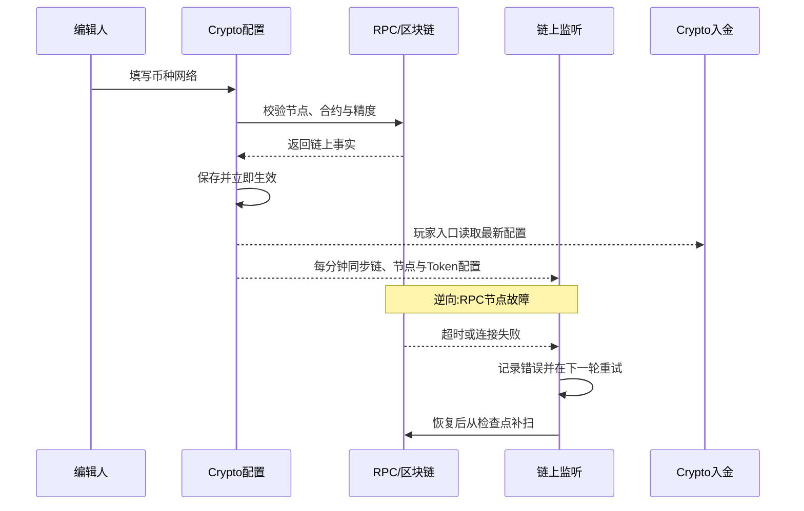

# 5.15 · Crypto配置中心

## 1. 用途

让授权人员在后台配置 Crypto 入金支持的链网络、币种、RPC 节点和钱包池,
币种网络保存时先经链上校验,配置保存后立即生效并同步给链上监听。

### 使用者

| 角色 | 用来做什么 | 没有会怎样 |
|---|---|---|
| 技术运营 | 上线新链、币种、节点和钱包池,调整确认与最小入金规则 | 每次变更都要改代码发版,配置错误无法提前发现 |
| 财务 | 控制哪些币种允许入金、提币及其金额规则 | 入金口径不透明,无法解释未到账或金额差异 |
| 超级管理员 | 新增与删除链网络,处理风控审核中的入金 | 高影响操作没有收口 |

在不发版的情况下扩展多链多币种,通过链上校验、幂等保存和并发控制
降低错账、漏账和配置冲突风险。

### 本次范围

- 不展示、导入或管理助记词、根密钥、私钥和派生私钥;初始化钱包池只在服务端生成并经 KMS 加密保存
- 不在本页执行链上归集、提现、Gas 补充或交易签名；归集见 [5.17 链上资产归集](../5.17-链上资产归集/README.md),方案见
  `../5.14-Crypto入金/Gas-Station与自动归集方案.md`
- 不提供任意 RPC 调试控制台,运营不能在后台提交自定义节点请求
- 不自动决定某条链或某个币种是否合法合规,上线前仍需业务所属地区的合规审批
- 不允许通过改配置回溯重算已经入账的历史交易
- 本版只支持 EVM 网络
- 本版不提供双人审批、配置版本与差异对比、RPC 健康检查与自动切换、手动测试 RPC、独立紧急停用和 KYT 映射;配置保存即生效

### 适用范围

| 维度 | 取值 |
|---|---|
| 终端 | Web 后台,桌面优先(设计基准 1440px) |
| 响应式 | 版面按窗口宽度自适应,不做移动端专门适配 |
| 界面语言 | 简体中文 |
| 时区 | UTC 保存,后台按浏览器本地时区展示,不标注时区 |
| 货币 | 所有拟支持的链上币种,金额规则必须带网络与币种标识 |

## 2. 配置项

菜单名称为「Crypto 配置中心」,副标题「配置链上币种与平台 Currency 的入账关系、部署网络、RPC 节点，并处理需要人工审核的入金。」。分五个标签页:**链网络 · 币种与网络 · RPC 节点 · 钱包池 · 入金记录**。
标签括号内显示数量:链网络、RPC 节点、入金记录为条数,币种与网络为币种数/网络映射数,钱包池为已初始化的链数/链总数。权限分别判定。入金记录归 [5.14](../5.14-Crypto入金/README.md)。
新增入口分别为新增链网络、新增币种、新增网络映射、新增 RPC 节点。

**链网络 · 筛选字段**

| 字段 | 类型 | 可输入数据与校验 |
|---|---|---|
| 链标识 | text | 模糊匹配,去除首尾空格 |
| 名称 | text | 模糊匹配,去除首尾空格 |

其他标签不提供筛选。

**链网络 · 表格列**

| 列 | 说明 | 默认显示 |
|---|---|---|
| 链标识 | 平台内部稳定标识 | 是 |
| 名称 | 网络名称;Chain ID 11155111 显示测试网标记 | 是 |
| 类型 | 网络族 | 是 |
| Chain ID | 链编号 | 是 |
| 原生币 | 原生币符号 | 是 |
| 确认数 | 默认确认数 | 是 |
| 扫描批次 | 单次扫描区块数 | 是 |
| 主地址 | 平台主地址,可复制 | 是 |
| 状态 | 启用 / 停用 | 是 |
| 创建时间 | 按浏览器本地时区 | 是 |
| 更新时间 | 按浏览器本地时区 | 是 |
| 操作 | 编辑 · 删除 | 是 |

**链网络 · 表单字段**

| 字段 | 必填 | 规则 |
|---|---|---|
| 网络模板 | 否 | 仅新增时显示:自定义网络 / Ethereum Sepolia(测试网),选模板后带出参数并锁定身份字段 |
| 链标识 | 是 | 2～40 位英文字母、数字或下划线,以字母开头,自动转大写;全局唯一,创建后不可修改 |
| 名称 | 是 | 最多 100 个字符 |
| 链类型 | 是 | 仅 EVM;创建后不可修改 |
| Chain ID | 是 | 正整数,不得与已有网络冲突;创建后不可修改 |
| 原生币符号 | 是 | 2～20 位英文字母或数字且含字母,默认 ETH;创建后不可修改 |
| 默认确认数 | 是 | 正整数,默认 6 |
| 单次扫描区块数 | 是 | 正整数,默认 1000 |
| 平台主地址 | 是 | 0x 开头的 40 位十六进制地址,全局唯一 |
| 启用 | 是 | 默认启用 |

**币种与网络 · 币种表格列**

| 列 | 说明 | 默认显示 |
|---|---|---|
| 链上币种 | 币种符号 | 是 |
| 入账 Currency | 关联的 Currency 名称与 currencyCode | 是 |
| 网络数量 | 该币种已配置的网络映射数 | 是 |
| 状态 | 启用 / 停用 | 是 |
| 创建时间 | 按浏览器本地时区 | 是 |

**币种 · 表单字段**(只提供新增,创建后不提供编辑与删除)

| 字段 | 必填 | 规则 |
|---|---|---|
| 链上币种符号 | 是 | 2～20 位英文字母或数字且含字母,自动转大写;全局唯一;Symbol 不能作为链上唯一识别依据 |
| 入账平台货币 | 是 | 保存稳定的 Currency ID;只可选择加密货币类型、状态正常且允许充值的 Currency |
| 启用 | 是 | 默认启用 |

**币种与网络 · 网络映射表格列**

| 列 | 说明 | 默认显示 |
|---|---|---|
| 币种 | 所属币种 | 是 |
| 链网络 | 所属链 | 是 |
| 类型 | 原生币 / Token | 是 |
| 合约地址 | 可复制 | 是 |
| 精度 | Decimals | 是 |
| 配置验证 | 验证通过 / 待验证 / 配置无效,附错误原因 | 是 |
| 最近验证时间 | 尚未验证时显示尚未验证 | 是 |
| 最小入金 | 金额规则 | 是 |
| 最小提币 | 金额规则 | 是 |
| 提币手续费 | 金额规则 | 是 |
| 确认数 | 覆盖确认数,留空时显示链默认 | 是 |
| 入金 | 启用 / 停用 | 是 |
| 提币 | 启用 / 停用 | 是 |
| 操作 | 编辑 | 是 |

**网络映射 · 表单字段**

| 字段 | 必填 | 规则 |
|---|---|---|
| Crypto 币种 | 是 | 已创建币种;编辑时不可更换 |
| 链网络 | 是 | 已创建的 EVM 网络;编辑时不可更换 |
| 资产类型 | 是 | 原生币 / Token 合约,默认 Token 合约 |
| 合约地址 | Token必填 | EVM 合约地址;同网络不得重复 |
| 精度 | 是 | 0～36 的整数,默认 18;A8 |
| 最小入金 | 是 | 大于等于 0,默认 0,小数位不超过精度且不超过 18 位 |
| 最小提币 | 是 | 大于等于 0,默认 0,小数位规则同上 |
| 提币手续费 | 是 | 大于等于 0,默认 0;最小提币大于 0 时须小于最小提币 |
| 覆盖确认数 | 否 | 留空继承链默认;填写后必须为正整数 |
| 部署区块 | 否 | 非负整数,默认 0;监听起点,见 5.14-A6 |
| 事件名称 | 否 | 默认 Transfer |
| 允许入金 | 是 | 默认开启;所属网络停用时币种不得对玩家可用 |
| 允许提币 | 是 | 默认关闭 |

**RPC 节点 · 表格列**

| 列 | 说明 | 默认显示 |
|---|---|---|
| 链网络 | 所属链 | 是 |
| 节点名称 | 同网络内唯一 | 是 |
| 类型 | RPC / WS | 是 |
| 节点地址 | 只显示协议和域名,路径脱敏 | 是 |
| 优先级 | 数值越小越优先 | 是 |
| 状态 | 启用 / 停用 | 是 |
| 操作 | 编辑 | 是 |

**RPC 节点 · 表单字段**

| 字段 | 必填 | 规则 |
|---|---|---|
| 链网络 | 是 | 已创建的 EVM 网络 |
| 节点类型 | 是 | HTTP RPC / WebSocket,默认 HTTP RPC |
| 节点名称 | 是 | 最多 100 个字符,同网络内唯一 |
| 节点 URL | 是 | HTTP RPC 只允许 https://,WebSocket 只允许 wss://;本地回环地址可用 http:// 或 ws://;按 A9 脱敏 |
| 优先级 | 是 | 正整数,默认 100,数值越小优先级越高 |
| 启用 | 是 | 默认启用 |

**钱包池 · 表格列**(每条链网络一行)

| 列 | 说明 | 默认显示 |
|---|---|---|
| 链网络 | 名称与链标识 | 是 |
| 类型 / Chain ID | 网络族与链编号 | 是 |
| 钱包池状态 | 已就绪 / 未初始化 | 是 |
| 钱包池 | 启用中钱包池的名称 | 是 |
| 派生路径 | 派生前缀 + 序号,不含密钥材料 | 是 |
| 已分配地址 | 已派生地址数 | 是 |
| 创建时间 | 按浏览器本地时区 | 是 |
| 操作 | 查看地址;未初始化时显示初始化钱包池,链未启用时提示请先启用链,非 EVM 显示暂不支持 | 是 |

**钱包池地址抽屉**:列为会员、入金地址、派生路径、序号、状态、分配时间;按地址、用户 ID、账号或昵称搜索,按启用/停用筛选。

### 配置限制与默认值

| 配置或参数 | 填写与执行规则 |
|---|---|
| RPC健康检查周期(A1) | 本版不提供 |
| 单次 RPC 超时(A2) | 后台校验与读取固定 10 秒,不按节点配置 |
| 节点落后阈值(A3) | 本版不提供 |
| 自动摘除阈值(A4) | 本版不提供 |
| 启用网络的节点下限(A5) | 本版不校验节点数量;校验币种网络和链上读取需要该链至少一个启用中的 HTTP RPC 节点 |
| Token精度(A8) | 首次配置时必须与链上元数据一致;产生入金后不可直接修改;币种配置;防止数量级错账 |
| RPC密钥展示(A9) | 保存后永不回显明文,只展示脱敏结果;凭据安全要求 |
| 测试网隔离(A11) | 本版无环境字段,主网与测试网按 Chain ID 区分;Chain ID 11155111 标记为测试网 |

## 3. 操作规则

### 高风险配置审批(A6)

本版不提供,持有对应权限的账号保存后直接生效。

### 配置生效方式(A7)

保存后立即生效,不生成配置版本。玩家端入口和后台读取即时使用新配置;链上监听每分钟同步一次配置,同步后再刷新订阅。已入账记录不回溯。

### 紧急停用时效(A10)

本版不提供独立紧急停用和时效承诺。需要停止入金时按 5.15-R7 关闭链或币种网络的开关。

### 新增编辑链网络(5.15-R2)

超级管理员新增或删除链网络;持有编辑权限的账号编辑链网络。

输入信息：“配置项”链网络表单字段;链标识、链类型、Chain ID 与原生币符号创建后不可修改。

1. 新增时校验字段格式与链标识、Chain ID、平台主地址唯一;本版只接受 EVM
2. 保存不访问 RPC,不校验 Chain ID 与节点是否一致
3. 编辑时只能修改名称、默认确认数、单次扫描区块数、平台主地址和启用状态;
   需要更换身份字段时新增链网络
4. 删除须二次确认;链网络仍被币种网络、RPC 节点、钱包池等配置引用时删除失败
5. 保存后立即生效并进入下一次监听配置同步

### 新增币种与编辑币种网络(5.15-R3)

持有币种新增权限的账号新增币种;持有网络编辑权限的账号新增或编辑币种网络。

输入信息：“配置项”币种与网络映射字段;关联项保存 Currency ID,
合约地址与精度以目标网络事实为准。

1. 原生币按网络身份识别;Token 必须以合约地址识别
2. 保存币种网络时读取该链优先级最高的启用 HTTP RPC 节点,校验链已启用、节点实际 Chain ID 与配置一致;Token 须在链上有合约代码并返回有效的 ERC20 余额结果,且精度符合 A8;校验不通过不得保存
3. 每个币种必须关联一个 Currency;同一网络的合约地址只能关联一个币种
4. 同一个 Currency 可以关联多条网络上的等价资产,如两条 EVM 网络的 USDT 都关联平台 USDT Currency;
   这表示同一计价资产的跨链入口,不是换汇
5. 禁止把不同计价资产直接映射后按 1:1 入账,如 USDC 不得通过配置直接记入 USDT 或 BRL;
   需要兑换时必须走独立闪兑订单和汇率规则
6. 只有加密货币类型、状态正常且允许充值的 Currency 才能关联;
   Currency 被停用或关闭充值后,对应链上资产立即停止向玩家展示
7. 已有入金、提现、归集或余额记录时不得修改合约、资产类型或精度,编辑时不能更换币种或链网络
8. 保存成功后配置验证为验证通过,并重置该币种网络的余额同步;调整最小额或确认数只影响之后处理的事件
9. 配置验证与入金、提币开关相互独立,验证未通过不自动关闭开关

### 新增编辑RPC节点(5.15-R4)

持有 RPC 编辑权限的账号新增、编辑或更换节点。

输入信息：“配置项” RPC 表单字段。

1. 地址仅允许 HTTPS/WSS,本地回环地址例外
2. 保存不测试连通性、不校验网络身份;节点是否可用在下一次校验币种网络或读取链上数据时体现
3. 同网络节点名称唯一,同网络同类型同 URL 不得重复
4. 节点的链、类型、URL、优先级或启用状态变化时,所涉链的全部币种网络配置验证转为待验证,并立即重新校验余额同步
5. 保存后立即生效,不校验节点数量下限

### RPC健康检查与自动切换(5.15-R5)

本版不提供。链上监听和后台读取都只使用同类型启用节点中优先级最高的一个,节点故障时不自动切换,由运营调整优先级或停用节点。

### 提交与审批配置(5.15-R6)

本版不提供。

### 启用链或币种(5.15-R7)

持有网络编辑权限的账号在编辑链网络或币种网络时切换启用、允许入金开关并保存。币种的启用状态只在新增时设置。

1. 玩家端入口只展示链已启用、有启用中钱包池、币种网络允许入金、币种启用、Currency 正常且允许充值的 Token 组合
2. 关闭后玩家端立即不再提供入口,已分配地址保留
3. 关闭后链上监听在配置同步后停止;处理中的事件关闭币种网络时记币种未匹配,已批准的记录继续入账
4. 重新开启后监听从检查点补扫停用期间的区块,事件按 5.14 去重、风控后再入账
5. 启用不校验节点数量和风控映射

### 紧急停用(5.15-R8)

本版不提供,见 A10。

### 钱包池(5.15-R10)

持有初始化权限的账号为启用中的 EVM 链初始化钱包池;持有查看权限的账号查看已分配地址。

输入信息：钱包池名称(必填,最多 100 个字符,默认「链名称 入金钱包池」)。

1. 每条链同时只能有一个启用中的钱包池;链须已启用且为 EVM
2. 初始化由钱包服务生成根密钥材料,经 KMS 加密保存,后台不展示助记词
3. 地址由钱包池按序号派生,用户与网络维度唯一;未初始化钱包池的链不向玩家开放入金
4. 初始化写入操作日志

## 4. 特殊情况

### 边界处理

| # | 场景 | 触发条件 | 预期处理 |
|---|---|---|---|
| E1 | 错配主网测试网 | 节点实际 Chain ID 与配置不一致 | 保存币种网络时被拒绝;RPC 节点本身的保存不校验 |
| E2 | 假币同名 | Symbol 相同但合约不同 | 币种符号全局唯一,不同合约按独立资产配置,不得覆盖现有币种 |
| E3 | Token精度错误 | 填写 Decimals 与链上不一致 | 按 A8 拒绝提交 |
| E4 | 单节点运行 | 链网络只有一个启用节点 | 允许;该节点故障时监听与校验中断,恢复后补扫 |
| E5 | RPC凭据泄露 | 页面、导出或错误日志尝试返回密钥 | 按 A9 脱敏或拒绝,记录安全告警 |
| E6 | 全节点不可用 | 所有节点停用或故障 | 不产生新的确认事件,自动入账随之暂停,恢复后补扫 |
| E7 | 多节点分叉 | 不同节点报告不一致的链事实 | 本版不比对多节点结果,只采信优先级最高的启用节点 |
| E8 | 并发编辑 | 两人基于同一旧版本提交不同修改 | 币种网络与 RPC 节点后提交者提示已变化,刷新后重试;链网络后提交者覆盖 |
| E9 | 自审 | 提交人与审批人为同一账号 | 本版无审批流程 |
| E10 | 配置变更 | 修改确认数或最小入金 | 只作用于之后处理的事件,已入账记录不变 |
| E11 | 最后节点被停用 | 普通编辑停用某链最后一个节点 | 允许;之后保存币种网络提示请先配置并启用链节点,监听中断 |
| E12 | 降确认数 | 降低默认确认数 | 保存后立即生效,不要求审批 |
| E13 | 节点返回错误事实 | 单一节点返回错误数据 | 本版不比对,运营发现后停用节点 |
| E14 | 停用期间用户继续转账 | 玩家复用历史地址入金 | 链或币种网络停用期间不监听,恢复后补扫登记,按 5.14 处理 |
| E15 | Currency状态变化 | 已映射 Currency 被停用或关闭充值 | 玩家端停止展示;已登记和新发生的入金不因此暂停入账 |
| E16 | 错误Currency关联 | 币种拟从一个 Currency 改绑另一个 | 不提供修改入口,通过新币种配置替代 |

### 新增编辑链网络遇到异常时(5.15-R2)

| 错误状况 | 提示 |
|---|---|
| 链标识或 Chain ID 重复 | 链标识或 Chain ID 已存在,请检查网络配置 |
| 修改不可变身份字段 | 链标识、网络族、Chain ID 和原生币创建后不可修改,请新增链网络 |
| 非 EVM 网络 | 当前仅支持 EVM 网络 |
| 主地址格式错误 | 平台主地址格式不正确,应为 0x 开头的 40 位十六进制地址 |
| 无权限 | 服务端拒绝 |

### 新增编辑币种配置遇到异常时(5.15-R3)

| 错误状况 | 提示 |
|---|---|
| 链未启用或非 EVM | 请先启用有效的 EVM 链网络 |
| 无启用节点 | 请先配置并启用链节点 |
| 节点连到其他网络 | 链节点实际网络与配置不一致,请检查节点地址 |
| 合约不存在 | 该地址在所选链上没有合约代码,请核对合约地址及链网络 |
| 合约不是 ERC20 | 该合约未返回有效的 ERC20 balanceOf 结果 |
| 节点超时 | 链节点请求超时,请稍后重试 |
| 币种符号重复 | 该 Crypto 币种符号已存在 |
| 币种网络或合约重复 | 该币种在此链网络已配置,或合约地址已被其他币种使用 |
| Currency不可关联 | 请选择正常且允许充值的平台加密货币,选项变更后请刷新 |
| 已有记录时改身份字段 | 该币种网络已有入金、提现、归集或余额记录,不能修改合约、资产类型或精度,请通过专门迁移处理 |
| 手续费不小于最小提币 | 手续费必须小于最小提币金额 |
| 非等价资产映射 | 链上资产与平台 Currency 不是同一计价资产,不可直接关联 |
| 配置并发变化 | 币种网络配置已变化,请刷新后重试 |
| 校验期间节点变化 | 链节点配置已变化,请重新保存以校验 |

### 新增编辑RPC节点遇到异常时(5.15-R4)

| 错误状况 | 提示 |
|---|---|
| 协议不安全 | 节点 URL 须使用 https://,本地回环地址可使用 http://(WebSocket 为 wss:// 与 ws://) |
| 节点名称重复 | 该链网络已有同名 RPC 节点 |
| 节点重复 | RPC 节点已存在,请检查配置 |
| 并发编辑 | RPC 节点配置已变化,请刷新后重试 |

### 钱包池遇到异常时(5.15-R10)

| 错误状况 | 提示 |
|---|---|
| 链未启用 | Enable the chain network before initializing its wallet pool |
| 已有启用中钱包池 | An active wallet pool already exists for this chain network |
| 非 EVM 链 | 列表显示暂不支持,不提供初始化入口 |
| 钱包服务不可用 | HD wallet service is temporarily unavailable |

### 页面状态

| 状态 | 表现 |
|---|---|
| 配置无效 / 待验证 | 网络映射行显示验证状态、错误原因与最近验证时间 |
| 密钥字段 | 节点地址列表脱敏 |
| 错误 | 页面顶部提示 Crypto 配置加载失败并允许重试;表单校验失败保留输入 |

## 5. 验收场景

| 需求编号 | 场景与操作 | 预期结果 |
|---|---|---|
| 5.15-R1 | 查看配置：进入页面 · 切换标签 · 按链标识或名称查询链网络 | 五个标签展示链、币种、RPC、钱包池与入金记录,节点地址脱敏 |
| 5.15-R2 | 新增编辑链网络：超级管理员新增或删除,有权限账号编辑 | 字段与唯一性校验生效,身份字段不可改,保存立即生效 |
| 5.15-R3 | 新增币种与编辑币种网络：新增币种 · 新增或编辑网络映射 | 链上资产唯一关联一个可充值 Currency;合约与精度经链上验证,同名假币不能映射为正版币种 |
| 5.15-R4 | 新增编辑RPC节点：新增或编辑节点 | 协议与名称校验生效,节点变化后所涉币种网络转待验证 |
| 5.15-R5 | RPC健康检查与自动切换：当前不提供 | 无健康状态展示;节点故障不自动切换,调整优先级或停用后生效 |
| 5.15-R6 | 提交与审批配置：当前不提供 | 页面无提交审批入口,保存即生效 |
| 5.15-R7 | 启用链或币种：编辑链网络或币种网络的开关并保存 | 全部条件满足才对玩家开放;关闭后玩家端立即不再提供入口 |
| 5.15-R8 | 紧急停用：当前不提供 | 页面无紧急停用入口,通过 R7 的开关停止入金 |
| 5.15-R9 | 手动测试RPC：当前不提供 | 页面无测试连接入口 |
| 5.15-R10 | 钱包池：初始化 · 查看地址 | 每链只有一个启用中钱包池,不展示密钥材料;地址可按用户搜索 |

### 新增编辑链网络(5.15-R2)

- 正向:超级管理员用 Sepolia 模板新增链网络 → 身份字段带出并锁定,保存后列表显示测试网标记
- 逆向:Chain ID 与已有网络相同 → 拒绝
- 逆向:编辑时修改 Chain ID → 拒绝并提示新增链网络
- 逆向:非超级管理员新增或删除 → 服务端拒绝

### 新增币种与编辑币种网络(5.15-R3)

- 正向:新增 USDT Token,合约和精度与链上一致 → 保存成功,配置验证通过
- 正向:两条 EVM 网络的 USDT 分别关联同一个 USDT Currency → 两条链入金都进入用户 USDT 钱包
- 逆向:合约地址在所选链上没有代码 → 拒绝
- 逆向:把 USDC 合约关联到 USDT Currency → 拒绝,不得按 1:1 当成 USDT 入账
- 逆向:已有入金后把 Decimals 从 6 改为 18 → 拒绝,避免数量级错账

### 新增编辑RPC节点(5.15-R4)

- 正向:新增备用节点 → 保存后按优先级参与选用
- 正向:保存后重新打开列表 → 节点地址只显示协议和域名
- 逆向:填写 http:// 公网地址 → 拒绝

### 启用链或币种(5.15-R7)

- 正向:关闭币种网络的允许入金 → 玩家端不再展示该组合,已分配地址保留
- 正向:重新开启 → 停用期间的转账经补扫后按 5.14 处理,不重复入账
- 逆向:链未初始化钱包池 → 玩家端不展示该链

### 钱包池(5.15-R10)

- 正向:为启用中的 EVM 链初始化 → 状态变为已就绪,操作日志可查
- 逆向:再次初始化同一条链 → 拒绝
- 逆向:链未启用 → 列表提示请先启用链

## 6. 相关资料

### 入口与关联页面

- 菜单:财务管理 → Crypto 配置中心
- 相关:入金记录标签见 5.14 · [5.17 链上资产归集](../5.17-链上资产归集/README.md) · [5.16 币种管理](../5.16-币种管理/README.md) · 全站操作日志;本页无页面跳转

### 权限

| 操作 | 权限或执行方 |
|---|---|
| 查看配置(5.15-R1) | `finance:recharge:crypto-config:view` |
| 新增、删除链网络(5.15-R2) | 超级管理员 |
| 编辑链网络(5.15-R2) | `finance:recharge:crypto-config:edit-network` |
| 新增币种(5.15-R3) | `finance:recharge:crypto-config:create-asset` |
| 新增编辑币种网络(5.15-R3) | `finance:recharge:crypto-config:edit-network` |
| 新增编辑RPC节点(5.15-R4) | `finance:recharge:crypto-config:edit-rpc` |
| RPC健康检查与自动切换(5.15-R5) | 当前不提供 |
| 提交与审批配置(5.15-R6) | 当前不提供 |
| 启用链或币种(5.15-R7) | `finance:recharge:crypto-config:edit-network` |
| 紧急停用(5.15-R8) | 当前不提供 |
| 手动测试RPC(5.15-R9) | 当前不提供 |
| 查看钱包池地址(5.15-R10) | `finance:recharge:crypto-config:wallet-pool-view` |
| 初始化钱包池(5.15-R10) | `finance:recharge:crypto-config:wallet-pool-init` |

### 术语与共用口径

> Crypto 入金、网络、确认数、链上事件和资产标识的业务语义引用
> `../5.14-Crypto入金/README.md`;资金语义引用
> `../../M2-会员管理/2.1-会员列表/资金模型.md`。

| 术语 | 定义 |
|---|---|
| 链网络 | 某个区块链网络的身份、确认、平台主地址和扫描规则 |
| 币种 | 链上币种符号与平台 `Currency` 的入账关系 |
| 币种网络 | 某个币种在某个网络上的原生币或 Token 配置及入金、提币规则 |
| Currency | 平台货币主数据,以稳定 ID 标识,以 `currencyCode` 定位玩家对应币种钱包;本页只引用不创建 |
| RPC节点 | 平台读取区块、交易、回执和事件所使用的链数据入口;不承担玩家余额记账 |
| 节点优先级 | 同类型启用节点的选用顺序,只使用最优先的一个;不是区块链共识权重 |
| 钱包池 | 按链网络初始化的 HD 根密钥,用于为每个用户派生唯一入金地址 |
| 配置验证 | 币种网络最近一次链上校验的结果 |

### 依赖与数据流

**数据流向**:编辑人填写链网络、币种或 RPC 配置 → 服务端校验格式与唯一性,币种网络再做链上校验 →
保存即生效 → 5.14 地址展示与玩家入口即时读取 → 系统每分钟把链、节点和 Token 配置同步给链上监听。

**系统串接**:区块链网络/RPC供应商、系统币种配置、钱包服务、5.14 Crypto入金、
全站操作日志。

- RPC 只提供链上读取事实,不能直接修改玩家余额
- `Currency` 决定玩家钱包使用的 `currencyCode`;本页保存链上币种到 Currency ID 的稳定关联
- 5.14 入账按币种网络关联的 Currency 定位玩家钱包,
  不根据 Symbol 猜币种,也不进行隐式换汇
- 同步给链上监听的 Token 启用状态取链启用且允许入金;原生币不同步,不被监听
- 所有外部服务异常都要返回明确状态,不得把“查不到”当成“交易不存在”

### 数据归属与职责

**数据归属**

- 拥有(owner=M5):Crypto链网络 · 币种与币种网络映射 · RPC节点 · 钱包池
- 只读:平台 `Currency`、currencyCode、类型、状态与充值开关(owner=系统设置,
  **本仓库范围外**)· 网络、区块、资产元数据(owner=区块链/RPC供应商,**本仓库范围外**)

> RPC鉴权凭据是受保护的运行凭据,不属于可查询业务数据。业务数据只保存凭据引用和脱敏摘要,
> 不允许通过数据库查询、页面、导出或日志还原明文。

**前后端职责**

| 事项 | 归属 |
|---|---|
| 权限、版本并发与状态校验 | **服务端** |
| 节点网络身份、资产和精度验证 | **服务端** |
| RPC凭据保护和脱敏 | **服务端** |
| 配置同步给链上监听 | **服务端** |
| 字段联动、格式提示和二次确认 | 界面 |
| 配置验证结果的展示 | 界面 |

### 新增编辑链网络的职责(5.15-R2)

| 归属 | 做什么 |
|---|---|
| 界面 | 字段格式提示,编辑时锁定身份字段,删除二次确认 |
| 服务端 | 唯一性、权限和不可变字段校验 |

### 新增币种与编辑币种网络的职责(5.15-R3)

| 归属 | 做什么 |
|---|---|
| 界面 | 金额精度校验,展示配置验证结果 |
| 服务端 | 验证资产存在、唯一标识、精度及 Currency 关系 |

### 新增编辑RPC节点的职责(5.15-R4)

| 归属 | 做什么 |
|---|---|
| 界面 | 协议格式提示,列表脱敏展示 |
| 服务端 | 校验协议、名称唯一与并发,重置所涉币种网络的验证状态 |

### 钱包池的职责(5.15-R10)

| 归属 | 做什么 |
|---|---|
| 界面 | 提示生成根密钥材料,展示钱包池状态与地址 |
| 服务端 | 校验链状态与唯一性,生成并加密保存根密钥,写操作日志 |
