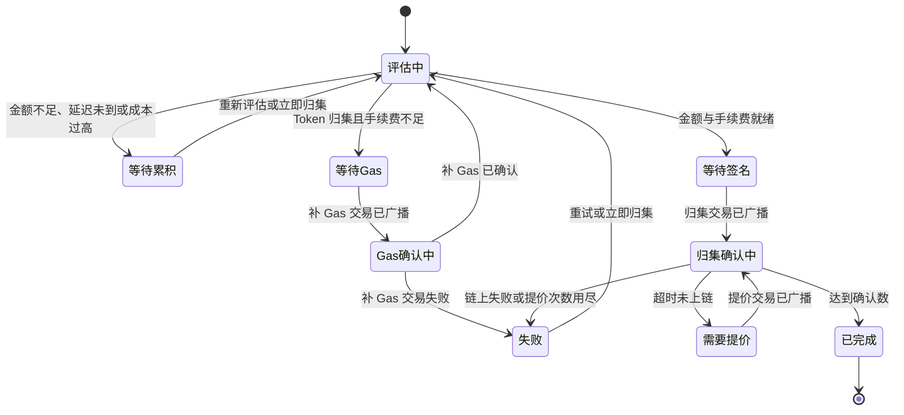

# 5.17 · 链上资产归集

## 1. 用途

超级管理员配置平台链上钱包和自动归集策略,并监控玩家入金地址上的资产转入平台归集钱包的全过程。

玩家入金到账后,资产仍留在玩家专属地址上。系统按策略自动判断是否值得归集,Token 归集缺手续费时从 Gas Station 补原生币,再把资产转入归集钱包。**归集只移动链上资产,不改变玩家余额,归集失败不影响已入账金额。**

本页只支持 EVM 链和平台 HD 钱包池派生的入金地址。本页不提供手填目标地址、手填金额、任意合约调用,也不提供归集钱包到资金库的调拨。隔离钱包和资金库可以登记,当前没有自动流转。

后台桌面端使用,界面简体中文,时间按操作人浏览器时区展示。页面每 30 秒自动刷新。策略金额按资产数量填写,Gas 相关金额按链原生币填写,提现热钱包限额按 USD 填写。

设计背景见 [Gas Station 与自动归集方案](../5.14-Crypto入金/Gas-Station与自动归集方案.md),当前规则以本页为准。

## 2. 查询与处理信息

页面顶部统计生效平台钱包数、活跃归集任务数(未完成)、失败任务数和异常余额同步数(失败、过期、暂停),统计范围是下方列表已加载的记录。下方分六个标签页,不分页、没有筛选,显示范围见各小节。

### 平台钱包

列表显示全部钱包版本:钱包名称和版本、链、角色、地址、托管方式、运行状态、限额、创建时间、操作。

| 新增时填写 | 含义和规则 |
|---|---|
| 链网络 | 必选,只能选已启用的 EVM 链 |
| 钱包角色 | 必选,默认归集钱包。可选归集钱包、Gas Station、提现热钱包、隔离钱包、资金库 |
| 钱包名称 | 必填,最多 100 字符 |
| KMS 密钥 | Gas Station 和提现热钱包必填,地址由密钥公钥自动推导,不能手填 |
| 托管方式 | 其他角色必选,外部钱包(默认)/ 多签钱包 / HD 钱包池 |
| 钱包地址 | 其他角色必填,0x 开头的 40 位十六进制地址 |
| 单笔上限、每日上限 | 选填,非负数,每日上限不能小于单笔上限。Gas Station 按原生币、提现热钱包按 USD 校验,其他角色填写后不参与校验 |

钱包运行状态:运行中、停止接收中、已停用。同一条链的同一角色只能有一个运行中的钱包。

### 归集策略

列表显示全部策略版本:资产和链、版本、状态、自动归集、最小金额、高额阈值、Gas 成本比、延迟、日 Gas 预算、归集钱包、操作。

| 新增或修改时填写 | 含义和规则 |
|---|---|
| 链网络、资产网络 | 必选。修改时不可更换 |
| 归集钱包 | 必选,同链运行中的归集钱包 |
| Gas Station | ERC-20 资产必选,同链运行中的 Gas Station;原生币资产不选 |
| 启用后自动归集 | 开关,默认开启。关闭后本策略不创建新任务 |
| 最小归集金额 | 必填,非负数,默认 0。低于此金额继续等待 |
| 高价值立即归集阈值 | 选填,不能低于最小归集金额。达到后跳过普通延迟,仍做成本判断 |
| 最高 Gas 成本比例 | 必填,大于 0,最多 8 位小数,默认 0.005(即 0.5%) |
| 普通归集延迟(秒) | 必填,0 至 86400,默认 600 |
| 单次补 Gas 上限 | 选填,非负数。留空表示不限 |
| 每日 Gas 预算 | 选填,非负数,按 UTC 自然日统计。留空表示不限 |
| 确认数 | 必填,1 至 10000,默认 6。补 Gas 交易和归集交易都按此判断确认 |

以下参数页面不提供修改,新建时取系统默认,修改策略时沿用原值:重新评估间隔 6 小时,Gas 预留比例 1.2,原生币预留 0,交易未上链超时 600 秒,提价幅度 12.5%,提价替换最多 3 次。

### 链上余额

显示最近 500 条同步记录,异常优先:钱包或地址、链、资产、链上余额、已预留、在途转出、同步状态、异常原因、同步尝试、成功观测区块、最后成功时间。

平台钱包(运行中、停止接收中)每分钟同步,Gas Station 只同步原生币;玩家入金地址超过 5 分钟未更新时补同步。余额超过 5 分钟未成功更新显示数据过期,保留最后成功值。从未成功时显示“未知（尚未成功同步）”,不当作 0。同步失败按 2、4、8、15 分钟退避重试。

同步状态:待处理、正常、失败、数据过期、配置无效已暂停。

### 归集任务

显示最近 200 条:任务、入金地址、资产、状态、计划金额、重试次数、异常、创建时间、操作。

### Gas 补充

显示最近 200 条:记录编号、Gas Station、目标地址、请求数量、实际数量、状态、异常、错误详情、创建时间。状态:待处理、签名中、确认中、已完成、失败、已取消。

### 链上交易

显示最近 200 条:逻辑交易、用途(补 Gas、归集、提现出款)、链、发送地址、接收地址、Nonce、状态、最新交易哈希、尝试次数、创建时间。

## 3. 处理规则

### 平台钱包

**新增**:新钱包默认停用,版本号在同链同角色内递增。钱包不能修改和删除,要换地址就新增一个新版本。

**启用**:链须可用。Gas Station 和提现热钱包启用时重新核对 KMS 密钥与地址。若同链同角色已有运行中的钱包,旧钱包转为“停止接收中”,引用旧钱包的运行中策略自动停用,需要运营用新钱包重建或修改策略后手动启用。停止接收中的钱包继续完成已有任务。

**停用**:钱包还有未完成的归集任务、补 Gas 或提现出款时拒绝停用。停用成功后,引用它的运行中策略自动停用。

### 归集策略

**新增和修改**:都生成一条新版本,默认停用,需要手动启用。修改不影响正在运行的旧版本,启用新版本前旧版本继续生效。

**启用**:归集钱包和 Gas Station 须仍在运行中。同链同资产原来运行中的策略自动停用,一条资产网络只有一个运行中策略。

**停用**:不再创建新任务,已创建的任务继续按原策略版本执行。

### 自动创建任务

系统每 15 秒扫描一次入金记录,以下条件全部满足时创建任务:

1. 入金已入账,风控结果为通过,入金地址属于平台钱包池
2. 该链该资产有运行中的策略,且开启了自动归集
3. 归集钱包运行中;ERC-20 资产的 Gas Station 也运行中

同一地址的同一资产同时只有一个未结束任务。任务未算出计划金额前,后续入金并入该任务;已算出计划金额后,新入金等当前任务完成再建新任务。

### 评估与执行

系统每分钟处理到期任务,流程如下:

1. **算金额**:读取实时链上余额,可归集金额取“本任务已通过风控的入金合计”与链上余额中较小者,不会转走未入账资产
2. **看门槛**:金额为 0 或低于最小归集金额,等待累积,按重新评估间隔再看
3. **看延迟**:未达到高价值阈值时,任务创建满普通归集延迟后才继续
4. **算成本**:Gas 价值占归集金额的比例超过最高 Gas 成本比例时等待累积。币种汇率缺失时同样等待
5. **补 Gas**:ERC-20 地址的原生币不足时,按缺口向 Gas Station 申请补充;到账确认后重新评估,再发起归集
6. **发归集**:ERC-20 转出全部可归集金额;原生币转出“可归集金额减手续费减预留”,不够时等待累积
7. **确认**:交易达到确认数算完成。ERC-20 还要核对转账事件的发送方、接收方和金额,不一致算失败
8. **提价**:交易超时未上链时用同一 Nonce 提价替换,用尽替换次数算失败

### 人工操作

| 操作 | 可用状态 | 规则 |
|---|---|---|
| 重试 | 失败 | 回到评估中,重新走全部门槛 |
| 立即归集 | 等待累积、失败 | 需要确认。跳过最小金额、普通延迟和 Gas 成本比例,系统仍重新读取链上余额;单次补 Gas 上限和每日预算继续生效。金额为 0 时回到等待累积 |

人工操作不能修改目标地址、金额和交易内容。重试和立即归集都生成一次新的执行序号。

### 重复与结果未知

- 每笔链上动作绑定任务和执行序号,同一序号重复处理返回原交易,不重复转账
- 同一发送地址的 Nonce 由系统独占分配,两个任务不会使用同一 Nonce
- 广播结果未知时任务停留在等待签名或确认中,系统用原交易继续查询和重发,不生成新交易
- 多个处理进程同时运行时按任务加锁,一个任务同一时间只被一个进程处理
- 签名前再次校验目标钱包角色、地址快照、金额和交易内容,不一致拒绝签名

### 留痕

钱包新增、启用、停用,策略新增、修改、启用、停用,任务重试和立即归集都写入操作日志。

## 4. 特殊情况

| 情况 | 如何处理 |
|---|---|
| 缺风控结果、风控拒绝或入金未到账 | 不创建任务,不补 Gas |
| 没有运行中的策略或自动归集关闭 | 不创建任务。条件恢复后,此前未归集的入金由下一次扫描补建任务 |
| 策略运行中但归集钱包或 Gas Station 不可用 | 不创建任务 |
| 评估中出现 RPC 故障、补 Gas 超限或超每日预算 | 任务状态不变,异常显示 `evaluation_failed`,重试次数加一,60 秒后自动再试,不进入失败 |
| 币种汇率缺失 | 判定成本过高,异常显示 `gas_cost_too_high`,任务等待累积 |
| 原生币余额付不起手续费和预留 | 异常显示 `native_balance_cannot_cover_gas`,任务等待累积 |
| 金额低于门槛 | 异常显示 `below_minimum`,任务等待累积 |
| 补 Gas 或归集交易链上执行失败 | 任务进入失败,异常显示 `chain_execution_reverted`,等人工重试 |
| ERC-20 转账事件不符 | 任务进入失败,异常显示 `sweep_transfer_log_mismatch` |
| 提价次数用尽 | 任务进入失败,异常显示 `replacement_attempts_exhausted` |
| 任务失败未处理 | 任务继续占用该地址该资产,新入金不建新任务,直到人工处理并完成 |
| 补 Gas 已确认但归集失败 | 已补原生币留在地址上,重试时按实际余额重新计算,余额足够就不再补 |
| 归集钱包切换时已有任务在跑 | 已有任务继续转入原钱包,原钱包“停止接收中”时仍可完成 |
| 失败任务的目标钱包已被停用 | 重试后签名被拒,任务持续显示 `evaluation_failed`,须先重新启用该钱包 |
| 链被停用 | 无法新增或启用钱包,未完成任务签名失败后按评估失败重试 |
| 非失败任务点击重试,或非等待累积、失败的任务点击立即归集 | 拒绝,任务不变 |
| 钱包服务未配置或不可用 | 新增、启用 KMS 钱包时提示对应错误,不写入 |
| 页面数据加载失败 | 顶部提示“归集数据加载失败”,可重试 |

## 5. 验收场景

| 需求编号 | 场景与操作 | 预期结果 |
|---|---|---|
| 5.17-R1 | 新增归集钱包,填写地址 | 钱包状态为已停用,需手动启用 |
| 5.17-R2 | 新增 Gas Station,填写有效 KMS 密钥 | 地址自动推导并显示,不可手填 |
| 5.17-R2 | KMS 密钥格式错误或钱包服务拒绝 | 提示错误,不创建钱包 |
| 5.17-R3 | 同链已有运行中的归集钱包,启用新版本 | 新钱包运行中,旧钱包停止接收中,引用旧钱包的运行中策略被停用 |
| 5.17-R4 | 钱包有未完成任务时点击停用 | 提示“钱包仍有未完成的链上操作，暂时不能停用”,状态不变 |
| 5.17-R5 | ERC-20 策略未选 Gas Station | 提示须选择同链已启用的 Gas Station,不创建 |
| 5.17-R5 | 高价值阈值低于最小归集金额 | 提示阈值不能低于最小归集金额,不创建 |
| 5.17-R6 | 修改运行中的策略 | 生成新版本且为停用,旧版本继续运行 |
| 5.17-R7 | 启用新版本 | 新版本运行中,同链同资产旧版本自动停用 |
| 5.17-R8 | 停用策略 | 不再创建新任务,已有任务继续执行 |
| 5.17-R9 | 风控通过的入金已入账,策略和钱包就绪 | 下一次扫描创建任务,状态评估中 |
| 5.17-R9 | 风控未通过的入金 | 不创建任务 |
| 5.17-R9 | 策略关闭自动归集时的入金,之后开启并启用 | 下一次扫描为该入金补建任务 |
| 5.17-R10 | 同一地址同一资产第二笔入金,第一笔任务尚无计划金额 | 并入同一任务,不新建 |
| 5.17-R11 | 金额低于最小归集金额 | 任务等待累积,异常显示 `below_minimum` |
| 5.17-R11 | 金额达到高价值阈值 | 跳过普通延迟继续评估 |
| 5.17-R12 | ERC-20 地址没有原生币 | 生成补 Gas 记录,确认后再发起归集 |
| 5.17-R12 | 地址原生币足够 | 不补 Gas,直接归集 |
| 5.17-R13 | 所需补 Gas 超过单次上限或每日预算 | 不补 Gas,任务异常 `evaluation_failed`,60 秒后再试 |
| 5.17-R14 | 归集交易达到确认数 | 任务已完成,归集钱包收到资产,玩家余额不变 |
| 5.17-R15 | 交易超时未上链 | 用同一 Nonce 提价替换,同一逻辑交易下尝试次数加一 |
| 5.17-R15 | 提价次数用尽 | 任务失败,异常 `replacement_attempts_exhausted` |
| 5.17-R16 | 对失败任务点击重试 | 任务回到评估中,重试次数加一 |
| 5.17-R17 | 对等待累积的小额任务点击立即归集并确认 | 跳过门槛完成归集;Gas 不足时先补 Gas |
| 5.17-R18 | 同一任务被重复处理,或广播后结果未知 | 只有一笔有效交易,不重复转账 |
| 5.17-R19 | 任务归集失败后查询玩家余额 | 玩家余额和入账记录不变 |
| 5.17-R20 | 非超级管理员账号访问页面 | 菜单不显示,直接访问进入无权限页,接口拒绝 |
| 5.17-R21 | 执行钱包启用或立即归集后查看操作日志 | 能查到操作人和操作内容 |

## 6. 相关资料

- 入口与关联查询:财务管理 > 链上资产归集。入金记录见 [5.14 Crypto入金](../5.14-Crypto入金/README.md),链和资产配置见 [5.15 Crypto配置](../5.15-Crypto配置/README.md),提现出款使用本页配置的提现热钱包,见 [5.1 提现订单](../5.1-提现订单/README.md)。操作记录在[操作日志](../../M6-账号管理/6.3-操作日志/README.md)查询。
- 权限:页面和全部操作仅系统角色(超级管理员)可用,没有独立权限码,不能通过角色授权给其他账号。
- 数据与责任:平台钱包、归集策略、归集任务和链上交易归 M5。入金事实和风控结果来自 5.14,汇率来自 [5.16](../5.16-币种管理/README.md)。私钥不离开钱包服务,页面不展示密钥材料。
- 共用规则:设计背景见 [Gas Station 与自动归集方案](../5.14-Crypto入金/Gas-Station与自动归集方案.md);玩家余额语义见[资金模型](../../M2-用户管理/2.1-用户列表/资金模型.md)。
