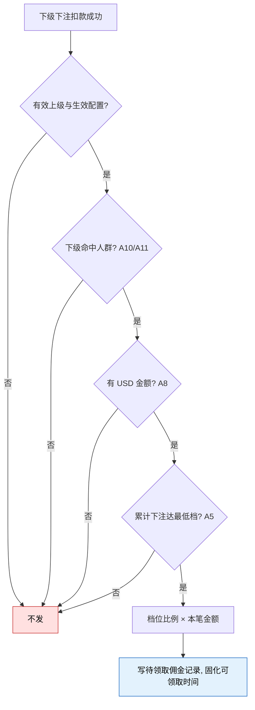
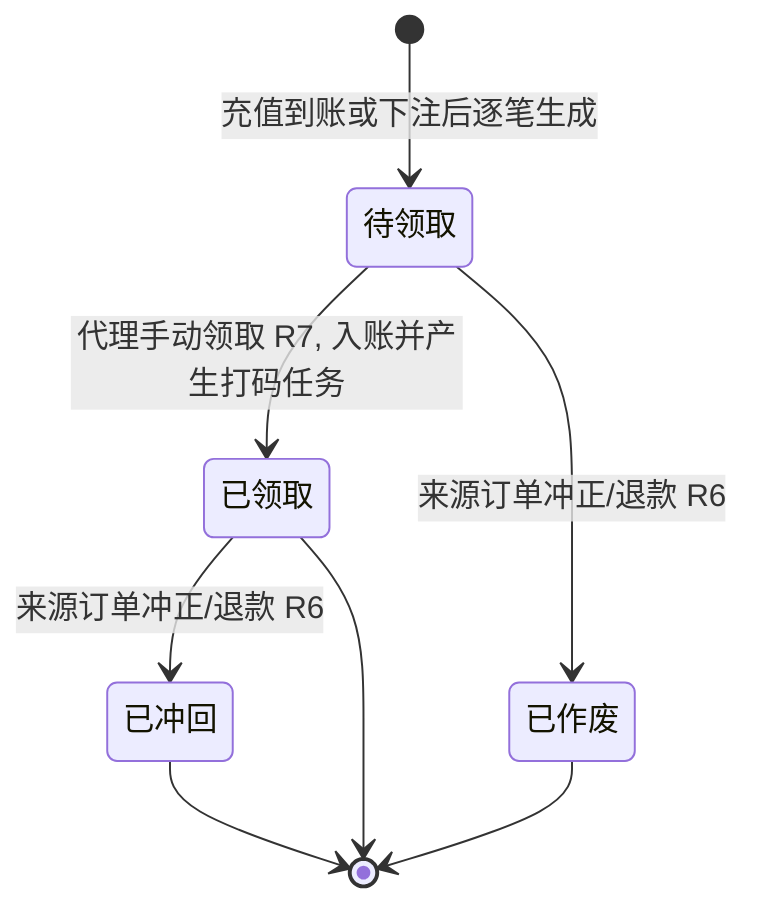

# 7.1 · 代理返佣

## 1. 活动介绍

玩家邀请直属下级获得充值与投注返佣,平台以可控成本换取自增长拉新;
运营按人群与渠道定向开启,调比例保存后立即生效,不用等发版。

### 使用者

| 角色 | 用来做什么 | 没有会怎样 |
|---|---|---|
| 运营 | 配置比例、档位与目标人群 | 规则写死,调比例要发版 |
| 代理(玩家) | 邀请好友赚佣金 | 无裂变激励,拉新全靠买量 |
| 财务 / 风控 | 逐笔核对佣金来源与计算依据 | 佣金算错或被刷,查不出依据 |

拉新成本与下级真实充值投注挂钩;每笔佣金带完整计算依据,可追溯。

### 本次范围

- **不做二级返佣、团队模式、三级分销** —— 枚举预留,首版只开放「仅直属」(A1)
- **不做代理关系绑定本身** —— 前置能力,归 7.3 代理列表(见模块决策 D28),本页只读引用
- **不做投注折算比例** —— 本版按实际下注的 USD 金额计佣(A12)
- **不做佣金提现流程** —— 入账后走钱包统一提现,打码与提现语义归资金模型
- 本页不设计玩家端页面;直属邀请与佣金交互见[Account需求](../../玩家端/Account/README.md#account-r13--邀请与佣金),计算与领取规则仍由本页维护

### 适用范围

| 维度 | 取值 |
|---|---|
| 终端 | Web 后台,桌面优先(设计基准 1440px) |
| 响应式 | 最小支持 1280px;不做移动端适配 |
| 界面语言 | 后台界面简体中文 |
| 时区 | 可领取时间按配置的运营时区计算;后台时间按浏览器本地时区展示 |
| 货币 | 判档与佣金计算按标准计价币种,见 A8 |

## 2. 运营配置

**活动配置字段**

每次保存都生成不可变的新版本,历史佣金仍使用产生时的比例和可领取时间。

| 字段 | 类型 | 必填 | 规则 |
|---|---|---|---|
| 启用返佣 | switch | 是 | 默认关闭;关闭立即停止产生新佣金,已生成的不回收 |
| 配置名称 | text | 是 | 默认「默认代理返佣」,去首尾空格,不能为空 |
| 运营时区 | text | 是 | 时区名称,默认 Asia/Shanghai;可领取时间按此计算(A4) |
| 用户标签 | switch + multiselect | 是 | 默认「所有用户标签」;关闭后至少选 1 个,口径 A10 |
| 开放渠道 | switch + multiselect | 是 | 默认「所有渠道」;关闭后至少选 1 个,口径 A10 |
| 活动模式 | — | — | A1,保存时固定仅直属,页面不展示 |
| 充值返佣比例 | number | 是 | A2 |
| 领取后流水倍数 | number | 是 | A7 |
| 锁定完整天数 | number | 是 | 非负整数,默认 0(A4) |
| 每日开放领取时间 | time | 是 | 00:00:00 至 23:59:59,默认 03:00:00(A4) |
| 投注返佣阶梯 · 累计有效投注门槛 | number | 是 | USD,不小于 0,不可重复(A3) |
| 投注返佣阶梯 · 返佣比例 | number | 是 | 0 ~ 100%(A3) |

### 配置限制与默认值

| 配置或参数 | 填写与执行规则 |
|---|---|
| 活动模式(A1) | 枚举:仅直属 / 直属+二级 / 直属+团队 / 三级分销;**首版只开放仅直属**,其余仅数据结构预留；活动配置 |
| 充值返佣比例(A2) | 0% ~ 100%,页面步进 0.0001%,默认 0；活动配置 |
| 投注返佣档位(A3) | 至少 1 档,档数不设上限;门槛不小于 0 且不可重复,比例 0% ~ 100%;不校验门槛递增与比例非递减;页面初始一档 0 USD / 0%；活动配置 |
| 佣金打码倍数(A7) | 不小于 0,不设上限,0 = 无要求,默认 0;**领取入账时**按记录快照的倍数产生打码任务,语义见 `资金模型.md`；活动配置 |
| 人群限定口径(A10) | 用户标签多选取**并集**,开放渠道多选取**并集**,两维度之间取**交集**;「所有」= 不限(含无标签、无渠道玩家);**限定对象是产生充值或投注的下级玩家**,不限定代理本人;标签只认启用中标签的当前命中；活动配置 |

## 3. 参与和领奖规则

### 结算周期与领取开放(A4)

两类佣金均逐笔生成待领取记录,生成时固化可领取时间:从产生时间加「锁定完整天数」,取此后最近的一次「每日开放领取时间」(按运营时区)。

示例:锁定 0 天、03:00 开放,02:00 产生的佣金当天 03:00 可领,20:00 产生的佣金次日 03:00 可领;锁定 1 天、03:00 开放,20:00 产生的佣金隔日 03:00 可领。

配置或来源：活动配置;之后修改配置不影响已生成记录。

### 判档口径(A5)

判档按**产生这笔投注的下级本人**累计下注金额(含本笔),按档位顺序取最后一个达到门槛的档位;发放基数为**本笔下注金额**,按命中档位全额单一比例,**非分段累进**。

配置或来源：D25。

### 充值返佣发放时机(A6)

充值到账时逐笔计算生成待领取记录,**不实时入账**,按 A4 到时开放领取。

### 金额口径(A8)

判档与计算一律按标准计价币种 USD;本笔没有 USD 换算结果时不生成佣金,不按原币硬算,之后补算也不补发。

### 佣金入账币种(A9)

以标准计价币种 USD 入账至代理 USD 钱包的彩金余额;钱包未开设时领取时自动开设,钱包已关闭时拒绝领取。

配置或来源：D26。

### 资格判定时点(A11)

每次计算按**当时**标签命中与渠道归属判定;不符合即不发,恢复后**不补发**。

### 有效投注折算(A12)

本版不提供游戏折算比例,投注基数为本笔下注的 USD 标准金额。只有平台原创游戏(Crash、Roulette、Dice、Mines、Plinko、Blackjack、Limbo、Baccarat)的下注计佣,其余玩法(含第三方游戏)不产生投注返佣。下注扣款成功即计佣,不等输赢结果。

配置或来源：系统规则。

### 领取机制(A14)

佣金一律由代理**手动领取**(R7),领取时入账并按 A7 产生打码任务;待领取佣金**不过期**。

> A1 的模式枚举含「三级分销」,依据是需求原稿所附的旧后台截图:
> `截图/弹窗-活动模式-下拉展开.png`(修改活动模式弹窗,模式下拉展开态)。

### 充值返佣计算(7.1-R4)

支付充值订单或链上入金成功到账(owner=财务,只读);人工生成的充值单不产生充值返佣。

输入信息：到账金额与换算结果 · 该玩家的上级(代理关系,只读)· 当时生效的配置版本 ·
该玩家的标签命中与渠道归属。

1. 无上级或关系已解除则结束;没有已启用且已生效的配置版本则结束
2. 按 A10/A11 判该玩家资格,不符合则不发;按 A13 排除
3. 取标准计价换算结果(A8);没有结果则不生成
4. 佣金 = 换算金额 × 充值返佣比例(比例与打码倍数一并快照)
5. 写**待领取**佣金记录:来源单据、比例与倍数快照、换算依据;按 A4 固化可领取时间
6. 同一订单**只生成一次**;入账发生在领取时(R7),本步不动钱包

### 投注返佣逐笔生成(7.1-R5)

下级在平台原创游戏下注扣款成功后由系统逐笔处理,无手工触发界面。

输入信息：下级本笔下注的 USD 金额(A8/A12)· 下级累计下注金额 · 当时生效的配置版本。

1. 无上级或关系已解除、无生效配置版本、不符合 A10/A11 时结束;按 A13 排除
2. 取本笔下注的 USD 金额;没有结果则结束(A8)
3. 按下级本人累计下注判档(A5),未达最低档不发不写记录
4. 佣金 = 本笔金额 × 档位比例(比例与倍数快照);写**待领取**记录,按 A4 固化可领取时间
5. 同一注单**只生成一次**
6. 活动关闭后新下注不再计佣;已生成的待领取佣金不受关闭影响

> 配色:红色为不发分支,蓝色为写入步骤;本流程不动钱包,入账发生在领取(R7)。

### 佣金领取入账(7.1-R7)

代理在玩家端发起领取,一次领取名下全部已到可领取时间的待领取记录,不提供单条领取;[Account本期界面](../../玩家端/Account/README.md#account-r13--邀请与佣金)的领取规则以本段为准。

输入信息：待领取佣金记录(含比例与打码倍数快照)· 本次领取请求的幂等键。

1. 取该代理状态为**待领取**且已到可领取时间(A4)的全部记录;没有则拒绝
2. 入账:账变带**来源标识**(资金域不与活动建立关联,00-公共约定铁律),金额入 USD 彩金余额(A9)
3. 按记录快照的打码倍数产生打码任务(A7):一次领取合并为一个任务,要求 = 各记录金额 × 各自倍数之和;倍数以**生成时快照**为准,领取时改配置不影响;要求为 0 时不产生任务
4. 状态流转待领取 → 已领取,写流水;累计已领取佣金同步增加
5. 同一幂等键重复领取只入账一次并返回原结果

### 业务流程

> 待领取不过期(A14)。佣金记录不含「打码中 / 可提现」状态 —— 打码进度归打码任务(`资金模型.md`),不重复承载。
> 记录页另有计算挂起、旧版已结算、旧版已取消三个状态文案,新佣金不会进入。

## 4. 特殊情况

### 排除项(A13)

测试账号、自我邀请、风控标记账号的充值与投注不计入;刷佣判定规则归风控(**范围外**)。

### 边界处理

| # | 场景 | 触发条件 | 预期处理 |
|---|---|---|---|
| E1 | 越权 | 无权限账号提交操作 | 服务端拒绝;隐藏按钮不作为唯一防线 |
| E2 | 并发编辑 | 两人基于同一版本改配置 | 不做版本校验,各自生成新版本,后保存的版本生效 |
| E3 | 冲正与回滚 | 充值冲正 / 结算后注单回滚 | 未领取作废、已领取按 R6 冲回;注单回滚不追溯,超阈值告警人工核查 |
| E4 | 关系变更请求 | 玩家要求更换上级 / 关系被解除 | 代理关系以邀请码绑定且**不可换绑**(D28),换绑请求一律拒绝;关系解除后不再计入原上级,已发与待领取佣金不回收不作废 |
| E5 | 代理被封禁 | 上级处于封禁状态 | 封禁期间不参与计算,解封不补发(同 A11) |
| E6 | 中途关闭 | 活动关闭 | 关闭后新充值与新下注不再产生佣金;已生成记录不受影响 |
| E7 | 换算缺失 | 标准计价未补算 | 不生成佣金,不按原币硬算,补算后不补发(A8) |
| E8 | 折算修改 | 高RTP折算比例调整 | 本版不提供折算比例(A12) |
| E9 | 领取竞态 | 领取与来源冲正同时发生 | 以先完成的状态流转为准:已作废不可再领取,已领取则转入冲回;不得出现双重状态 |
| E10 | 关闭后遗留 | 活动关闭时仍有待领取佣金 | 仍可领取,已产生权益不没收(A14);后台记录可查 |
| E11 | 改配置 | 记录生成后修改比例、倍数或领取时间 | 已生成记录不变,只影响之后新产生的佣金 |

### 充值返佣计算遇到异常时(7.1-R4)

| 错误状况 | 处理 |
|---|---|
| 资格不符 | 不发,不留跳过原因 |
| 换算缺失 | 不生成,不按原币硬算 |
| 重复触发 | 幂等,只生成一次 |

### 投注返佣逐笔生成遇到异常时(7.1-R5)

| 错误状况 | 处理 |
|---|---|
| 未达最低档 | 不发不写记录 |
| 重复触发 | 幂等,只生成一次 |

### 佣金领取入账遇到异常时(7.1-R7)

| 错误状况 | 处理 |
|---|---|
| 没有已到可领取时间的记录 | 拒绝,提示当前没有可领取佣金 |
| 幂等键为空或已被其他用户使用 | 拒绝 |
| USD 钱包已关闭 | 拒绝,提示钱包已关闭 |
| 重复领取 | 幂等,只入账一次 |
| 领取时记录状态已变化 | 整笔回滚,提示刷新后重试 |
| 入账失败 | 整笔回滚,记录保持待领取,可重试 |

### 页面状态

四态按全局默认。本页特有态:

| 状态 | 表现 |
|---|---|
| 尚未创建配置 | 版本提示显示尚未创建,表单带初始值,保存后生成首个版本 |
| 活动已关闭 | 配置仍可编辑,打开开关保存后生成新版本恢复计佣;历史记录可查 |

## 5. 验收场景

| 需求编号 | 场景与操作 | 预期结果 |
|---|---|---|
| 7.1-R1 | 查看活动配置：进入页面 | 展示全部配置、启停状态与当前版本号 |
| 7.1-R2 | 编辑活动配置：修改并保存 | 按 A2、A3、A7、A10 校验;生成新版本立即生效,只对之后的计算生效,**不追溯**;版本留存操作人 |
| 7.1-R3 | 启停活动：切换开关并保存 | 关闭即停止新佣金;历史记录保留可查 |
| 7.1-R4 | 充值返佣计算：直属下级充值到账 | 按 A6 逐笔计算生成**待领取**记录;同一订单幂等只生成一次 |
| 7.1-R5 | 投注返佣逐笔生成：下级在原创游戏下注 | 按 A5 下级本人累计判档、本笔金额计算,生成**待领取**记录;同一注单幂等只生成一次 |
| 7.1-R6 | 佣金冲回：来源充值冲正/退款 | 未领取的记录直接**作废**;已领取的自动冲回**以钱包余额为上限**(不产生负余额),未耗打码任务核销;差额只在冲回留痕中记录并告警,**首版不做挂账台账与系统内追偿**,线下人工处理(D27 已定,有意省略勿补)。投注返佣结算后的注单回滚**不追溯**,超阈值告警 |
| 7.1-R7 | 佣金领取入账：代理在玩家端发起领取 | 领取全部已到可领取时间的记录(A4/A14);入账带来源标识 + 按 A7 产生打码任务;重复领取幂等 |

### 充值返佣计算(7.1-R4)

- 正向:下级充值换算 100 USD,比例 5% → 生成 5 USD 待领取记录,按 A4 到时可领取
- 逆向:限定渠道时下级不属所选渠道 → 不发
- 逆向:人工生成的充值单到账 → 不发

### 投注返佣逐笔生成(7.1-R5)

- 正向:下级本人累计下注 6000 USD、本笔 800 USD,示例档位 ≥5000 为 2.5% → 佣金 20 USD,按 A4 到时可领取
- 逆向:下级在第三方游戏下注 → 不产生投注返佣

### 佣金领取入账(7.1-R7)

- 正向:到可领取时间后领取 5 USD(倍数快照 3)→ USD 彩金余额增加 5,打码任务 15 USD,状态已领取
- 正向:有两条已到时、一条未到时 → 领取两条,未到时的保持待领取
- 逆向:没有已到可领取时间的记录 → 拒绝,提示当前没有可领取佣金

## 6. 相关资料

### 入口与关联页面

- 菜单:代理管理 → 代理配置
- 跳入:仅从菜单进入

- 跳出:7.2 佣金记录 · 7.3 代理列表 · 2.5 用户标签 · 2.2 钱包流水

### 权限

| 操作 | 权限或执行方 |
|---|---|
| 查看活动配置(7.1-R1) | `agent:config:view` |
| 编辑活动配置(7.1-R2) | `agent:config:edit` |
| 启停活动(7.1-R3) | `agent:config:edit` |
| 充值返佣计算(7.1-R4) | 系统触发,无界面权限 |
| 投注返佣逐笔生成(7.1-R5) | 系统触发,无界面权限 |
| 佣金冲回(7.1-R6) | 系统触发,无界面权限 |
| 佣金领取入账(7.1-R7) | 系统触发,无界面权限 |

### 术语与共用口径

> 通用词(代理关系、直属下级、一级代理)见 `../README.md` 第 2 段;
> 打码任务、有效投注的资金语义见 `../../M2-用户管理/2.1-用户列表/资金模型.md`,不重复定义。

| 术语 | 定义 |
|---|---|
| 充值返佣 | 直属下级每笔成功到账充值,按比例逐笔给上级的佣金 |
| 投注返佣 | 按下级本人累计下注判档、按本笔下注金额逐笔给上级的佣金 |
| 有效投注 | 本页指下注的 USD 标准金额(A12),不做游戏折算 |
| 佣金打码 | 佣金入账产生的打码任务倍数,完成前不可提现 |
| 配置快照 | 每笔佣金固化的配置版本、比例、倍数与可领取时间,事后改配置不影响已算佣金 |
| 领取 | 代理在玩家端把待领取佣金转入钱包的动作;入账并按快照倍数产生打码任务 |

### 依赖与数据流

**数据流向**:运营保存配置生成新版本 → 充值到账触发 R4 / 下级下注触发 R5 →
读代理关系、标签命中、渠道、换算记录 → 计算并生成**待领取**佣金记录 →
代理到可领取时间后在玩家端领取(R7)→ 钱包入账(带来源标识)+ 打码任务 →
佣金记录页(7.2)与玩家端读取状态。

**系统串接**:代理关系(owner=M7,规则见 7.3)· 充值订单、钱包、打码任务、换算记录(owner=财务)·
注单与下注金额(owner=玩法,**范围外**)·
标签命中集(owner=M2)· 渠道(owner=M7,见 7.4)。

- 对钱包**只发起入账与冲回请求**,不直接改余额;资金域不反向依赖活动域
- 领取由玩家端(**范围外**)发起,但校验、入账与状态流转全部在服务端;玩家端不判定资格
- 标签只读当前命中集,不反向写入;标签删除预检须能查到本活动引用
- 换算记录只读;其口径变化直接改变佣金结果,改动须与本页同步评审

### 数据归属与职责

**数据归属**

- **拥有**(owner=M7):活动配置及历史版本 · 档位表 · 佣金记录
- **只读**:代理关系(owner=M7,规则见 7.3)· 充值订单、钱包、打码任务、换算记录(owner=财务)·
  注单与下注金额(owner=玩法,**范围外**)·
  标签命中集(owner=M2)· 渠道(owner=M7,见 7.4)

> **佣金记录是审计数据**:计算依据(比例快照、换算依据、档位、来源单据)入账后不可改;
> 状态流转每次写流水;配置每次保存留一个不可变版本。

**前后端职责**

| 事项 | 归属 |
|---|---|
| 权限判定 · 配置校验 · 资格判定与计算 · 入账冲回与幂等续跑 | **服务端** |
| 档位行增删、字段范围即时校验 | 界面 |

### 充值返佣计算的职责(7.1-R4)

| 归属 | 做什么 |
|---|---|
| 界面 | 无(系统需求);结果呈现在佣金记录 |
| 服务端 | 资格判定、计算、写记录,保证幂等 |

### 投注返佣逐笔生成的职责(7.1-R5)

| 归属 | 做什么 |
|---|---|
| 界面 | 无(系统需求);结果呈现在佣金记录 |
| 服务端 | 资格判定、判档、写记录,保证幂等 |

### 佣金领取入账的职责(7.1-R7)

| 归属 | 做什么 |
|---|---|
| 界面 | 无(玩家端行为);后台在佣金记录中呈现领取状态与时间 |
| 服务端 | 状态与时点校验、入账、打码任务、状态流转,保证幂等 |
