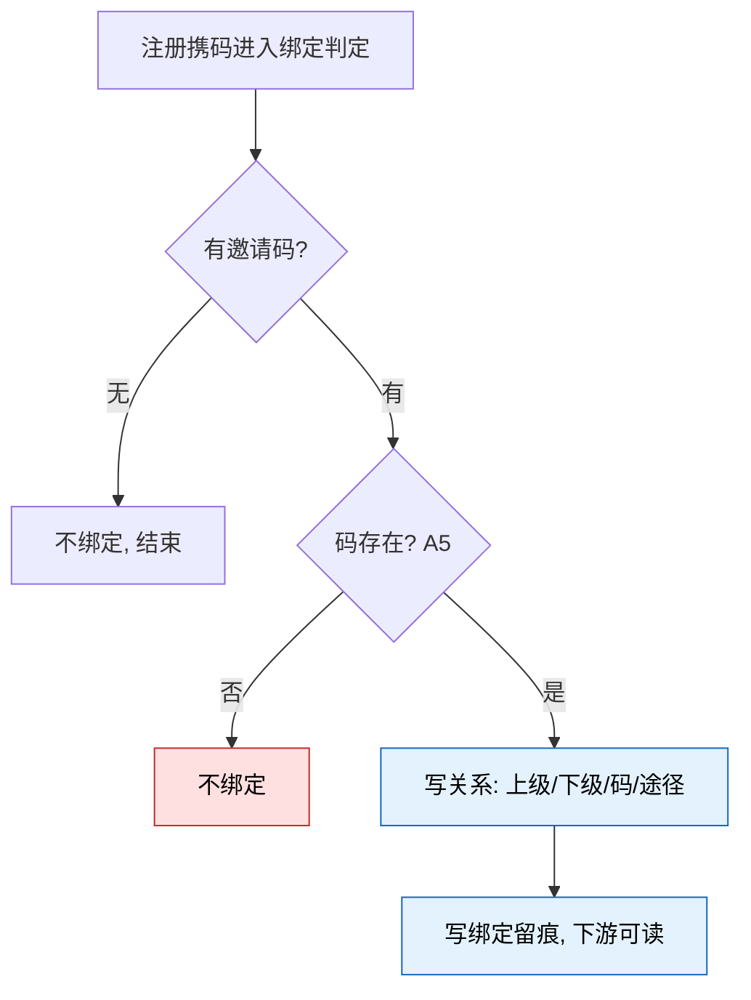

# 7.3 · 代理列表

## 1. 用途

定清玩家之间的邀请绑定规则,并让运营与客服查得到「谁邀请了谁、下级贡献了多少」——
它是代理返佣的计算地基,关系不清,佣金争议就无法查证。

### 使用者

| 角色 | 用来做什么 | 没有会怎样 |
|---|---|---|
| 运营 | 看代理结构与产出,评估返佣活动效果 | 只看得到佣金总数,不知道钱发给了什么样的代理 |
| 客服 | 处理「我下级充值了为什么没佣金」 | 查不到绑定关系与贡献明细,只能升级工单 |
| 风控 | 识别自邀、互刷的账号结构 | 刷佣结构靠人工猜 |

绑定规则一次定清,返佣、玩家端邀请页、风控共用同一事实;
客服凭邀请用户与佣金记录自助答复佣金争议,不再升级。

### 本次范围

- 提供代理列表与代理详情的查询(R1、R2),以及绑定与邀请码的后台逻辑(R3、R5);4.16 邀请宝箱另需 R6、4.17 拼多多活动另需 R7 的只读关系事实输出
- **不做换绑** —— 绑定终身有效(D28 已定)
- **本版不提供人工解除入口**(R4)
- **不做补填** —— 仅注册时绑定,注册后不能再认上级(A3)
- 不做多码与活动码 —— 每人一个固定邀请码(A1)
- 不做玩家端邀请页本身 —— 规则以本页为准,玩家端照此实现
- 不做佣金计算与发放 —— 归 7.1,本页只读聚合展示

### 适用范围

| 维度 | 取值 |
|---|---|
| 终端 | Web 后台,桌面优先(设计基准 1440px) |
| 响应式 | 最小支持 1280px;不做移动端适配 |
| 界面语言 | 后台界面简体中文 |
| 时区 | 时间按浏览器本地时区展示 |
| 货币 | 金额列按标准计价币种展示,见 A8 |

## 2. 查询与处理信息

**筛选字段**

| 字段 | 类型 | 可输入数据与校验 |
|---|---|---|
| 用户 ID | text | 代理的玩家账号标识,精确匹配 |
| 推广码 | text | 模糊匹配 |

本版不提供按上级、渠道来源、绑定时间、有无下级筛选。

**表格列**

列表只包含已生成邀请码的玩家,按创建时间倒序。

| 列 | 说明 | 默认显示 |
|---|---|---|
| 会员 | 用户名,点击打开用户详情 | 是 |
| 用户名称 | 无内容显示 - | 是 |
| 推广码 | 即邀请码,可复制 | 是 |
| 等级 | 代理等级,默认 1,不参与 7.1 计佣 | 是 |
| 邀请人数 | 直属下级数,含已解除关系 | 是 |
| 累计已领取佣金 | USD(A8) | 是 |
| 待领取佣金 | 待领取状态记录之和,含未到可领取时间的部分,USD(A8) | 是 |
| 操作 | 详情:打开用户详情的代理页签 | 是 |

**代理详情**

用户详情的代理页签展示推广码、邀请人数,以及「邀请用户」「佣金记录」两个子页签;只有已生成邀请码的玩家才有此页签。

**邀请用户**(下级清单,可按用户 ID 筛选,按创建时间倒序)

| 列 | 说明 |
|---|---|
| 会员 | 下级用户名,点击打开用户详情 |
| 邮箱 | 下级邮箱 |
| 注册 IP | 无记录显示 - |
| 设备码 | 无记录显示 - |
| 充值次数 / 充值金额 | 金额 USD(A8) |
| 提现金额 | USD(A8) |
| 投注次数 / 投注金额 | 金额 USD(A8) |
| 佣金金额 | 下级维度的历史累计值;领取入账不累加到本列,核对佣金以佣金记录为准 |
| 邀请时间 | 关系建立时间 |
| 注册时间 | 下级注册时间 |

本版不展示关系状态,已解除的下级与有效下级同样列出。

**佣金记录**(可按推荐人筛选)

| 列 | 说明 |
|---|---|
| 推荐人 | 产生这笔佣金的下级 |
| 类型 | 下注 / 充值 |
| 佣金金额 | USD(A8) |
| 返佣比例 | 生成时快照 |
| 产生时间 / 可领取时间 | 可领取时间生成时固化(7.1-A4) |
| 状态 | 口径见 7.1 |
| 创建时间 | 记录创建时间 |

### 配置限制与默认值

| 配置或参数 | 填写与执行规则 |
|---|---|
| 每页条数(A7) | 默认 20 条/页;界面可切换 20 / 50 / 100 |
| 金额列口径(A8) | 一律按标准计价币种 USD 展示,口径同 7.1-A8,见 `标准计价.md` |

## 3. 处理规则

### 邀请码形态(A1)

每玩家一个**固定个人码**,玩家登录后首次读取代理信息(侧边栏或邀请页)时自动生成,8 位大写字母与数字,去除 0、O、1、I 等易混字符,全局唯一、终身不变;不可自定义、不可多码。

配置或来源：(最简方案,D28)。

### 绑定途径(A2)

新玩家端首次落地时由邀请链接带码，自动创建游客账号时完成绑定；游客注册正式账号时不提供手输或改码，新UID读取本浏览器首次落地保存的邀请码；已建号后访问其他邀请链接不补绑。游客建号的来源记「链接」，正式注册接口的来源记「手输」；手输来源不作为新游客流程入口。

配置或来源：(最简方案,D28)。

### 绑定时点(A3)

**仅注册时**绑定,注册后不可补填;上级必然先于下级注册,循环绑定天然不可能;存量玩家不追溯补绑。

配置或来源：(最简方案,D28)。

### 换绑与解除(A4)

不可换绑(D28 已定);关系解除后该下级不再计入原上级且**不可重绑**任何上级。本版后台不提供解除入口(R4)。

配置或来源：D28。

### 注册绑定关系(7.3-R3)

新玩家首次落地自动创建游客账号，来源携带邀请码(链接带入,A2)；无码则不进入绑定。游客在登录弹窗内注册正式账号是另一次注册，新UID按首次落地保存的邀请码建立关系，游客号的关系不变。

输入信息：邀请码 · 新玩家注册信息(owner=M2,只读)。

1. 注册流程携码进入绑定判定;无码直接结束,玩家无上级
2. 校验码存在(A5);不存在则不绑定
3. 校验非自我绑定 —— A3 下天然不可能(属主必已存在、新玩家尚无码),服务端仍兜底校验
4. 写关系:上级、下级、邀请码、绑定时间、来源途径(链接 / 手输),终身有效;绑定时间取玩家注册时间,同时写绑定流水
5. 同一玩家注册重复提交,幂等只产生一条关系
6. 无码或码无效不影响注册结果(A5);关系与账号初始化同事务写入,写入异常时本次注册初始化失败,提示联系客服

> 配色:红色为不绑定分支,不单独留痕,
> 蓝色为写入与留痕步骤。无码与无效码都不阻断注册(A5)。

### 人工解除关系(7.3-R4)

本版不提供。代理列表、用户详情都没有解除入口,权限目录也没有对应节点。

关系保留「有效 / 已解除」两种状态:7.1 只对有效关系计佣,解除后该下级不可再绑定任何上级,关系记录不删除。

### 邀请宝箱读取关系事实(7.3-R6)

[4.16 邀请宝箱](../../M4-活动管理/4.16-邀请宝箱/README.md)按直属关系接纳新下级并认定有效人数,
M7 为其提供同一运营方内稳定且唯一的关系标识、上下级、注册绑定业务时点、当前关系状态以及解除业务时点与原因。
重复投递或补发保持原标识和原业务时点,不能按接收时间伪造新的绑定或解除。

- M4 消费失败不影响注册、绑定或解除结果;恢复后按原时点补处理,并以关系标识去重,不产生重复下级或奖励。关系读取失败与确实无绑定必须区分,失败可恢复,不静默认作无上级。
- 解除前已被活动认定为有效的下级,其有效人数及已解锁奖励保留;解除前仍未满足条件的下级停止继续达标。若达标事实发生在解除前而通知迟到,M4 使用原业务时点及其资格依据恢复判断;解除时点起的新达标不算入原上级。
- 活动不写关系、不补绑或换绑,不把资格不符改成关系解除。设备去重和活动有效人数不改变本页的直属下级数,也不改变 7.1 的返佣计算。
- 此处只提供事实读取与恢复依据,不新增人工解除界面或活动侧解除入口;原 R4 界面范围保持不变。

### 拼多多活动读取关系事实(7.3-R7)

[4.17 拼多多活动](../../M4-活动管理/4.17-拼多多活动/README.md)复用 R6 的稳定关系标识、同一运营方内的上下级、注册绑定业务时点、状态及解除业务时点,注册成功事实由 M2 提供。M4 根据活动规则决定是否赠次,每名好友在整个活动内至多贡献一次邀请机会;重复、延迟或补发不得形成新好友或新机会。

- M4 按玩家本轮首次旋转与统计上界,只将本轮首抽后新注册的合格直属好友纳入本轮加速;统计上界取实际结束与有效截止时刻的较早者。其充值和有效投注还须发生于本轮内及关系有效期间;旧轮好友与贡献不能随跨轮保留的邀请机会一起转入新轮。M7 只提供关系事实,不计算活动 P 人数、R 充值、W 投注或判断加速条件。
- 解除前合法产生的邀请机会及本轮贡献按活动规则保留;解除业务时点起的新充值、投注不再贡献原上级的加速条件。读取失败与无绑定严格区分,未知保持待恢复;迟到事实使用原业务时点归属原轮,不以消息到达时的新轮重新赠次或累计。原轮是否仍能旋转、领奖及系统实际阻塞的顺延,由 M4 按4.17-A18决定;M7关系恢复本身不改活动期限。
- 活动同 IP 名额、参与标签、渠道、机会余额和轮次均归 M4,不写关系、不补绑或换绑,也不修改本页直属下级数或 7.1 佣金。原绑定或解除写入失败仍按 R3/R4 处理,不得使注册依赖活动消费成功。

## 4. 特殊情况

### 无效码处理(A5)

码不存在时,**注册照常完成、仅不绑定**,不阻断注册。

### 封禁与注销影响(A6)

关系保留;封禁不影响关系、邀请码与计佣(7.1-E5)。

### 边界处理

| # | 场景 | 触发条件 | 预期处理 |
|---|---|---|---|
| E1 | 越权 | 无权限账号访问列表 | 跳转无权限页,服务端拒绝;隐藏菜单不作为唯一防线 |
| E2 | 无效码注册 | 码不存在 | 注册照常、不绑定(A5),不得报错打断注册 |
| E3 | 自我与循环绑定 | 构造请求试图绑自己或成环 | A3 下天然不可能,服务端仍兜底拒绝 |
| E4 | 重复绑定 | 同一玩家注册重复提交 / 二次尝试换上级 | 幂等只留一条关系;已有关系时不改变上级,不报错 |
| E5 | 解除遗留 | 解除时仍有待领取佣金 | 佣金不动(7.1-E4);解除只影响之后的计佣 |
| E6 | 存量玩家 | 功能上线前注册的玩家 | 无上级,不追溯补绑(A3);用户详情的上级代理显示「官方」 |

### 注册绑定关系遇到异常时(7.3-R3)

| 错误状况 | 处理 |
|---|---|
| 码不存在 | 不绑定,注册照常 |
| 重复提交 | 幂等,只绑一次 |
| 关系写入失败 | 本次注册初始化失败,提示联系客服 |

### 页面状态

四态按全局默认。本页特有态:

| 状态 | 表现 |
|---|---|
| 无上级 | 用户详情的上级代理显示「官方」,不留白 |

## 5. 验收场景

| 需求编号 | 场景与操作 | 预期结果 |
|---|---|---|
| 7.3-R1 | 查看代理列表：进入页面 · 点击查询 | 能按用户 ID、推广码筛出代理;佣金列与 7.1 口径同源 |
| 7.3-R2 | 查看下级清单：点击详情 | 用户详情的代理页签展示该代理全部直属下级及贡献明细;佣金记录子页签只含该代理的记录 |
| 7.3-R3 | 注册绑定关系：新玩家经邀请链接或带码注册 | 按 A1~A3、A5 判定;绑定即终身有效,全程留痕;**注册不因无码或无效码而失败** |
| 7.3-R4 | 人工解除关系：查看代理列表与用户详情 | 当前不提供:没有解除入口,权限目录没有解除节点 |
| 7.3-R5 | 邀请码生成：玩家登录后首次读取代理信息 | 自动生成全局唯一固定码(A1),再次读取返回同一码,终身不变 |
| 7.3-R6 | 邀请宝箱重复读取或补收绑定、解除事实,并模拟解除前后达标及迟到通知 | 关系标识与业务时点稳定,失败与无绑定可区分且可恢复;不重复计入下级,解除前已有效者保留,解除前未达标者不再由之后事实达标;解除前发生的迟到事实可按原依据恢复;不影响注册、关系写入或 7.1 佣金 |
| 7.3-R7 | 拼多多活动重复或迟到收到注册绑定、解除事实,并在轮次切换后补收旧轮好友充值与投注 | 原关系标识与时点不变,每好友全活动至多赠次一次;旧机会可跨轮消费,旧好友及旧贡献不计新轮加速;解除前合法事实保留,解除时点起的新事实排除;取数未知可恢复且不当作无关系、不重复发奖,系统实际阻塞由M4按4.17-A18决定顺延;不影响 7.1、4.16 或注册结果 |

### 注册绑定关系(7.3-R3)

- 正向:经 A 的邀请链接注册 → 新玩家成为 A 的直属下级,来源记「链接」
- 正向:无码注册 → 无上级,用户详情的上级代理显示「官方」
- 逆向:带一个不存在的码注册 → 注册成功、不绑定

## 6. 相关资料

### 入口与关联页面

- 菜单:代理管理 → 代理列表
- 详情:列表点详情打开用户详情的代理页签;代理详情页与其内容相同,列表未提供入口

- 跳出:2.1 会员列表(查玩家详情)· 7.2 佣金记录(详情内嵌同一查询)
- 跳入:仅菜单

### 权限

| 操作 | 权限或执行方 |
|---|---|
| 查看代理列表(7.3-R1) | `agent:list:view` |
| 查看下级清单(7.3-R2) | `agent:list:view` |
| 注册绑定关系(7.3-R3) | 系统触发,无界面权限 |
| 人工解除关系(7.3-R4) | 本版不提供 |
| 邀请码生成(7.3-R5) | 系统触发,无界面权限 |
| 邀请宝箱读取关系事实(7.3-R6) | 系统按运营方隔离读取,无新增界面权限 |
| 拼多多活动读取关系事实(7.3-R7) | 系统按运营方隔离读取,无新增界面权限 |

> 佣金记录子页签的数据还要求 `agent:commission-record:view`。
> 4.16 另增加 R6、4.17 另增加 R7 的只读输出与恢复能力,不扩大上述界面范围。

### 术语与共用口径

> 通用词(代理关系、直属下级、一级代理)见 `../README.md` 第 2 段。

| 术语 | 定义 |
|---|---|
| 邀请码 | 玩家名下唯一且终身不变的绑定凭证,后台称推广码,首次读取代理信息时自动生成(A1) |
| 邀请链接 | 携带邀请码的注册入口,经它注册自动填码(A2) |
| 绑定 | 新玩家注册时与邀请码属主建立上下级关系,终身有效 |
| 解除 | 把某条关系置为失效的例外状态;解除后不可重绑,本版后台无入口 |

### 依赖与数据流

**数据流向**:玩家注册(携码)→ 服务端绑定判定,写关系与留痕 → 7.1 计佣读关系判归属 →
本页展示邀请关系与佣金汇总 → 客服与运营查证。

**系统串接**:注册流程与玩家档案(owner=M2;绑定判定嵌在注册流程内,**不得使注册失败**)·
代理返佣(7.1,读关系计佣)· 佣金记录(7.2,详情内嵌)·
玩家端邀请页(**范围外**,展示邀请码与下级,规则以本页为准)·
渠道(owner=M7,见 7.4)。

- 关系是 7.1 计佣的唯一归属依据;**只有 R3 能写关系**,其余环节一律只读
- 佣金数字是 7.1 数据的只读聚合,本页不重复定义口径
- 4.16 按 R6 读取关系事实;有效计奖人数、活动奖励与领取记录归 M4,资金入账归 M5,均不写回本页关系或改写 7.1 计佣结果。
- 4.17 按 R7 读取关系事实;注册 IP 及渠道事实另读 M2,轮次、邀请赠次和本轮加速归 M4,真实支付与最终结算有效投注分别读财务和玩法;旋转进度不入账,整轮彩金领取才由 M4 向 M5 发出确定的入账和打码指令。

### 数据归属与职责

**数据归属**

- **拥有**(owner=M7):代理关系(上级、下级、邀请码、绑定时间、来源途径、状态)·
  邀请码 · 绑定与解除留痕;R6/R7 输出稳定关系标识与绑定、解除业务时点
- **只读**:玩家档案与注册事件(owner=M2)· 渠道(owner=M7,见 7.4)·
  佣金记录与汇总(owner=M7,定义在 7.1,本页只读聚合)

> **关系记录只增不删**:解除是状态流转加留痕。历史佣金的归属解释依赖它,删了链路就断了。

**前后端职责**

| 事项 | 归属 |
|---|---|
| 权限判定 · 码校验与绑定判定 · 幂等与留痕 · 聚合口径正确性 | **服务端** |
| 筛选交互、复制推广码 | 界面 |

### 注册绑定关系的职责(7.3-R3)

| 归属 | 做什么 |
|---|---|
| 界面 | 无(注册流程属玩家端,**范围外**);后台在本页与邀请用户呈现绑定结果 |
| 服务端 | 码校验、写关系与留痕;无码或码无效不阻断注册 |
