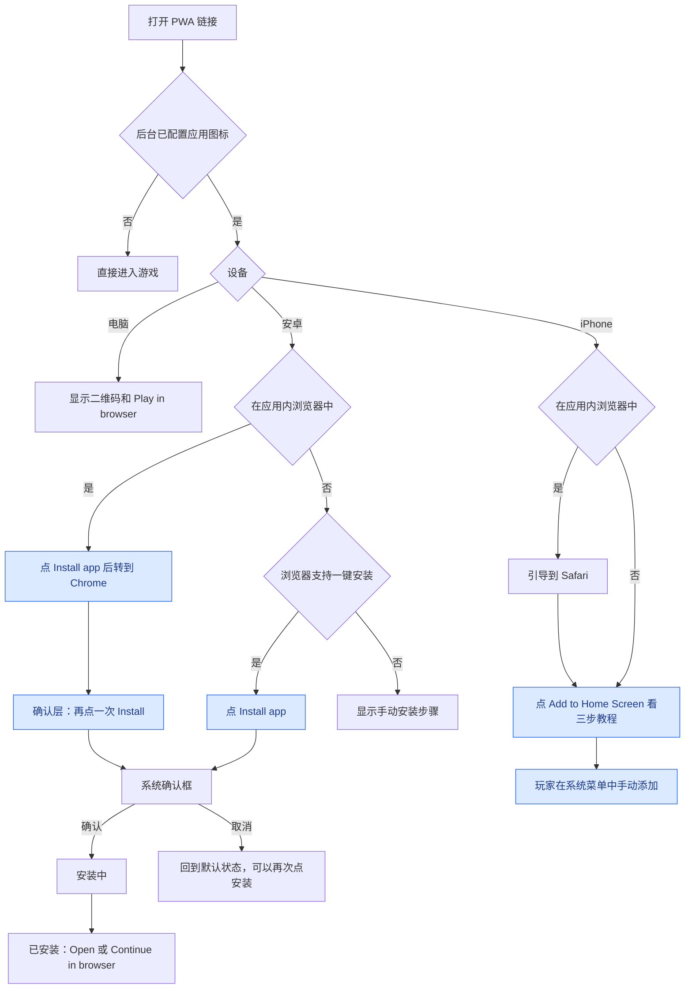

# 安装到桌面 · 安装页与桌面应用

> 本文是已确定、尚未实现的需求。玩家端当前不能安装到桌面，没有安装页；后台没有应用图标、PWA 链接和安装统计。实现后，玩家端部分移入“玩家端/安装到桌面”，后台部分并入[11.3 网站管理](../../M11-内容管理/11.3-网站管理/README.md)和[7.4 推广渠道](../../M7-代理管理/7.4-推广渠道/README.md)，并从[未落地需求索引](../README.md)移除。

## 1. 用途

玩家可以把游戏安装到手机桌面：桌面出现图标，点击后全屏打开，不显示浏览器地址栏。投放方用带渠道参数的 PWA 链接投放，玩家打开链接先看到安装页，按引导安装，也可以选择直接在网页玩。

桌面上显示的名称直接使用网站管理里的网站名称，应用图标由运营在网站管理上传；运营在推广渠道取得每个渠道的 PWA 链接并查看安装统计。安装绑定域名：在哪个域名安装，桌面图标就打开哪个域名，各环境互不影响。

本版安卓提供一键安装，iPhone 引导玩家手动添加到主屏幕，电脑只显示二维码。安装页使用平台自己的名称、图标和页面样式，不模仿应用商店页面，不显示虚构的评分和评论。安装不回传广告平台。本版不提供消息推送、离线使用、电脑端安装，也不提供按渠道配置不同的名称和图标。

玩家端以手机为主，语言规则与玩家端其他页面相同。统计的自然日按平台业务时区。

## 2. 配置项

### 网站管理

都在“网站品牌”中配置。网站名称是已有配置，应用图标是新增配置。

| 配置项 | 含义和填写规则 |
|---|---|
| 网站名称 | 已有配置，必填，一行文字，最多 30 个字。安装后显示在桌面图标下方，也显示在安装页，不另设桌面名称。名称较长时手机系统会截断 |
| 应用图标 | 新增配置，选填。一张正方形图片，PNG、JPEG 或 WebP，边长不小于 512 px，单张不超过 10 MB，系统生成安装所需的各种尺寸。安卓会把图标裁成圆形或圆角，主体放在中间、四周留边。透明底在 iPhone 上显示为黑色，上传处提示使用不透明底。未上传时不提供安装 |

已有的网站图标只用于浏览器标签页和收藏夹，发布尺寸为 192 px，可以是透明底，不能代替应用图标。

### 推广渠道新增

| 内容 | 规则 |
|---|---|
| PWA 链接 | 渠道域名下的安装页地址加渠道参数，与 H5 推广链接并列显示，可复制。未上传应用图标时，链接旁提示“未配置应用图标，链接将直接进入游戏” |
| 操作：安装统计 | 按日期范围查看该渠道每天的三项数据，默认近 7 天，最长 90 天 |

### 安装统计

| 指标 | 定义 |
|---|---|
| 打开安装页人数 | 当天打开过该渠道安装页的浏览器数，同一浏览器一天计一次 |
| 安装成功数 | 当天完成安装的次数。安卓以系统提示安装成功为准；iPhone 无法得知添加是否完成，以第一次从桌面图标打开为准 |
| 选择网页玩人数 | 当天在该渠道安装页点击“Play in browser”的浏览器数，同一浏览器一天计一次 |

数据来自玩家端上报，按渠道和自然日汇总，没有数据的日期显示 0。

### 安装页内容

| 内容 | 规则 |
|---|---|
| 图标和名称 | 网站管理中的应用图标和网站名称 |
| 简介 | 网站管理“标题与分享”中当前语言的描述 |
| 主按钮 | 安卓为“Install app”，iPhone 为“Add to Home Screen” |
| 网页入口 | 每一屏都有“Play in browser”；已安装状态下为“Continue in browser” |
| 截图 | 三张固定的产品截图，随玩家端版本维护，后台不配置 |
| 说明 | 安装后的三项好处：从桌面一点即开、全屏、始终是最新版本 |
| 页脚 | 年龄提示，以及服务条款和隐私政策链接 |

## 3. 操作规则

各设备的流程如下，蓝色为玩家操作，其余为页面状态。

### 安卓：一键安装

玩家点“Install app”，系统弹出确认框。确认后页面显示“Installing…”，提示保持页面打开。系统安装完成后页面变为已安装状态：显示“Open”按钮和“Continue in browser”，并提示在桌面或应用列表中找到图标。

点“Open”时打开已安装的应用；打不开时停留在当前页面，提示从桌面图标打开。

### 安卓：在应用内浏览器中打开

Facebook、Instagram 等应用自带的浏览器不能安装。此时按钮下方提示安装会在 Chrome 中完成，玩家点“Install app”后转到 Chrome 打开同一个链接，渠道参数和广告点击标识随链接带过去。Chrome 中显示确认层，玩家再点一次“Install”，之后与一键安装相同。

转到 Chrome 失败时，显示手动安装步骤。

### 安卓：浏览器不支持一键安装

显示三步：打开浏览器菜单，选择“添加到主屏幕”或“安装应用”，确认安装。玩家可以点“Got it”关闭，或选择“Play in browser”。

### iPhone：添加到主屏幕

iPhone 没有一键安装。玩家点“Add to Home Screen”后显示三步教程：点分享按钮，选择“添加到主屏幕”，点“添加”。分享按钮在不同系统版本中位置不同，教程按系统版本显示对应的入口；识别不出版本时两种入口都说明。

### iPhone：在应用内浏览器中打开

应用自带的浏览器不能添加到主屏幕。页面提示先在 Safari 中打开，提供“Open in Safari”按钮；打不开时显示手动步骤：点右上角菜单，选择用外部浏览器打开。玩家也可以选择“Play here instead”直接在当前浏览器玩。

### 电脑

显示当前链接的二维码，提示用手机扫码安装，同时提供“Play in browser”。

### 直接在网页玩

点“Play in browser”进入游戏首页，渠道参数和广告点击标识保持不变，之后的注册归属该渠道。

### 从桌面图标打开

从桌面图标打开时全屏显示，直接进入游戏首页，不再显示安装页。

### 渠道与广告点击信息的延续

安装时把渠道参数和广告点击标识写入应用的启动信息。玩家从桌面图标首次打开并注册时，账号归属 PWA 链接的渠道，广告点击标识随注册提交，规则与[广告回传](../7.4-广告回传/README.md)相同。

安卓上，桌面应用与安装时所用的浏览器共用登录状态，安装前已登录的玩家打开应用后仍是登录状态。iPhone 上，桌面应用与 Safari 互不共用登录状态，玩家首次从桌面图标打开时按首次访问处理。

### 已安装后再次打开 PWA 链接

浏览器能识别应用已安装时，页面直接显示已安装状态，不再要求安装。识别不了时按未安装显示。

### 修改网站名称和应用图标

保存后，新安装的玩家立即使用新的名称和图标。已安装的安卓设备由系统在之后的使用中更新，不保证立即生效。iPhone 上已添加的图标和名称不变，玩家删除后重新添加才会更新。

## 4. 特殊情况

| 情况 | 如何处理 |
|---|---|
| 后台未上传应用图标 | PWA 链接直接进入游戏首页，渠道参数保持不变；后台在 PWA 链接旁提示 |
| 网站名称还没有设置 | 与未上传应用图标相同，PWA 链接直接进入游戏首页 |
| 应用图标不是正方形或边长小于 512 px | 拒绝保存并提示原因，原图标不变 |
| 玩家在系统确认框点取消 | 回到默认状态，可以再次点击安装 |
| 安装过程中玩家离开页面 | 安装由系统继续完成；再次打开链接时按能否识别已安装处理 |
| 玩家卸载后再次打开链接 | 按未安装显示，可以重新安装 |
| iPhone 玩家重复添加 | 系统允许重复添加；每次第一次从新图标打开各计一次安装成功 |
| 应用内浏览器转到外部浏览器失败 | 显示手动步骤，玩家仍可选择在当前浏览器玩 |
| 渠道已停用 | 安装页照常显示，注册时按[7.4 推广渠道](../../M7-代理管理/7.4-推广渠道/README.md)的规则拒绝 |
| 链接不带渠道参数 | 安装页照常显示，注册归属按 7.4 不带渠道参数的规则；这类访问不计入任何渠道的安装统计 |
| 玩家端上报失败 | 不影响安装和游戏，这次访问不计入统计 |
| 更换域名 | 已安装的图标仍打开原域名，原域名需保持可访问 |
| 账号只有 `cms:website:view` | 可以查看应用图标，不能保存，服务端同样拒绝 |

## 5. 验收场景

| 需求编号 | 场景与操作 | 预期结果 |
|---|---|---|
| 安装到桌面-R1 | 在网站管理的网站品牌中上传边长 512 px 以上的正方形应用图标并保存 | 保存成功；再次打开能看到已保存的图标 |
| 安装到桌面-R1 | 上传非正方形或边长小于 512 px 的图片作为应用图标 | 拒绝保存并提示原因，原图标不变 |
| 安装到桌面-R2 | 安装后查看桌面图标 | 图标下方显示网站管理中的网站名称，图标是上传的应用图标 |
| 安装到桌面-R3 | 查看推广渠道列表 | 每个渠道同时显示 H5 推广链接和 PWA 链接，都带渠道参数，可复制 |
| 安装到桌面-R4 | 安卓 Chrome 打开 PWA 链接，点“Install app”并在系统确认框确认 | 页面依次显示安装中和已安装；桌面出现配置的图标和名称 |
| 安装到桌面-R4 | 在系统确认框点取消 | 回到默认状态，可以再次点击安装 |
| 安装到桌面-R5 | 从桌面图标打开 | 全屏显示，没有浏览器地址栏，直接进入游戏首页 |
| 安装到桌面-R6 | 在 Facebook 应用内打开 PWA 链接，点“Install app” | 转到 Chrome 并显示确认层；再点一次“Install”后完成安装 |
| 安装到桌面-R7 | 用不支持一键安装的安卓浏览器打开 PWA 链接并点安装 | 显示三步手动安装步骤 |
| 安装到桌面-R8 | iPhone Safari 打开 PWA 链接，点“Add to Home Screen”，按教程添加 | 显示三步教程；桌面出现图标，从图标打开直接进入游戏首页 |
| 安装到桌面-R9 | 在 iPhone 的 Facebook 应用内打开 PWA 链接 | 提示先在 Safari 中打开，并提供“Play here instead” |
| 安装到桌面-R10 | 电脑浏览器打开 PWA 链接 | 显示二维码和“Play in browser”；手机扫码后打开同一渠道的安装页 |
| 安装到桌面-R11 | 在安装页点“Play in browser”并注册 | 进入游戏首页，账号归属该渠道 |
| 安装到桌面-R12 | 用带广告点击标识的 PWA 链接安装，从桌面图标首次打开并注册 | 账号归属该渠道，回传记录的广告点击信息为有 |
| 安装到桌面-R13 | 安卓已安装后再次打开 PWA 链接 | 显示已安装状态，不再要求安装 |
| 安装到桌面-R14 | 后台未上传应用图标时打开 PWA 链接 | 直接进入游戏首页，后续注册归属该渠道 |
| 安装到桌面-R15 | 同一浏览器同一天两次打开某渠道的安装页并安装一次，另一浏览器打开后点“Play in browser” | 该渠道当天打开安装页人数为 2，安装成功数为 1，选择网页玩人数为 1 |
| 安装到桌面-R16 | 安装后在后台修改网站名称和应用图标，另一台手机新安装 | 新安装的手机显示新的名称和图标 |
| 安装到桌面-R17 | 在测试环境和正式环境的域名各安装一次 | 桌面出现两个图标，分别打开各自的域名 |
| 安装到桌面-R18 | 只有 `cms:website:view` 的账号上传并保存应用图标 | 服务端拒绝，原配置不变 |

## 6. 相关资料

- 入口与关联页面：玩家从 PWA 链接进入安装页。运营在内容管理的网站管理维护网站名称和应用图标，在推广渠道查看 PWA 链接和安装统计。
- 权限：上传应用图标和修改网站名称 `cms:website:edit`，查看 `cms:website:view`；查看 PWA 链接和安装统计 `promotion:channel:view`。
- 数据与责任：网站名称和应用图标归 M11，PWA 链接和安装统计归 M7，安装页和上报由玩家端负责。渠道归属规则归 7.4，安装不产生资金和活动权益。
- 共用规则：渠道参数与注册归属见[7.4 推广渠道](../../M7-代理管理/7.4-推广渠道/README.md)；广告点击标识和回传见[广告回传](../7.4-广告回传/README.md)；范围决策见[玩家端决策 D148](../../玩家端/README.md#7-决策清单)。页面样式由设计稿表达，设计稿链接在 Jira。
- Jira：[KAN-1134](https://bingobox.atlassian.net/browse/KAN-1134)。
