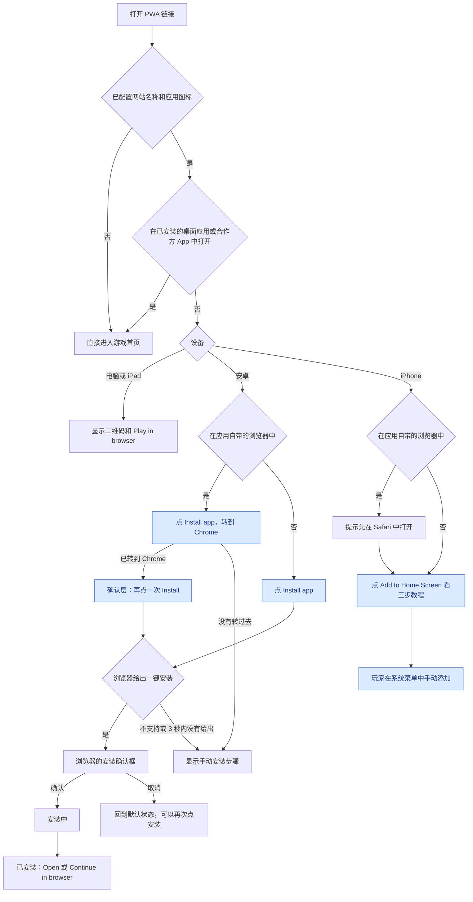

# 安装到桌面 · 安装页与桌面应用

## 1. 用途

玩家可以把游戏安装到手机桌面：桌面出现图标，点击后全屏打开，不显示浏览器地址栏。投放方用带渠道参数的 PWA 链接投放，玩家打开链接先看到安装页，按引导安装，也可以选择直接在网页玩。

桌面上显示的名称是[网站管理](../../M11-内容管理/11.3-网站管理/README.md)里的网站名称，图标是那里上传的应用图标，两项都配置后才提供安装。运营在[推广渠道](../../M7-代理管理/7.4-推广渠道/README.md)取得每个渠道的 PWA 链接并查看安装统计。安装绑定域名：在哪个域名安装，桌面图标就打开哪个域名，各环境互不影响。

安卓提供一键安装，iPhone 引导玩家手动添加到主屏幕，电脑和 iPad 只显示二维码。安装页使用平台自己的名称、图标和页面样式，不模仿应用商店页面，不显示虚构的评分和评论。安装不回传广告平台，只在后台按渠道统计。本版不提供消息推送、离线使用和电脑端的安装引导，也不提供按渠道配置不同的名称和图标。在[合作方 App](../合作方App/README.md) 内打开网站时不提供安装。

玩家端以手机为主，语言规则与玩家端其他页面相同。统计的自然日按平台业务时区。

本页按玩家仓库 `feat/us-ui-dev` 分支描述；玩家 `main` 没有安装页，各页面也不提供安装。下文涉及手机系统和浏览器的表现以源码为依据，尚未在安卓 Chrome、应用自带的浏览器和 iPhone 真机上验证。

## 2. 查询与处理信息

### 提供安装的条件

| 信息 | 含义和规则 |
|---|---|
| 是否提供安装 | 网站管理已配置网站名称和应用图标时提供。缺任意一项时任何页面都不提供安装，PWA 链接直接进入游戏首页 |
| PWA 链接 | 渠道域名下的安装页地址加渠道参数，由推广渠道列表提供；投放时链接上还可以带广告点击标识 |
| 设备 | 按浏览器区分安卓手机、iPhone 和其他设备；电脑、iPad 等其他设备只显示二维码。Facebook、Instagram 等应用自带的浏览器不能安装，单独处理 |

### 安装页内容

| 内容 | 规则 |
|---|---|
| 页头 | 网站管理中的 Logo，没有上传 Logo 时显示网站名称；手机页面页头右侧是网页入口 |
| 图标和名称 | 网站管理中的应用图标和网站名称，手机页面的标题为“Get the 网站名称 app” |
| 简介 | 网站管理“标题与分享”中当前语言的描述，没有时不显示 |
| 主按钮 | 安卓为“Install app”，iPhone 为“Add to Home Screen” |
| 网页入口 | 手机页面顶部一直有“Play in browser”，已安装状态下为“Continue in browser”。安卓的确认层和手动安装步骤、iPhone 的“先在 Safari 中打开”层各有自己的网页入口；iPhone 三步教程层上没有，关闭后使用页面顶部的入口。电脑页有“Play in browser” |
| 截图 | 手机页面有三张固定的产品截图，电脑页有一张，随玩家端版本维护，后台不配置 |
| 说明 | 安装后的三项好处：从桌面一点即开、全屏、始终是最新版本 |
| 页脚 | 手机页面有年龄提示，以及服务条款和隐私政策链接；电脑页没有页脚 |

### 各设备看到的页面

| 设备与浏览器 | 页面 |
|---|---|
| 安卓 Chrome 等能一键安装的浏览器 | 安装页，主按钮“Install app”，按钮下方说明免费、直接从浏览器安装 |
| 安卓上应用自带的浏览器 | 同上，按钮下方说明安装会在 Chrome 中继续 |
| iPhone Safari | 安装页，主按钮“Add to Home Screen”，点后显示三步教程 |
| iPhone 上应用自带的浏览器 | 打开即显示“先在 Safari 中打开”层 |
| 电脑、iPad 和其他设备 | 当前链接的二维码和“Play in browser” |
| 已安装的桌面应用 | 不显示安装页，直接进入游戏首页 |
| 合作方 App 内 | 不显示安装页和安装提示，直接进入游戏首页 |

### 上报的统计

| 事件 | 何时上报与计数 |
|---|---|
| 打开安装页 | 安装页显示时上报；同一浏览器对同一渠道每个自然日计一次 |
| 安装成功 | 安卓在浏览器告知安装页已安装时上报，玩家确认安装后即上报；iPhone 在第一次从桌面图标打开时上报。每次安装计一次 |
| 选择网页玩 | 点任一网页入口时上报；同一浏览器对同一渠道每个自然日计一次 |

三项数据在后台按渠道和自然日展示，见[推广渠道](../../M7-代理管理/7.4-推广渠道/README.md)的安装统计。链接不带渠道参数时不上报。

## 3. 处理规则

各设备的流程如下，蓝色为玩家操作，其余为页面状态。

### 是否显示安装页

网站名称和应用图标都已配置时，玩家端每个页面都向浏览器声明可以安装，PWA 链接显示安装页。缺任意一项时任何页面都不提供安装，PWA 链接直接进入游戏首页，链接上的参数原样保留，之后的注册仍归属该渠道。后台保存后约一分钟内生效。

安装页不创建游客账号：很多访客在应用自带的浏览器里打开，再转到 Chrome 或 Safari。还没有账号的访客点网页入口进入游戏，或安装后从桌面图标打开时，才按首次访问创建游客账号；已登录的玩家保持原有登录状态。访客所属渠道开启了广告回传时，安装页同样加载像素并上报浏览，规则见[推广渠道](../../M7-代理管理/7.4-推广渠道/README.md)。

### 安卓：一键安装

玩家点“Install app”，浏览器弹出安装确认框。确认后页面显示“Installing…”，提示保持页面打开。浏览器告知已安装后，页面变为已安装状态：标题为“网站名称 is installed”，显示“Open 网站名称”按钮和桌面图标的样子，提示在桌面或应用列表中找到图标，页面顶部的网页入口变为“Continue in browser”。

点“Open 网站名称”打开已安装的应用。应用没有接手时，浏览器在当前标签页打开游戏首页，或停留在安装页并提示从桌面图标打开。

玩家在安装确认框确认后，浏览器随即告知页面已安装，系统此时可能还在安装：页面已显示已安装状态并计入安装成功数，这时点“Open 网站名称”可能打不开应用。

### 安卓：在应用自带的浏览器中打开

Facebook、Instagram 等应用自带的浏览器不能安装。此时按钮下方说明安装会在 Chrome 中继续，玩家点“Install app”后转到 Chrome 打开同一个链接，渠道参数和广告点击标识随链接带过去。Chrome 中显示确认层，玩家再点一次“Install”，之后与一键安装相同；确认层上也可以选“Not now, play in browser”。

没有转到 Chrome 时，显示手动安装步骤。

### 安卓：不能一键安装

浏览器不支持一键安装，或玩家点安装后 3 秒内浏览器还没有给出一键安装时，显示三步：打开浏览器菜单，选择“Add to Home screen”或“Install app”，点“Install”确认。玩家可以点“Got it”关闭，或选择“Play in browser”。

### iPhone：添加到主屏幕

iPhone 没有一键安装。玩家点“Add to Home Screen”后显示三步教程：点分享按钮，选择“Add to Home Screen”，点“Add”。分享按钮在不同版本的 Safari 中位置不同，教程按版本显示对应的入口；识别不出版本时按工具栏说明，并补充新版本要先点“•••”。iPhone 上的其他浏览器也按 Safari 的说法显示。玩家点“Got it”关闭教程。

### iPhone：在应用自带的浏览器中打开

应用自带的浏览器不能添加到主屏幕。页面打开时就显示提示层：说明要先在 Safari 中打开，提供“Open in Safari”按钮，并列出手动步骤，即点右上角“•••”，选择用外部浏览器打开。玩家也可以选择“Play here instead”直接在当前浏览器玩。关闭提示层后再点“Add to Home Screen”，仍显示这一层。

### 电脑和 iPad

显示当前链接的二维码，提示用手机扫码后按步骤安装，同时提供“Play in browser”。手机扫码打开的是同一渠道的安装页。

### 直接在网页玩

点任一网页入口进入游戏首页，渠道参数和广告点击标识保持不变，之后的注册归属该渠道。

### 从桌面图标打开

从桌面图标打开时全屏显示，不显示浏览器地址栏，直接进入游戏首页。在已安装的应用里打开 PWA 链接，同样进入游戏首页，不显示安装页。

### 在合作方 App 内打开

合作方 App 不能安装到桌面。在 App 内打开 PWA 链接时，页面直接进入游戏首页，链接上的参数保持不变，不显示安装页和安装提示，也不上报打开安装页。iPhone 上的合作方 App 不算从桌面图标打开，不上报安装成功。手机浏览器打开过 APP 链接的，之后同样按 App 内处理，直到清除网站数据，见[合作方 App](../合作方App/README.md)。

### 渠道与广告点击信息的延续

从安装页安装时，链接里的渠道参数和广告点击标识写入应用的启动地址。玩家从桌面图标首次打开并注册时，账号归属 PWA 链接的渠道，广告点击标识随注册提交，规则与[推广渠道](../../M7-代理管理/7.4-推广渠道/README.md)的广告回传相同。

安卓上，桌面应用与安装时所用的浏览器共用登录状态，安装前已登录的玩家打开应用后仍是登录状态。iPhone 上，桌面应用与 Safari 互不共用登录状态，玩家首次从桌面图标打开时按首次访问处理。

### 已安装后再次打开 PWA 链接

安卓上，浏览器能识别应用已安装时，页面直接显示已安装状态，不再要求安装。只有两种情况能识别：在从安装页安装时所用的浏览器里打开，不论是哪条链接；或再次打开安装时的同一条链接。其他情况按未安装显示，例如换一个浏览器打开另一条链接、清除浏览器数据后打开另一条链接，或应用是在其他页面从浏览器菜单安装的。

玩家卸载应用后，浏览器重新给出一键安装时，页面回到未安装状态，可以重新安装。iPhone 无法识别是否已添加，始终按未安装显示。

### 修改网站名称和应用图标

后台保存后约一分钟内，新安装的玩家使用新的名称和图标。已安装的安卓设备由系统在之后的使用中更新，不保证立即生效。iPhone 上已添加的图标和名称不变，玩家删除后重新添加才会更新。

### 上报安装统计

上报不需要登录，按链接里的渠道计入；链接不带渠道参数时不上报。上报失败不提示，也不影响页面。iPhone 的安装成功没有报上去时，下次从桌面图标打开会再报，报上去之后不再上报。

## 4. 特殊情况

| 情况 | 如何处理 |
|---|---|
| 后台未上传应用图标，或网站名称还没有设置 | PWA 链接直接进入游戏首页，链接上的参数保持不变；后台在 PWA 链接下方提示未配置应用图标 |
| 玩家在安装确认框点取消 | 回到默认状态，可以再次点击安装 |
| 安装过程中玩家离开安装页 | 安装由系统继续完成；安装页没有收到已安装通知的，这次安装不计入安装成功数。再次打开链接时按能否识别已安装处理 |
| 页面已显示已安装，系统还在安装 | 点“Open 网站名称”可能打不开应用：浏览器改在当前标签页打开游戏首页，或提示从桌面图标打开 |
| 已安装后换一个浏览器打开另一条链接，或清除浏览器数据后打开另一条链接 | 识别不出已安装，按未安装显示 |
| 玩家卸载后再次打开链接 | 浏览器重新给出一键安装后按未安装显示，可以重新安装 |
| iPhone 玩家重复添加 | 系统允许重复添加；每个新图标第一次打开各计一次安装成功 |
| 应用自带的浏览器没有转到外部浏览器 | 安卓显示手动安装步骤，iPhone 的提示层本身列出手动步骤；玩家仍可选择在当前浏览器玩 |
| 玩家从应用自带的浏览器转到 Chrome 或 Safari | 两个浏览器各上报一次打开安装页，后台的打开安装页人数计 2 |
| 玩家不经安装页，在其他页面用浏览器菜单或分享菜单安装 | 可以安装和使用；安卓的这类安装不计入安装成功数，iPhone 只在应用的启动地址带渠道参数时计入 |
| 渠道已停用 | 安装页照常显示并计入安装统计，注册时按[推广渠道](../../M7-代理管理/7.4-推广渠道/README.md)的规则拒绝 |
| 链接不带渠道参数 | 安装页照常显示，注册归属按推广渠道不带渠道参数的规则；这类访问不计入任何渠道的安装统计 |
| 链接里的渠道不存在 | 安装页照常显示，上报不计入统计；注册按推广渠道的规则拒绝 |
| 玩家端上报失败 | 不影响安装和游戏，这次访问不计入统计 |
| 更换域名 | 已安装的图标仍打开原域名，原域名需保持可访问 |
| 在合作方 App 内打开 PWA 链接 | 直接进入游戏首页，链接参数保留，不计入打开安装页人数 |
| 手机浏览器打开过 APP 链接后再打开 PWA 链接 | 按合作方 App 内处理，直接进入游戏首页，不计入打开安装页人数，直到清除网站数据 |

## 5. 验收场景

| 需求编号 | 场景与操作 | 预期结果 |
|---|---|---|
| 安装到桌面-R1 | 后台在网站管理上传应用图标并保存，约一分钟后用手机打开 PWA 链接；上传校验见 11.3-R6 | 显示安装页，页面上的图标是上传的应用图标 |
| 安装到桌面-R2 | 安装后查看桌面图标 | 图标下方显示网站管理中的网站名称，图标是上传的应用图标 |
| 安装到桌面-R3 | 复制推广渠道列表中的 PWA 链接，在手机上打开；列表规则见 7.4-R35 | 打开该渠道的安装页，地址带该渠道的参数 |
| 安装到桌面-R4 | 安卓 Chrome 打开 PWA 链接，点“Install app”并在安装确认框确认 | 页面依次显示安装中和已安装；桌面出现配置的图标和名称 |
| 安装到桌面-R4 | 在安装确认框点取消 | 回到默认状态，可以再次点击安装 |
| 安装到桌面-R5 | 从桌面图标打开；在已安装的应用里打开 PWA 链接 | 全屏显示，没有浏览器地址栏，都直接进入游戏首页，不显示安装页 |
| 安装到桌面-R6 | 在安卓的 Facebook 应用内打开 PWA 链接，点“Install app” | 转到 Chrome 并显示确认层；再点一次“Install”后完成安装 |
| 安装到桌面-R7 | 用不支持一键安装的安卓浏览器打开 PWA 链接并点安装 | 显示三步手动安装步骤 |
| 安装到桌面-R8 | iPhone Safari 打开 PWA 链接，点“Add to Home Screen”，按教程添加 | 显示三步教程；桌面出现图标，从图标打开直接进入游戏首页 |
| 安装到桌面-R9 | 在 iPhone 的 Facebook 应用内打开 PWA 链接 | 打开即提示先在 Safari 中打开，提供“Open in Safari”和“Play here instead” |
| 安装到桌面-R10 | 电脑浏览器打开 PWA 链接 | 显示二维码和“Play in browser”；手机扫码后打开同一渠道的安装页 |
| 安装到桌面-R11 | 在安装页点“Play in browser”并注册 | 进入游戏首页，账号归属该渠道 |
| 安装到桌面-R12 | 用带广告点击标识的 PWA 链接安装，从桌面图标首次打开并注册 | 账号归属该渠道，回传记录的广告点击信息为有 |
| 安装到桌面-R13 | 安卓安装后，在同一浏览器再次打开 PWA 链接 | 显示已安装状态，不再要求安装 |
| 安装到桌面-R13 | 安卓安装后，换一个浏览器打开另一个渠道的 PWA 链接 | 按未安装显示 |
| 安装到桌面-R14 | 后台未上传应用图标时打开 PWA 链接 | 直接进入游戏首页，链接上的参数保留，后续注册归属该渠道 |
| 安装到桌面-R15 | 同一浏览器同一天两次打开某渠道的安装页并安装一次，另一浏览器打开后点“Play in browser”；后台展示见 7.4-R36 | 该渠道当天打开安装页人数为 2，安装成功数为 1，选择网页玩人数为 1 |
| 安装到桌面-R16 | 安装后在后台修改网站名称和应用图标，约一分钟后另一台手机新安装 | 新安装的手机显示新的名称和图标 |
| 安装到桌面-R17 | 在测试环境和正式环境的域名各安装一次 | 桌面出现两个图标，分别打开各自的域名 |
| 安装到桌面-R18 | 只有 `cms:website:view` 的账号上传并保存应用图标；权限规则见 11.3-R5 | 服务端拒绝，原配置不变，玩家端是否提供安装不变 |
| 安装到桌面-R19 | 网站管理已配置网站名称和应用图标，在合作方 App 内打开某渠道的 PWA 链接 | 直接进入游戏首页，链接参数保留；不显示安装页和安装提示，该渠道当天的打开安装页人数不增加 |
| 安装到桌面-R20 | 在 iPhone 的合作方 App 内第一次打开网站 | 不计入安装成功数 |

## 6. 相关资料

- 入口与关联页面：玩家从 PWA 链接进入安装页。运营在[11.3 网站管理](../../M11-内容管理/11.3-网站管理/README.md)维护网站名称和应用图标，在[7.4 推广渠道](../../M7-代理管理/7.4-推广渠道/README.md)取得 PWA 链接、查看安装统计。在合作方 App 内的表现见[合作方 App](../合作方App/README.md)。
- 权限：安装页和安装上报不需要登录。后台的权限码见 11.3 和 7.4。
- 数据与责任：网站名称和应用图标归 M11，PWA 链接和安装统计归 M7，安装页和上报由玩家端负责。渠道归属规则归 7.4，安装不产生资金和活动权益。
- 共用规则：渠道参数与注册归属、广告点击标识和回传见[7.4 推广渠道](../../M7-代理管理/7.4-推广渠道/README.md)；范围决策见[玩家端决策 D148](../README.md#7-决策清单)。页面样式由设计稿表达，设计稿链接在 Jira。与当前实现不同的候选见[未落地需求](../../未落地需求/README.md)。
- Jira：[KAN-1134](https://bingobox.atlassian.net/browse/KAN-1134)。

代码依据（2026-11-26）：[玩家 feat/us-ui-dev · install](https://github.com/bingo-lab-1/bingo-frontend/tree/8f16f0027d59c068501a5c543f83eeff88109ddd/apps/web/app/%5Blocale%5D/install)；[玩家 feat/us-ui-dev · web-app-manifest.ts](https://github.com/bingo-lab-1/bingo-frontend/blob/8f16f0027d59c068501a5c543f83eeff88109ddd/apps/web/app/%5Blocale%5D/_lib/web-app-manifest.ts)；[玩家 feat/us-ui-dev · installed-app-launch.tsx](https://github.com/bingo-lab-1/bingo-frontend/blob/8f16f0027d59c068501a5c543f83eeff88109ddd/apps/web/app/%5Blocale%5D/_components/installed-app-launch.tsx)；[后端 · install](https://github.com/bingo-lab-1/bingo-backend/tree/0743e267f5ddcb20f13a5012d32dd2a4bb04bfe6/libs/install/src)。

合作方 App 内不提供安装的代码依据（2026-11-27）：[玩家 feat/app-shell · use-install.ts](https://github.com/bingo-lab-1/bingo-frontend/blob/9d993cc929fcd8bfee44402c35e1dafbbf82201f/apps/web/app/%5Blocale%5D/install/_hooks/use-install.ts)；[玩家 feat/app-shell · installed-app-launch.tsx](https://github.com/bingo-lab-1/bingo-frontend/blob/9d993cc929fcd8bfee44402c35e1dafbbf82201f/apps/web/app/%5Blocale%5D/_components/installed-app-launch.tsx)；[玩家 feat/app-shell · app-shell.ts](https://github.com/bingo-lab-1/bingo-frontend/blob/9d993cc929fcd8bfee44402c35e1dafbbf82201f/apps/web/lib/app-shell.ts)。
